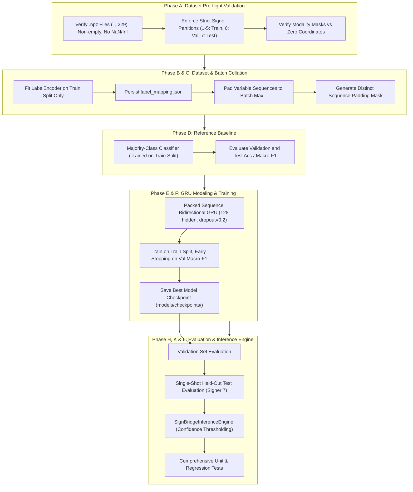

# SignBridge AI: Baseline Machine Learning Model Implementation Plan
## Indian Sign Language (ISL) Sentence-Recognition Closed-Set Baseline

**Document ID:** `docs/baseline-model-implementation-plan.md`  
**Milestone:** Step 3 — Machine Learning Model Development & Training Baseline  
**Target Dataset:** ISL-CSLTR Benchmark Corpus (`data/processed/isl_csltr_tensors_v2/`)  
**Hardware Profile:** Intel Core Ultra 5 225H (CPU-first execution), Optional Colab GPU workflow  
**Status:** Architecture & Engineering Specification  

---

## 1. Executive Summary & Formulation Scope

SignBridge AI's long-term mission is to create a bidirectional Indian Sign Language (ISL) communication platform providing real-time text and speech translation across critical public and private domains (healthcare, education, banking, travel, workplace).

### Closed-Set Sequence Classification Scope
The initial machine learning baseline implemented in Step 3 is explicitly formulated as a **closed-set sentence classification engine**:
- **Task:** Given an input sequence of visual landmark feature vectors $\mathbf{X} = (\mathbf{x}_1, \dots, \mathbf{x}_T) \in \mathbb{R}^{T \times 229}$ extracted from an isolated ISL sentence recording, predict the sentence category label $y \in \{0, 1, \dots, C-1\}$.
- **Crucial Limitation:** The model is **not an open-vocabulary translator** and does not translate previously unseen arbitrary ISL conversations or syntax. It learns to classify visual sequence trajectories corresponding to the benchmark sentence categories in the ISL-CSLTR dataset.
- **Absence of Frame-Level Gloss Alignments:** The ISL-CSLTR dataset provides video-level sentence transcripts and 1-to-1 gloss translations, but contains **no temporal frame-level gloss boundaries**. Therefore, connectionist temporal classification (CTC) or frame-aligned continuous token prediction is scientifically unsupported at this stage. The initial model must operate as a sequence classifier over full gesture trajectories.

---

## 2. Dataset Topology & Ingestion Contract

### Feature Space (Candidate B 3D)
Every video frame is mapped to a 229-dimensional vector:
$$\mathbf{x}_t = [\mathbf{p}_t, \mathbf{h}_{L,t}, \mathbf{h}_{R,t}, \mathbf{m}_t] \in \mathbb{R}^{229}$$

| Feature Component | Dimension | Coordinate Space & Description |
|---|---|---|
| **Pose Landmarks ($\mathbf{p}_t$)** | 99 (33 × 3) | Torso-centered $(x, y, z)$ coordinates scaled by bi-acromial shoulder span. |
| **Left Hand ($\mathbf{h}_{L,t}$)** | 63 (21 × 3) | Wrist-relative $(x, y)$, shoulder-distance-scaled $(z)$. Zero-filled if occluded. |
| **Right Hand ($\mathbf{h}_{R,t}$)** | 63 (21 × 3) | Wrist-relative $(x, y)$, shoulder-distance-scaled $(z)$. Zero-filled if occluded. |
| **Modality Indicators ($\mathbf{m}_t$)** | 4 | $[m_{\text{left}}, m_{\text{right}}, m_{\text{pose}}, m_{\text{norm}}]$: Binary flags indicating landmark detection and normalization validity. |

### Zero-Fabrication Integrity
Missing hand landmarks are explicitly filled with $0.0$, and their respective presence flag is set to $0.0$. No linear interpolation or synthetic coordinates are fabricated.

### Signer-Independent Split Allocation
To guarantee real-world generalization evaluation without identity leakage, the corpus is partitioned strictly by signer:
- **Training Set (Signers 1, 2, 3, 4, 5):** Native signers (1, 2) and volunteer signers (3–5).
- **Validation Set (Signer 6):** Held-out volunteer signer used strictly for model selection, hyperparameter tuning, and early stopping.
- **Test Set (Signer 7):** Held-out volunteer signer kept completely untouched until final single-shot evaluation.
- **Quarantine:** All 234 corrupted, low-resolution, or unverified recordings remain strictly excluded.

---

## 3. Modular Architecture Breakdown

The ML subsystem is structured under `backend/app/ml/`:

```
backend/app/ml/
├── __init__.py               # Top-level exports
├── dataset.py                # PyTorch Dataset for .npz tensor loading and caching
├── labels.py                 # LabelEncoder fitting strictly on training split
├── collate.py                # Variable-length batch collation and separate padding masks
├── metrics.py                # Macro/Micro Accuracy, Precision, Recall, F1, Confusion Matrix
├── models/
│   ├── __init__.py           # Model factory
│   └── gru_classifier.py     # Mask-aware bidirectional GRU sentence classifier
├── training/
│   ├── __init__.py           # Training routines
│   ├── config.py             # Reproducible training configuration dataclass
│   ├── train.py              # Epoch training and validation loop with early stopping
│   └── evaluate.py           # Evaluation pipeline and majority-class baseline
├── inference.py              # Single-sample inference engine with confidence checks
└── README.md                 # Technical documentation
```

### Script Entrypoints
- `scripts/validate_ml_dataset.py`: Comprehensive pre-flight dataset verification script.
- `scripts/train_gru.py`: Full training runner with argument parsing and logging.
- `scripts/evaluate_gru.py`: Final test evaluation and confusion matrix generator.

---

## 4. Phase-by-Phase Execution Roadmap



---

## 5. Overfitting Controls & Scientific Safeguards

1. **Information Leakage Prevention:** The LabelEncoder vocabulary and any feature statistics are fitted strictly on the training partition (Signers 1–5).
2. **Padding Isolation:** The sequence padding mask prevents padded zero frames from influencing GRU hidden state transitions or pooling representations.
3. **Capacity Regularization:** Hidden dimension is constrained to 128 units with dropout ($p = 0.2$) and weight decay ($10^{-4}$) to prevent overfitting on the modest sample size (~300 training samples).
4. **Early Stopping:** Monitored on validation macro-F1 with a patience of 10 epochs.
5. **No Test Set Tuning:** The test set (Signer 7) is evaluated exactly once after all architecture, hyperparameters, and checkpoints are frozen.
