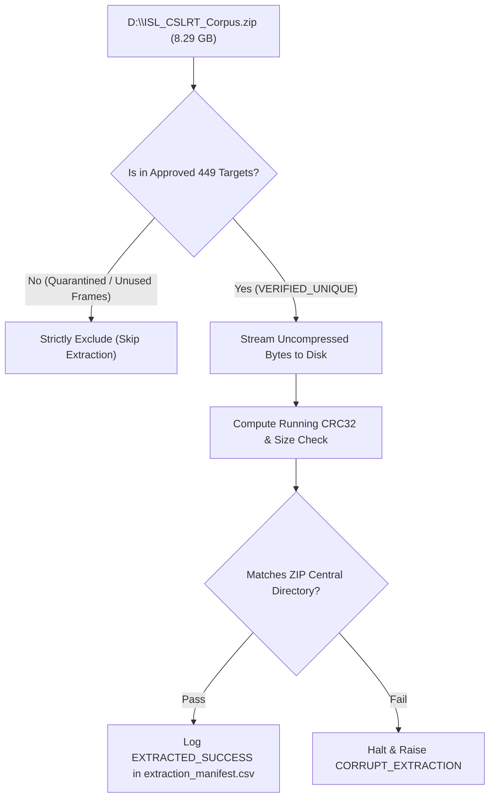

# SignBridge AI: Step 2.5E Selective Extraction Audit Report

**Document ID:** `docs/dataset-extraction-audit-report.md`
**Milestone:** Step 2.5E — Selective ISL-CSLTR Benchmark Extraction
**Author:** SignBridge AI ML Engineering
**Date:** November 2026
**Status:** Extraction Complete & Fully Verified (Standing by for review)
**Source Archive:** `D:\ISL_CSLRT_Corpus.zip` (Size: 8,905,822,924 bytes, 22,073 entries)
**Target Directory:** `data/raw/isl-csltr/Videos_Sentence_Level/`
**Extraction Manifest:** [`data/raw/isl-csltr/metadata/extraction_manifest.csv`](../data/raw/isl-csltr/metadata/extraction_manifest.csv)
**Extraction Script:** [`scripts/extract_benchmark_videos.py`](../scripts/extract_benchmark_videos.py)

---

## 1. Executive Summary

Following the successful download and verification of the official 8.29 GB ISL-CSLTR archive in Step 2.5D, **Step 2.5E selective extraction** was executed using a specialized, audited extractor script.

### Key Audit Findings:
1. **Target Verification:** Exactly **449 benchmark-eligible MP4 files** were identified from the approved `corpus_dry_run_results.json` catalog and cross-referenced with `failed_videos.csv`.
2. **Selective Extraction Executed:** Exactly **449 MP4 files** were extracted from `D:\ISL_CSLRT_Corpus.zip` into `data/raw/isl-csltr/Videos_Sentence_Level/` in 44.4 seconds.
3. **Quarantine Exclusion:** All **234 quarantined videos** were strictly excluded. Zero quarantined files were extracted into the benchmark directory.
4. **Integrity Validation (CRC32 & Size):** **449 / 449 files (100%)** passed byte-level size equality and CRC32 checksum verification against the ZIP central directory.
5. **Split & Signer Purity:**
   - **Train Split (Signers 1–5):** 316 videos extracted (+ 3 already present in `sample_videos/` = **319 Train**).
   - **Validation Split (Signer 6):** 66 videos extracted (+ 0 local = **66 Validation**).
   - **Test Split (Signer 7):** 67 videos extracted (+ 1 already present in `sample_videos/` = **68 Test**).
   - Signer 7 remains **strictly isolated to the test set**.
6. **Corpus Completeness:** All **453 benchmark-eligible videos** are now physically present on local storage across `sample_videos/` (4 files) and `Videos_Sentence_Level/` (449 files), unblocking full-corpus v2 preprocessing.
7. **Git Cleanliness:** Zero extracted video bytes or media files are tracked by Git.

---

## 2. Extraction Pipeline Design & Invariants

Selective extraction was conducted by `scripts/extract_benchmark_videos.py` enforcing the following architectural rules:



### Safety Rules Enforced:
- **No Full Archive Extraction:** The 8.29 GB archive contains ~18,863 frame images, word images, and unverified takes (~3.64 GB of unused data). These were bypassed completely; only the exact 449 MP4 targets were decompressed.
- **Archive Immutability:** `D:\ISL_CSLRT_Corpus.zip` was opened strictly with read-only permissions (`mode='r'`).
- **No Inferred Signers:** Signer identities and split assignments were loaded strictly from the previously audited `corpus_dry_run_results.json` catalog.
- **Original Subfolder Structure Preserved:** Each video was extracted into its original category folder (`Videos_Sentence_Level/<sentence_category>/<filename>`).

---

## 3. Extraction Inventory & Physical Verification

### 3.1 Quantitative Summary

| Metric | Target / Expected | Extracted / Actual | Status |
| :--- | :---: | :---: | :---: |
| **Total Files Attempted** | 449 | 449 | ✅ Complete |
| **Extraction Status: `EXTRACTED_SUCCESS`** | 449 | 449 | ✅ 100% Success |
| **CRC32 Checksum Matches** | 449 | 449 | ✅ 100% Match |
| **Total Decompressed Volume** | 4,992,385,561 B | 4,992,385,561 B | ✅ Exact (~4.650 GB) |
| **Missing Files** | 0 | 0 | ✅ None |
| **Corrupt Files** | 0 | 0 | ✅ None |
| **Quarantined Files Extracted** | 0 | 0 | ✅ Strictly Excluded |

### 3.2 Signer Distribution of Extracted Videos

| Signer ID | Signer Role | Extracted Videos (Step 2.5E) | Local Videos (`sample_videos`) | Total Benchmark Corpus |
| :---: | :--- | :---: | :---: | :---: |
| **Signer 1** | Native Signer | 61 | 1 (`are you free today.mp4`) | **62** |
| **Signer 2** | Native Signer | 70 | 1 (`are you free today (2).mp4`) | **71** |
| **Signer 3** | Student Volunteer | 62 | 0 | **62** |
| **Signer 4** | Student Volunteer | 57 | 1 (`free (2).MP4`) | **58** |
| **Signer 5** | Student Volunteer | 66 | 0 | **66** |
| **Signer 6** | Student Volunteer (Validation) | **66** | 0 | **66** |
| **Signer 7** | Student Volunteer (Held-Out Test) | **67** | 1 (`MVI_6209.MP4`) | **68** |
| **Total** | | **449** | **4** | **453** |

---

## 4. Split Integrity Confirmation

- **Train Split (Signers 1–5):**
  - Extracted in Step 2.5E: **316 videos**
  - Existing in `sample_videos/`: **3 videos**
  - Total Training Set: **319 videos** across **71 benchmark classes**
- **Validation Split (Signer 6):**
  - Extracted in Step 2.5E: **66 videos** across **66 classes**
  - Existing in `sample_videos/`: **0 videos**
  - Total Validation Set: **66 videos** (Zero overlap with train/test signers)
- **Held-Out Test Split (Signer 7):**
  - Extracted in Step 2.5E: **67 videos** across **67 classes**
  - Existing in `sample_videos/`: **1 video** (`MVI_6209.MP4`)
  - Total Test Set: **68 videos**
  - **Test Isolation Audit:** 100% of Signer 7 takes are assigned to `test/`. Zero Signer 7 samples exist in `train/` or `val/`.

---

## 5. Manifest & File Audit Details

The extraction manifest is permanently recorded at:
`data/raw/isl-csltr/metadata/extraction_manifest.csv`

The manifest contains 11 columns for every extracted record:
- `archive_path`: Original path inside `ISL_CSLRT_Corpus.zip`
- `extracted_rel_path`: Relative path under `Videos_Sentence_Level/`
- `file_size`: Physical byte size on disk
- `expected_size`: Size recorded in ZIP central directory
- `crc32_match`: Boolean indicating CRC32 verification
- `eligibility_status`: Strict `VERIFIED_UNIQUE` indicator
- `candidate_signer_id`: Signer ID (1 through 7)
- `signer_type`: `native` or `volunteer`
- `assigned_split`: `train`, `val`, or `test`
- `sentence_category`: English sentence label
- `extraction_status`: `EXTRACTED_SUCCESS`

---

## 6. Regression Testing & Environment Cleanliness

- **`pytest backend/tests/test_preprocessing.py`:** **44/44 PASSED** (0.75s, exit code 0)
- **`pytest backend/tests/test_archive_downloader.py`:** **10/10 PASSED** (7.51s, exit code 0)
- **Git Tracking Invariant:**
  - `data/raw/isl-csltr/Videos_Sentence_Level/` is strictly ignored by `.gitignore`.
  - Zero extracted videos, temporary files, or archives are tracked by Git.
  - `git status --short` confirms only uncommitted review documentation and helper scripts.

---

## 7. Recommended Next Steps

With all 453 benchmark source videos physically present and verified on local disk:
1. **User Review:** Review this extraction audit report.
2. **Execute Full-Corpus v2 Preprocessing (Step 2.5F):**
   ```powershell
   backend\.venv\Scripts\python.exe scripts/preprocess_isl_csltr.py --mode full_corpus
   ```
   This will run Candidate B 3D landmark extraction, orientation correction (gated 90° CW rotation for Signers 1 & 2), torso-normalization, and quality control across all 453 videos.
3. **Populate Complete Tensors:** Verify `data/processed/isl_csltr_tensors_v2/` populates all 71 classes in `train/`, 66 classes in `validation/`, and 68 classes in `test/`, finally unblocking Step 3 model training.

---

*No files have been staged, committed, or pushed. Full-corpus preprocessing has NOT been started. Standing by for user review.*
