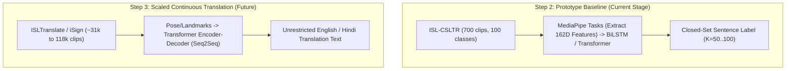

# SignBridge AI: Dataset Research & Structure Audit

**Document ID:** `docs/dataset-research-audit.md`  
**Milestone:** Step 2.1 — Dataset Research and Structure Audit  
**Author:** SignBridge AI ML Engineering  
**Date:** November 2026 (Revised)  
**Status:** Reviewed & Updated  

---

## 1. Executive Summary & Audit Scope

This document provides a rigorous, read-only research and structural audit of the three primary Indian Sign Language (ISL) datasets identified in the SignBridge AI blueprint (`docs/project-blueprint.pdf`, Sections 9, 10, 14, 15, and 20) and implementation plans (`docs/implementation-plan/04-dataset-and-ml-plan.md`):

1. **ISL-CSLTR** (Mendeley Data, 2021)
2. **iSign** (Findings of ACL 2024 / Hugging Face Hub)
3. **ISLTranslate** (Findings of ACL 2023 / GitHub)

### Scope, Rules, and Design Boundaries
- **Strict Compliance:** No datasets were downloaded, no models were trained, and no application source code was modified.
- **Truthfulness Standard:** All statistics, licensing terms, and metadata descriptions are derived strictly from official published papers and repositories. All unverified or conflicting parameters are flagged with `[UNCERTAIN]`, `[UNVERIFIED]`, or `[DISCREPANCY]`.
- **The Core ML Rule:** **Sentence-level text annotations do NOT imply gloss annotations.** Full English or Hindi translation sentences do not provide tokenized, temporally aligned sign-by-sign glosses ($G_1, G_2, \dots, G_M$) unless explicitly annotated and validated.
- **Feature Extraction Boundary:** The proposed $T \times 162$ landmark feature representation (42 left hand, 42 right hand, 78 upper-body pose) is an **internal SignBridge AI design assumption**. None of the candidate datasets provide this representation out-of-the-box, and its feasibility must be verified empirically on raw video data.

---

## 2. In-Depth Dataset Audits

### 2.1. ISL-CSLTR (Indian Sign Language Dataset for Continuous Sign Language Translation and Recognition)

#### Official Source & Access Link
- **Hosting Platform:** Mendeley Data
- **Official DOI:** `10.17632/kcmpdxky7p.1`
- **Direct URL:** [https://data.mendeley.com/datasets/kcmpdxky7p/1](https://data.mendeley.com/datasets/kcmpdxky7p/1)
- **Principal Authors / Contributors:** R. Elakkiya and Bharatram S. Natarajan (SASTRA Deemed University, Tamil Nadu, India)
- **Publication Date:** January 2021

#### Licence & Usage Restrictions
- **Licence:** Creative Commons Attribution 4.0 International (**CC BY 4.0**).
- **Permissions:** Open-access licence permitting redistribution, transformation, and adaptation for both academic and commercial purposes, provided proper credit is given to the original authors.
- **Verification Status:** `[VERIFIED]` directly from the Mendeley Data metadata record.

#### Verifiable Dataset Scale & Composition
- **Total Videos:** **700** fully recorded video clips.
- **Total Frames:** **18,863** sentence-level video frames.
- **Word/Lexicon Subset:** **1,036** isolated word-level images.
- **Vocabulary Scope:** **100** spoken language conversational sentences/phrases.
- **Verification Status:** `[VERIFIED]` from published dataset description.

#### Signer Demographics & Recording Discrepancy
- **Documented Discrepancy `[DISCREPANCY]`:**
  - The dataset overview explicitly states that the corpus features performances from **7 different signers**.
  - However, the recording methodology section details recruiting **2 native signers** from specialized residential/vocational deaf schools in Andhra Pradesh and **4 student volunteers** from SASTRA Deemed University.
  - This creates an unverified numerical discrepancy: $2 + 4 = 6 \neq 7$.
  - It is currently uncertain whether a 7th signer was added without updating the prose or if the signer count was misstated.
- **Signer Metadata Assumption Warning:** We must **not assume** that clean, individual signer IDs (e.g., `Signer_1` through `Signer_7`) or balanced per-signer sample distributions exist in the annotation files until the actual metadata CSVs are inspected.
- **Visual Environment:** Controlled laboratory/indoor studio setting, uniform solid-color background, stable frontal illumination, static camera.

#### Available Annotations & Structure
- **Sentence-Level Transcripts:** Yes. Annotation files provide spoken English sentence text corresponding to the video clips.
- **Signer Identity Annotations:** `[UNVERIFIED]`. The exact column schema, signer labeling convention, and sample breakdown per signer remain unverified until the CSV files are inspected directly.
- **Temporal Boundaries:** Stated to contain time boundary details, but format (seconds vs frame numbers) requires verification.
- **Gloss Labels:** `[UNVERIFIED / ABSENT]`. While 1,036 word-level images exist in the corpus, there is no verified continuous linguistic gloss alignment (such as HamNoSys or ID-gloss sequences) for Connectionist Temporal Classification (CTC).

#### Video Format & Metadata
- **Video Container:** AVI / MP4 format.
- **Frame Rate:** ~25 to 30 frames per second (fps).
- **Resolution:** Controlled standard definition (SD/HD 720p).

#### Suitability for SignBridge AI
- **Sentence-Level Translation Suitability:** **Low to Moderate**. With only 100 fixed sentences, it cannot support open-vocabulary translation.
- **Baseline Prototype Suitability:** **High**. Suitable for **Paradigm 1 (Closed-Set Sentence Classification)** to validate backend ingestion and the custom feature extraction pipeline before attempting larger datasets.

#### Limitations & Compatibility Risks
1. **Signer Metadata Ambiguity:** The $6 \text{ vs. } 7$ signer discrepancy prevents establishing a verified signer-independent split prior to inspecting metadata.
2. **Vocabulary Size:** 100 sentences restricted to basic daily phrases cannot cover SignBridge AI's 7 application domains.
3. **Overfitting Risk:** Controlled studio backgrounds may cause models to overfit to static environments rather than gesture dynamics.

---

### 2.2. iSign (A Benchmark for Indian Sign Language Processing)

#### Official Source & Access Link
- **Hosting Platform:** Hugging Face Hub under the `Exploration-Lab` organization
- **Hugging Face Repository:** `Exploration-Lab/iSign` ([https://huggingface.co/datasets/Exploration-Lab/iSign](https://huggingface.co/datasets/Exploration-Lab/iSign))
- **Project Website:** [https://exploration-lab.github.io/iSign/](https://exploration-lab.github.io/iSign/)
- **Academic Paper:** *"iSign: A Benchmark for Indian Sign Language Processing"*, published in **Findings of the Association for Computational Linguistics (ACL 2024)**
- **Authors:** Abhinav Joshi, Romit Mohanty, Mounika Kanakanti, Andesha Mangla, Sudeep Choudhary, Monali Barbate, Ashutosh Modi (Exploration Lab, IIT Kanpur, in collaboration with ISLRTC and Microsoft)

#### Licence & Usage Restrictions
- **Licence:** Creative Commons Attribution-NonCommercial-ShareAlike 4.0 International (**CC BY-NC-SA 4.0**).
- **Access Gate:** **Gated Access** on Hugging Face. Requires manual access approval via an application detailing researcher identity, affiliation, and non-commercial purpose.
- **Commercial Restrictions:** **Strictly non-commercial**. Commercial deployment or hosting of derivative weights in commercial products is explicitly prohibited.
- **Verification Status:** `[VERIFIED]` from official ACL 2024 publication and Hugging Face dataset card.

#### Verifiable Dataset Scale & Composition
- **Total Samples:** Over **118,000+** video-sentence and phrase pairs.
- **Temporal Volume:** Tens of hours of continuous video content.
- **Tasks Supported in Benchmark:**
  1. *SignVideo2Text* (Continuous ISL-to-English/Hindi translation)
  2. *SignPose2Text* (Pose sequence to written text)
  3. *Text2Pose* (Sign language generation)
  4. *Word Presence Prediction*
  5. *Semantic Similarity Prediction*
- **Verification Status:** `[VERIFIED]` from published ACL 2024 benchmarks.

#### Signer Demographics & Recording Environment
- **Signer Background:** Professional deaf instructors, interpreters, and broadcast presenters (DD News ISL interpreters, certified ISLRTC educators).
- **Visual Environment:** Broadcast news studio and educational presentation footage, featuring news tickers, picture-in-picture insets, studio sets, and variable lighting.

#### Available Annotations & Structure
- **Sentence-Level Transcripts:** Yes. High-quality parallel English and Hindi textual translations matched to continuous video clips.
- **Signer Identity:** `[UNCERTAIN]`. Signer identities are not systematically isolated into distinct metadata columns across all clips.
- **Temporal Boundaries:** Yes. Clip boundaries correspond to sentence/phrase segments aligned with subtitles or speech voiceovers.
- **Gloss Labels:** ❌ **NO gloss annotations**. Explicitly designed for direct video-to-text / pose-to-text sequence-to-sequence modeling, omitting intermediate tokenized glosses.
- **Pre-Extracted Keypoints:** The repository provides `.pose` files (using `pose-format`), but these do not match SignBridge AI's custom $T \times 162$ landmark structure.

#### Video Format & Metadata
- **Video Container:** MP4 video segments and serialized `.pose` files.
- **Resolution / Frame Rate:** Variable (typically 25–30 fps, broadcast 720p/1080p).
- **Metadata Files:** CSV files linking video/pose file hashes to target English and Hindi text translations.

#### Suitability for SignBridge AI
- **Sentence-Level Translation Suitability:** **Very High (Research/Fine-Tuning)** for **Paradigm 3 (Continuous Video-to-Text Translation)**.
- **Production Suitability:** **Restricted**. Non-commercial license prevents proprietary commercial deployment.

#### Limitations & Compatibility Risks
1. **Domain Shift:** News broadcast signing employs formal administrative vocabulary, differing from conversational signs in healthcare, banking, and travel.
2. **Visual Insets:** News clips place the signer inside an overlay box with dynamic background graphics, requiring visual cropping or pose-only feature extraction.
3. **Gated Credentialing:** Requires manual approval, preventing automated downloading.

---

### 2.3. ISLTranslate (A Dataset for Translating Indian Sign Language to English)

#### Official Source & Access Link
- **Hosting Platform:** GitHub (`Exploration-Lab/ISLTranslate`)
- **Official Repository:** [https://github.com/Exploration-Lab/ISLTranslate](https://github.com/Exploration-Lab/ISLTranslate)
- **Academic Paper:** *"ISLTranslate: A Dataset for Translating Indian Sign Language to English"*, published in **Findings of the Association for Computational Linguistics (ACL 2023)**
- **arXiv Preprint:** `arXiv:2307.05440` ([https://arxiv.org/abs/2307.05440](https://arxiv.org/abs/2307.05440))
- **Authors:** Abhinav Joshi, Susmit Agrawal, Ashutosh Modi (IIT Kanpur & IIT Hyderabad)

#### Licence & Usage Restrictions
- **Licence:** Creative Commons Attribution-NonCommercial (**CC BY-NC**).
- **Clarification:** The official GitHub repository explicitly states **CC BY-NC**. It must **not** be cited as CC BY-NC-SA unless confirmed by another official repository update.
- **Permissions:** Freely available for non-commercial research and educational experimentation with citation. Commercial use is prohibited.
- **Verification Status:** `[VERIFIED]` from official GitHub repository documentation.

#### Verifiable Dataset Scale & Composition
- **Total Samples:** **31,222** continuous ISL-to-English video-sentence/phrase pairs.
- **Vocabulary / Language:** English target translations covering educational topics, general knowledge, public administration, and daily concepts.
- **Verification Status:** `[VERIFIED]` from paper and repository metadata.

#### Signer Demographics & Recording Environment
- **Source Footage:** Publicly available educational YouTube videos produced by certified Indian deaf organizations (ISLRTC, Deaf Enabled Foundation).
- **Signer Diversity:** Multiple diverse deaf signers and instructors across hundreds of source videos.
- **Visual Environment:** Varied classroom, studio, and webinar backgrounds with differing camera qualities, lighting conditions, and clothing contrasts.

#### Available Annotations & Structure
- **Sentence-Level Transcripts:** Yes. Provided in `ISLTranslate.csv`, mapping each unique video clip ID (`UID`) directly to its ground-truth English translation sentence.
- **Signer Identity:** `[UNCERTAIN]`. Individual signer IDs are not isolated into dedicated CSV metadata columns for every clip.
- **Temporal Boundaries:** Segmented semi-automatically using audio speech voiceover alignment followed by manual verification.
- **Gloss Labels:** ❌ **NO gloss annotations**. The dataset is purely video-to-text.
- **Pre-Extracted Keypoints:** The repository authors provide MediaPipe Holistic landmark feature arrays for a subset of the data, but these do not follow our proposed normalized $T \times 162$ tensor layout.

#### Video Format & Metadata
- **Video Container:** MP4 video segments (download scripts and extracted features provided in repository).
- **Resolution / Frame Rate:** Variable web video standards (25–30 fps, 480p to 1080p).
- **Annotation Files:** `ISLTranslate.csv` with fields: `video_id`, `start_time`, `end_time`, `english_sentence`.

#### Suitability for SignBridge AI
- **Sentence-Level Translation Suitability:** **High**. Provides a realistic distribution of educational and conversational ISL sentences in English, well-suited for benchmarking end-to-end continuous translation.
- **Production Suitability:** **Non-Commercial Academic Benchmark**. Models trained on this dataset cannot be sold commercially.

#### Limitations & Compatibility Risks
1. **Audio-Cut Boundary Jitter:** Clips cut from continuous YouTube voiceovers occasionally exhibit boundary artifacts (lead-in/lead-out gestures).
2. **Missing Hindi Translations:** Only provides target English translations natively; Hindi translations require an external translation pipeline.
3. **Absence of Discrete Glosses:** Precludes CTC-based gloss training pipelines.

---

## 3. Cross-Dataset Comparative Matrix

| Parameter / Dimension | **ISL-CSLTR** | **iSign** | **ISLTranslate** |
| :--- | :--- | :--- | :--- |
| **Hosting Platform** | Mendeley Data | Hugging Face Hub (`Exploration-Lab/iSign`) | GitHub (`Exploration-Lab/ISLTranslate`) |
| **Academic Peer Review** | Data in Brief / Mendeley (2021) | Findings of ACL 2024 | Findings of ACL 2023 |
| **Primary Domain** | Daily conversational phrases | Public news broadcasts, announcements | Educational, public welfare, general |
| **Verified Scale** | **700 videos** (100 sentences) | **118,000+ pairs** (tens of hours) | **31,222 pairs** (~31k sentences) |
| **Licence Type** | **CC BY 4.0** (Open Access, Commercial allowed with credit) | **CC BY-NC-SA 4.0** (Non-commercial research only) | **CC BY-NC** (Non-commercial research only) |
| **Access Gate** | Immediate direct download | Gated access application required | Direct GitHub / script download |
| **Target Languages** | English spoken sentences | English and Hindi parallel text | English text |
| **Gloss Annotations** | ⚠️ `[UNVERIFIED / ABSENT]` | ❌ **No glosses** | ❌ **No glosses** |
| **Signer Metadata** | ⚠️ **Discrepancy** (7 stated vs. 2 native + 4 students = 6); metadata unverified | `[UNCERTAIN]` (Not uniquely columnized) | `[UNCERTAIN]` (Segmented by source video) |
| **Visual Capture** | Controlled indoor studio, plain backdrop | Broadcast overlays, news split-screens | Diverse web video, varying lighting |
| **Keypoint Data** | Raw videos + frame dumps only (No pre-extracted landmarks) | Native `.pose` files available | MediaPipe holistic dumps provided |
| **Best Architectural Fit** | Paradigm 1 (Closed-Set Sentence Classification) | Paradigm 3 (End-to-End Sequence-to-Sequence) | Paradigm 3 (Continuous Video-to-Text) |

---

## 4. Verification Status: What is Proven vs. What Remains Uncertain

### What is Confirmed & Proven `[VERIFIED]`
1. **Licensing Reality:**
   - **ISL-CSLTR** is the **only** candidate dataset under an open **CC BY 4.0** license permitting commercial use.
   - **ISLTranslate** is licensed under **CC BY-NC** (confirmed from its official GitHub repository).
   - **iSign** is licensed under **CC BY-NC-SA 4.0** with gated Hugging Face access.
   - Any models trained on iSign or ISLTranslate cannot be deployed in commercial proprietary products.
2. **The Gloss Reality:**
   - **None** of the three datasets provide verified, frame-level, tokenized linguistic gloss sequences ($G$).
   - Claims that continuous sign translation models can be trained via standard Gloss-CTC pipelines (Paradigm 2) on these datasets are scientifically unsound.
3. **Dataset Sizes:**
   - ISL-CSLTR: Exactly 700 video files covering 100 sentences.
   - ISLTranslate: Exactly 31,222 video-sentence pairs.
   - iSign: 118,000+ multimodal pairs.

### What Remains Uncertain or Unverified `[UNCERTAIN]`
1. **ISL-CSLTR Signer Discrepancy:** The unresolved contradiction between the stated 7 signers and the recorded $2 \text{ native} + 4 \text{ student volunteers} = 6$ signers.
2. **Signer ID Metadata in ISL-CSLTR:** Whether individual signer IDs and sample counts per signer are explicitly present and balanced in the CSV files.
3. **Feasibility of $T \times 162$ Landmark Representation:** The proposed $T \times 162$ landmark array is an unverified design assumption; its extraction success rate and temporal stability across raw ISL-CSLTR videos must be validated empirically.
4. **ISL-CSLTR Domain Overlap:** Whether the 100 sentences in ISL-CSLTR align with SignBridge AI's 7 specific production domains.
5. **iSign Gated Approval Latency:** The turnaround time for Hugging Face access requests.
6. **ISLTranslate Source Video Availability:** The proportion of YouTube source videos that remain accessible online without link rot.

---

## 5. Architectural Fit & Data Splitting Analysis

In `docs/implementation-plan/04-dataset-and-ml-plan.md`, SignBridge AI defined three machine learning paradigms:

### 5.1. Feature Extraction as an Unverified Design Assumption
- The SignBridge AI design specifies a normalized 162-dimensional feature vector per frame ($21 \times 2 = 42$ left hand, $21 \times 2 = 42$ right hand, $26 \times 3 = 78$ upper-body pose) padded to a fixed sequence length $T=60$.
- **Explicit Clarification:** ISL-CSLTR does **not** provide these features. It provides raw video clips and image frames.
- Extracting this representation requires running the MediaPipe Tasks Python API (`HandLandmarker` and `PoseLandmarker`) across all video clips.
- Feasibility, landmark detection failure rates (e.g., rapid hand motion blur or occlusions), and execution time must be tested directly on the dataset files during Step 2.2.

### 5.2. Data Splitting & Leakage Prevention Rules
- **Signer-Independent Splitting is Recommended:** To evaluate true generalization rather than memorization of individual signing styles, train/val/test splits should ideally partition signers independently (e.g., specific signers in train, distinct signers in validation and test).
- **Dependency on Verified Metadata:** The actual split strategy cannot be finalized upfront; it **must depend on verified signer IDs and per-signer sample distributions** discovered during metadata inspection. If the dataset does not cleanly isolate signers, an alternative grouping must be applied.
- **Strict Leakage Prevention:**
  - **No Cross-Split Sequence Leakage:** Takes, repetitions, or segmented clips originating from the same source video or the same recording sequence must never be split across train and test partitions.
  - **No Background/Session Leakage:** Clips sharing the same immediate background, lighting setup, or clothing must be audited to ensure the model learns gesture semantics rather than environmental cues.

---

## 6. Actionable Recommendation

### Which Dataset to Inspect First: **ISL-CSLTR**

We recommend proceeding to inspect **ISL-CSLTR** first for the following reasons:

1. **Permissive Open Licensing:**
   - Licensed under **CC BY 4.0**, permitting immediate, legally unencumbered research, experimentation, and benchmarking without gated access delays or non-commercial restrictions.
2. **Right-Sized for Rapid Pipeline Prototyping:**
   - With 700 clips and 100 sentences, ISL-CSLTR is compact enough to allow complete end-to-end extraction, feature validation, and PyTorch dataloader unit testing in seconds rather than days.
3. **Controlled Visual Quality:**
   - Studio backgrounds allow us to verify landmark extraction accuracy under baseline conditions before subjecting models to web video compression artifacts or broadcast overlays.
4. **Prerequisite Caveat:** Before designing train/test splits, we must resolve the $6 \text{ vs. } 7$ signer discrepancy and inspect the actual CSV metadata.

---

## 7. Next Dataset Inspection Checklist

When proceeding to Step 2.2 (Dataset Acquisition & Feature Extraction Design), the following checklist must be systematically executed during the inspection of ISL-CSLTR before writing extraction code:

1. **Actual Downloaded Archive Structure:**
   - Inspect folder hierarchy, archive file formats (`.zip`, `.tar.gz`), uncompressed size, and subfolder organization (e.g., separation of sentence videos, word images, and annotation files).
2. **CSV Column Names and Sample Rows:**
   - Inspect the exact header row and first 10 sample rows of all CSV/annotation files.
   - Verify column names for video file paths, label text, and metadata tags.
3. **Video Formats, Dimensions, and Durations:**
   - Verify video container formats (`.mp4`, `.avi`), codecs (H.264, MPEG-4), frame dimensions ($W \times H$), frame rates (fps), and clip durations (seconds and total frame counts).
4. **Signer IDs and Sample Distribution:**
   - Determine whether a dedicated signer ID column exists in the metadata.
   - Count the number of unique signers and verify whether there are 6 or 7 signers.
   - Calculate sample distribution per signer (checking for class/signer imbalance).
5. **Sentence-Level Annotation Quality:**
   - Inspect transcript consistency, punctuation, capitalization, and vocabulary overlap with SignBridge AI's 7 target domains.
   - Check for duplicate or conflicting sentence annotations.
6. **Presence/Absence of Gloss Labels and Timestamps:**
   - Confirm definitively whether word-level time offsets, frame indices, or discrete gloss token sequences are present in the sentence annotation files.
7. **Feasibility of MediaPipe Landmark Extraction ($T \times 162$):**
   - Run MediaPipe Tasks Hand & Pose landmarker on a small sample of 5–10 representative videos.
   - Measure hand detection failure rate, tracking continuity, coordinate normalization stability, and extraction speed (fps).
