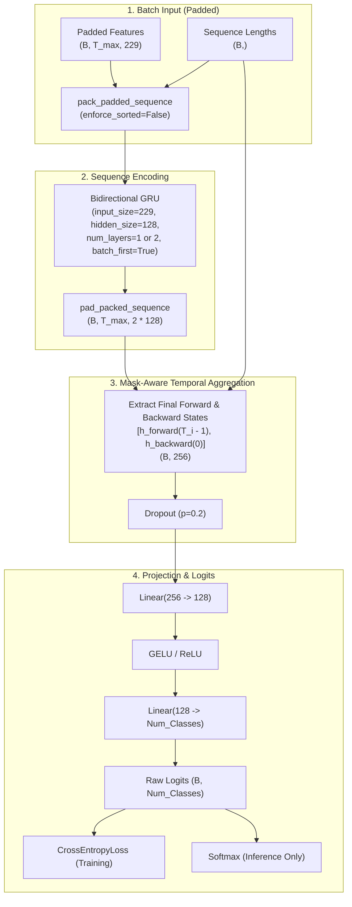

# SignBridge AI: GRU Sequence Classifier Architecture Specification
## Deep Learning Baseline for Closed-Set ISL Sentence Recognition

**Document ID:** `docs/gru-model-architecture.md`  
**Milestone:** Step 3 — Machine Learning Model Development & Training Baseline  
**Model Class:** `backend.app.ml.models.gru_classifier.SignBridgeGRUClassifier`  
**Framework:** PyTorch (CPU-compatible, CUDA-ready)  

---

## 1. Architectural Philosophy

Indian Sign Language gestures are dynamic temporal trajectories across 3D body pose, left hand, and right hand landmarks. Given variable-length videos ($T \in [30, 160]$ frames) and a compact corpus size (~450 benchmark samples), the architecture must satisfy three core criteria:
1. **Temporal Recurrence with Adaptive Gating:** Gated Recurrent Units (GRU) offer effective sequential memory while maintaining lower parameter complexity compared to standard 3-gate LSTMs, reducing overfitting risk.
2. **Variable-Length Sequence Handling:** Efficient handling of variable duration without artificial sequence stretching or loss of temporal rhythm via PyTorch `PackedSequence`.
3. **Decoupled Padding & Modality Masks:** Absolute mathematical separation between the *modality presence flags* ($m_t \in \mathbb{R}^4$) that indicate whether hands were visible, and the *batch padding mask* ($\mathbf{M}_{\text{pad}} \in \{0, 1\}^{B \times T_{\max}}$) used to ignore zero-padding across batches.

---

## 2. Model Structure & Tensor Flow

---

## 3. Mathematical Formulation

### 3.1 Input Representation
Let $\mathbf{X}_i = (\mathbf{x}_{i,1}, \dots, \mathbf{x}_{i, T_i}) \in \mathbb{R}^{T_i \times 229}$ denote the $i$-th sequence of length $T_i$ in a batch of size $B$, where $T_{\max} = \max_{i} T_i$.
Padded frames $t \in (T_i, T_{\max}]$ are assigned $\mathbf{x}_{i,t} = \mathbf{0}_{229}$.

### 3.2 Gated Recurrent Unit Transitions
For each valid frame $t \in [1, T_i]$, the GRU computes:
$$\mathbf{r}_t = \sigma(\mathbf{W}_{ir} \mathbf{x}_t + \mathbf{b}_{ir} + \mathbf{W}_{hr} \mathbf{h}_{t-1} + \mathbf{b}_{hr})$$
$$\mathbf{z}_t = \sigma(\mathbf{W}_{iz} \mathbf{x}_t + \mathbf{b}_{iz} + \mathbf{W}_{hz} \mathbf{h}_{t-1} + \mathbf{b}_{hz})$$
$$\mathbf{n}_t = \tanh(\mathbf{W}_{in} \mathbf{x}_t + \mathbf{b}_{in} + \mathbf{r}_t \odot (\mathbf{W}_{hn} \mathbf{h}_{t-1} + \mathbf{b}_{hn}))$$
$$\mathbf{h}_t = (1 - \mathbf{z}_t) \odot \mathbf{n}_t + \mathbf{z}_t \odot \mathbf{h}_{t-1}$$
where $\sigma(\cdot)$ is the sigmoid function, $\odot$ represents the Hadamard product, $\mathbf{r}_t$ is the reset gate, $\mathbf{z}_t$ is the update gate, and $\mathbf{n}_t$ is the candidate hidden state.

### 3.3 Bidirectional Sequence Extraction
For a bidirectional GRU:
- Forward pass yields $\vec{\mathbf{h}}_t \in \mathbb{R}^{H}$ for $t = 1, \dots, T_i$.
- Backward pass yields $\overleftarrow{\mathbf{h}}_t \in \mathbb{R}^{H}$ for $t = T_i, \dots, 1$.

To prevent padded frames from polluting the sequential representation, the summary embedding is formed by concatenating the exact final forward state at step $T_i - 1$ with the initial backward state at step $0$:
$$\mathbf{e}_i = [\vec{\mathbf{h}}_{i, T_i-1} \,\|\, \overleftarrow{\mathbf{h}}_{i, 0}] \in \mathbb{R}^{2H}$$

### 3.4 Classification Projection
$$\hat{\mathbf{z}}_i = \mathbf{W}_2 \cdot \text{GELU}(\mathbf{W}_1 \mathbf{e}_i + \mathbf{b}_1) + \mathbf{b}_2 \in \mathbb{R}^C$$
where $C$ is the number of target sentence categories.

During training, standard multinomial cross-entropy loss is computed directly on raw logits:
$$\mathcal{L} = -\frac{1}{B} \sum_{i=1}^B \log \left( \frac{\exp(\hat{z}_{i, y_i})}{\sum_{c=0}^{C-1} \exp(\hat{z}_{i, c})} \right)$$

---

## 4. Hyperparameter Configuration

| Parameter | Selected Value | Justification |
|---|---|---|
| **Input Dimension (`input_dim`)** | 229 | Fixed by Candidate B feature topology. |
| **Hidden Dimension (`hidden_dim`)** | 128 | Balance between representation capacity and sample count (~300 train samples). |
| **Recurrent Layers (`num_layers`)** | 1 (or 2) | Prevents gradient degradation and over-parameterization on small corpora. |
| **Bidirectionality (`bidirectional`)** | True (or False) | Bidirectional captures anticipatory hand transitions and concluding gesture trajectories. |
| **Dropout Rate (`dropout`)** | 0.2 | Regularization between recurrent layer and classification head. |
| **Batch Size** | 8 or 16 | Keeps gradient estimates stable on CPU while allowing mini-batch parallelism. |
| **Optimizer** | AdamW | Decoupled weight decay ($10^{-4}$) for effective regularization. |
| **Learning Rate** | $1.0 \times 10^{-3}$ | Standard stable initial learning rate with ReduceLROnPlateau / cosine decay. |
| **Early Stopping Patience** | 10 epochs | Halts training when validation macro-F1 plateaus. |
| **Gradient Clipping** | $\le 1.0$ | Prevents exploding gradients during recurrent backpropagation through time (BPTT). |
