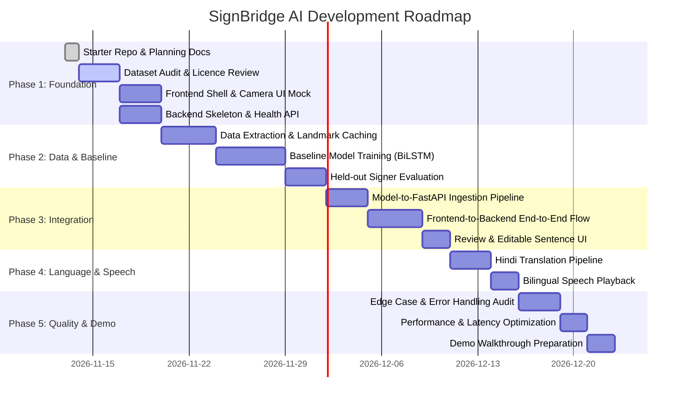
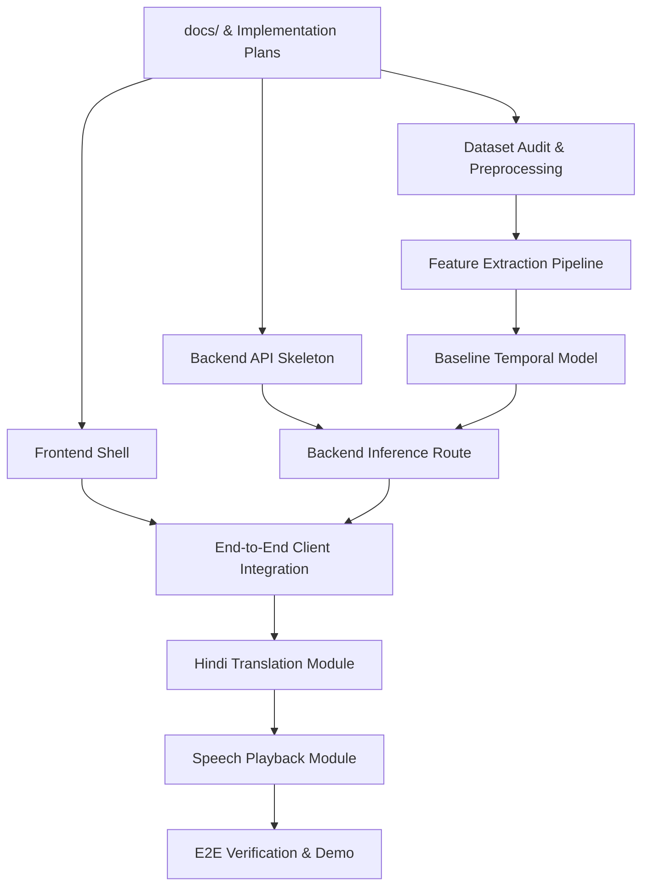

# SignBridge AI: Master Implementation Plan

**Document ID:** `01-master-plan`  
**Status:** Planning & Architectural Blueprint  
**Primary Reference:** `docs/project-blueprint.pdf`  
**Last Updated:** 2026-11-13  

---

## 1. Executive Summary & Project Overview

**SignBridge AI** is an AI-powered assistive communication platform engineered to translate Indian Sign Language (ISL) gestures into natural, sentence-level text and spoken audio in both **English** and **Hindi**. 

Unlike simple gesture recognition systems that merely classify isolated fingerspelling alphabets or static hand poses, SignBridge AI focuses on **continuous, sequence-level sign language translation**. It bridges the critical communication divide between Deaf and hard-of-hearing individuals and hearing individuals across essential public and everyday settings.

### Core Objectives
1. **Camera-Based Continuous Recognition:** Capture natural signing sequences directly via standard webcams without specialized hardware (e.g., data gloves or depth sensors).
2. **Visual Feature Extraction & Temporal Modeling:** Track hand landmarks, body pose, and facial expressions over time to interpret full sign sentences.
3. **Bilingual Sentence Generation:** Output readable, grammatically coherent English sentences and corresponding Hindi translations.
4. **Contextual Seven-Domain Support:** Provide tailored user flows, vocabulary suggestions, and conversational context across seven critical domains.
5. **Human-in-the-Loop Review:** Provide review and editing capabilities so users can verify translations before audio is synthesized.
6. **Responsible AI & Honest Abstention:** Explicitly report uncertainty and prompt the user to repeat rather than hallucinating translations when confidence is low.
7. **Privacy by Design:** Process camera video temporarily in memory or ephemeral storage with zero default persistence of raw video.

---

## 2. Seven Communication Domains (Scope Distinction)

SignBridge AI targets seven real-world interaction environments:

1. **Education:** Classroom interactions, asking questions, lecture assistance, attendance, and exam support.
2. **Healthcare:** Communicating symptoms, expressing urgent pain/needs, doctor consultations, and pharmacy queries.
3. **Banking:** Account opening, teller inquiries, withdrawals/deposits, loan discussions, and ATM assistance.
4. **Workplaces:** Professional introductions, standups, sprint meetings, task handoffs, and coworker coordination.
5. **Travel:** Inquiring for directions, buying transit tickets, railway/flight inquiries, and hotel check-in.
6. **Government & Public Services:** Counter inquiries, application forms, identity documentation, and civic assistance.
7. **Everyday Conversations:** Informal greetings, social dialogue, expressing feelings, family discussions, and time-related phrases.

> ### ⚠️ Critical Scope Distinction: UI Scope vs. Model Scope
> - **Product/UI Scope:** The frontend interface presents all **seven communication domains** to organize navigation, suggested phrase lists, and contextual prompts.
> - **Validated AI Model Scope:** The machine learning translation engine is strictly scoped to the exact vocabulary, phrases, signers, and conditions validated in the training datasets. The application **must never claim full language coverage across all 7 domains** unless backed by empirical dataset training and test benchmarks.

---

## 3. High-Level System Architecture

The architecture consists of four distinct, loosely coupled layers:

```mermaid
flowchart TD
    subgraph ClientLayer ["1. Client Layer (Frontend)"]
        UI["React + Vite UI"]
        Cam["MediaStream Camera Capture"]
        Review["Text Review & Editor"]
        TTS["Web Speech Synthesis (EN/HI)"]
    end

    subgraph APILayer ["2. API & Gateway Layer (Backend)"]
        FastAPI["FastAPI REST API"]
        Val["Request Validation & Ephemeral Ingestion"]
        CtxMgr["Domain Context Manager"]
    end

    subgraph InferenceLayer ["3. ML & CV Inference Engine"]
        CV["OpenCV Frame Sampler"]
        MP["MediaPipe Landmark Extractor (Hands + Pose)"]
        SeqModel["Temporal Model (BiLSTM / 1D-CNN)"]
        Decoder["Sentence Decoder / Beam Search"]
    end

    subgraph TranslationLayer ["4. Language & Translation Engine"]
        EngFormatter["English Sentence Formatter"]
        TransService["Hindi Translation Module (Validated Engine)"]
    end

    UI --> Cam
    Cam -->|Video Clip / WebM| FastAPI
    FastAPI --> Val
    Val --> CV
    CV --> MP
    MP -->|Landmark Sequence (T, D)| SeqModel
    SeqModel --> Decoder
    Decoder --> EngFormatter
    EngFormatter --> TransService
    TransService -->|Bilingual Results + Confidence| CtxMgr
    CtxMgr -->|Structured JSON| UI
    UI --> Review
    Review -->|Confirmed Text| TTS
```

---

## 4. End-to-End Data Flow

The operational flow follows a step-by-step pipeline:

```
[Camera Input] 
       │ 1. User selects domain (e.g. Healthcare) and grants camera permission.
       ▼
[Recording / Stream]
       │ 2. Signer performs ISL sentence; browser records video blob (WebM/MP4).
       ▼
[Secure API Ingestion]
       │ 3. Client POSTs multipart payload to FastAPI `/api/v1/inference/translate`.
       ▼
[Video Preprocessing]
       │ 4. Backend extracts frames at standardized FPS (e.g., 25–30 fps) and resolution.
       ▼
[Visual Feature Extraction]
       │ 5. MediaPipe extracts 3D coordinates for hand landmarks (21 per hand) and body pose.
       ▼
[Temporal Sequence Modeling]
       │ 6. Deep learning model processes sequence tensor over time window $T$.
       ▼
[Confidence Evaluation & Abstention]
       │ 7. If confidence score < threshold $\tau$, return clear abstention / repeat prompt.
       ▼
[Sentence Text Generation]
       │ 8. Decode sequence into grammatically sound English sentence.
       ▼
[Language Translation (Hindi)]
       │ 9. Pass English sentence to evaluated translation pipeline to produce Hindi text.
       ▼
[Interactive User Review]
       │ 10. Frontend renders bilingual output; user reviews/edits text to ensure correctness.
       ▼
[Speech Output]
       │ 11. User triggers playback; browser SpeechSynthesis speaks selected language aloud.
```

---

## 5. Technology Stack & Justification

| Layer / Component | Technology Selected | Justification & Role |
| :--- | :--- | :--- |
| **Frontend Framework** | **React + Vite** | High performance, rapid HMR, component modularity, and rich ecosystem for media handling. |
| **Styling & Design** | **Tailwind CSS** | Utility-first, responsive, accessible color contrast, clean mobile/desktop layouts. |
| **Backend Framework** | **Python 3.10+ & FastAPI** | Native async support, high throughput, automatic OpenAPI documentation, tight integration with ML libraries. |
| **Video Processing** | **OpenCV (`cv2`)** | Industry standard for frame decoding, downsampling, color conversions, and geometric resizing. |
| **Landmark Extraction** | **MediaPipe (Hands / Holistic)** | Lightweight, real-time, highly accurate 21-point hand landmark and pose extraction with robust normalized coordinates. |
| **Machine Learning** | **PyTorch** | Dynamic computation graphs, extensive sequence modeling support, straightforward deployment and optimization. |
| **Speech Synthesis** | **Web Speech API (`window.speechSynthesis`)** | Native zero-dependency client-side speech output supporting multiple English and Hindi regional voices. |
| **Exploration & Research** | **Jupyter Notebooks / Google Colab** | Reproducible data exploration, dataset inspection, benchmark comparisons, and model training. |
| **Version Control** | **Git & GitHub** | Distributed code tracking, code review, branch protection, and collaboration. |

---

## 6. Development Phases & Milestones

The project is structured into **5 sequential phases** matching the implementation blueprint:



### Milestone Deliverables
- **M1 (Phase 1):** Functional frontend camera preview, working FastAPI health check, and complete dataset audit report.
- **M2 (Phase 2):** Reproducible landmark extraction pipeline and baseline temporal model with independent signer validation metrics.
- **M3 (Phase 3):** Full end-to-end integration: video recorded in browser $\to$ sent to backend $\to$ real inference returned to review UI.
- **M4 (Phase 4):** Validated Hindi translation and working browser text-to-speech for both languages.
- **M5 (Phase 5):** Complete test suite, error handling, performance benchmark report, and polished demo scenario.

---

## 7. Module Dependencies & Task Breakdown

### Module Dependency Matrix



### Team-Independent Task Breakdown

| Track | Independent Starting Tasks | Gated / Dependent Tasks |
| :--- | :--- | :--- |
| **Frontend Track** | • Build responsive layout and 7-domain navigation.<br>• Implement camera permission & preview components.<br>• Build editable review text box and language toggles.<br>• Build mock speech playback using Web Speech API. | • Connect live video upload to backend API (requires backend inference endpoint).<br>• Real-time confidence visualization (requires ML response schema). |
| **Backend Track** | • Initialize FastAPI skeleton with CORS & config.<br>• Define Pydantic request/response schemas.<br>• Implement `/health` and domain metadata endpoints.<br>• Build ephemeral video upload validation. | • Connect feature extraction & model inference engine (requires trained model artifact).<br>• Hindi translation integration (requires selected translation engine). |
| **ML & Data Track** | • Audit candidate datasets (ISL-CSLTR, iSign, ISLTranslate).<br>• Verify licences, annotations, and signer distribution.<br>• Implement MediaPipe landmark extraction scripts.<br>• Build PyTorch DataLoader with signer-independent splits. | • Train baseline model (requires cleaned dataset).<br>• Export model checkpoint for backend integration (requires validation pass). |

---

## 8. Major Technical Risks & Fallback Strategies

| Identified Risk | Severity | Root Cause / Impact | Concrete Mitigation & Fallback Strategy |
| :--- | :---: | :--- | :--- |
| **Limited Dataset Size & Signer Diversity** | **High** | Small corpus size causing poor generalization to unseen signers. | • Restrict initial evaluation to a strictly verified subset of phrases.<br>• Use signer-independent splits (k-fold by signer) to avoid optimistic leakage.<br>• Transparently report dataset limits in UI. |
| **Incompatible Dataset Annotations** | **High** | Combining datasets with mismatched gloss standards or missing sentence labels. | • **Strict Rule:** Do not combine datasets without manual verification.<br>• If glosses are absent, use direct sequence-to-text modeling rather than gloss-to-text. |
| **Continuous Sentence Translation Complexity** | **High** | Difficulty segmenting continuous signing boundaries. | • Start with a lightweight temporal model (BiLSTM/GRU) on bounded vocabulary before attempting Transformers.<br>• Define fixed maximum sequence lengths and padding strategies. |
| **Hindi Translation Hallucinations** | **Medium** | Machine translation models making grammar errors in critical phrases. | • Use a dedicated, benchmarked translation library (e.g., IndicTrans2 or validated MarianMT) with human verification of common domain phrases.<br>• Allow users to view and edit both English and Hindi text. |
| **Adverse Camera & Lighting Conditions** | **Medium** | Motion blur, bad lighting, or hands outside frame lead to failed landmark detection. | • Implement input quality checks in the feature extractor.<br>• If hand landmarks are undetected for $>40\%$ of frames, prompt user: *"Hands not clearly visible. Please adjust camera framing."* |
| **Overclaiming Domain Capability** | **High** | Users assuming all 7 domains have full vocabulary coverage. | • Prominently display a disclaimer badge: *"Prototype Mode: Trained on validated phrase subsets. Medical/legal interpretation requires certified human interpreters."* |
| **Hosting & Inference Latency Limits** | **Medium** | Heavy deep learning models causing slow response times on free cloud hosting. | • Benchmark model footprint; target $<150\text{ MB}$ weights.<br>• Run landmark extraction on CPU with optimized batch sizes.<br>• Maintain a clear loading indicator during inference. |
| **High-Stakes Misunderstanding** | **Critical** | Errors in medical or banking settings leading to serious real-world harm. | • Require mandatory user confirmation before audio playback.<br>• Provide an explicit "Edit Translation" UI flow so the user always has final control over the spoken output. |

