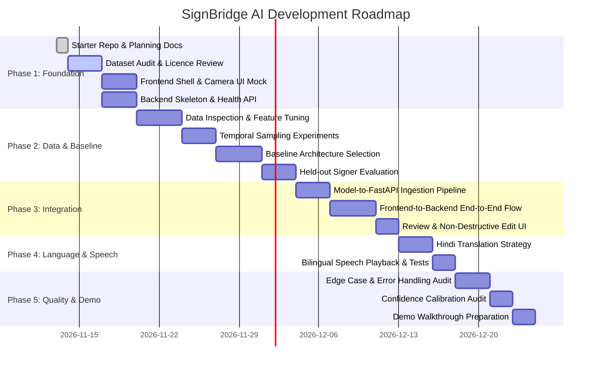
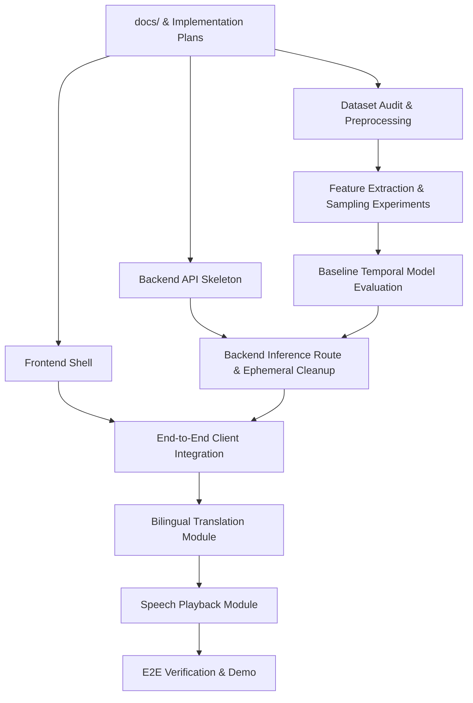

# SignBridge AI: Master Implementation Plan

**Document ID:** `01-master-plan`
**Status:** Planning & Architectural Blueprint (Technically Reviewed)
**Primary Reference:** `docs/project-blueprint.pdf`
**Last Updated:** 2026-11-13

---

## 1. Executive Summary & Project Overview

**SignBridge AI** is an assistive communication platform designed to bridge communication barriers between Indian Sign Language (ISL) users and hearing non-signers by translating signing video input into natural written text and spoken audio in **English** and **Hindi**.

### Clear Technical Paradigm Distinction
To maintain scientific rigor and prevent misleading claims, the platform clearly distinguishes three distinct sign language processing paradigms:

1. **Closed-Set / Fixed Sentence Classification:**
   - The model maps an entire signing video clip directly to one of $K$ predefined sentence classes (e.g., $K=50$ or $100$ fixed domain sentences).
   - *Scope:* A strong, realistic candidate for an initial reproducible prototype baseline on small, controlled corpora.
   - *Boundary:* It is **not** open-vocabulary or unrestricted continuous translation; it classifies whole video clips into known phrase targets.
2. **Gloss-Based Recognition and Translation (GSLR + SLT):**
   - A two-stage pipeline: Stage 1 performs Continuous Sign Language Recognition (CSLR), mapping video frames to an ordered sequence of discrete sign glosses (often trained with Connectionist Temporal Classification / CTC loss). Stage 2 performs Sign Language Translation (SLT), translating gloss sequences into spoken language sentences using rule-based grammar mapping or sequence-to-sequence NLP models.
   - *Boundary:* Feasible **only** if the underlying dataset contains verified, aligned gloss annotations.
3. **Continuous Video-to-Text Translation (End-to-End SLT):**
   - Direct sequence-to-sequence neural translation mapping extracted visual feature sequences directly to tokenized written text (English/Hindi) without intermediate gloss representations.
   - *Boundary:* Requires substantial parallel video-sentence datasets (e.g., iSign, ISLTranslate) and significant compute; challenging to train on small corpora without severe overfitting.

The prototype baseline begins with an experimentally verified baseline matching the available dataset's actual annotations. Unrestricted continuous translation must never be claimed for a closed-set classifier.

### Core Objectives
1. **Camera-Based Video Capture:** Capture signing sequences directly via standard webcams without specialized hardware (such as data gloves or depth sensors).
2. **Visual Feature Extraction & Temporal Modeling:** Extract geometric skeletal landmarks (hands, body pose, and optional non-manual facial cues) over time, and evaluate candidate temporal architectures (e.g., BiLSTM, GRU, 1D-CNN, TCN) on held-out splits.
3. **Bilingual Text & Speech Output:** Output clear English text and corresponding Hindi translations through a two-tier language layer (human-reviewed domain phrases for high translation fidelity; machine translation for open text). *Tier 1 English-Hindi phrase pairs are reviewed and approved by qualified bilingual human reviewers. This approval concerns stored translation pairs rather than visual sign recognition, and does not claim guaranteed 100% grammatical accuracy in every context. ML visual recognition accuracy and translation quality remain separate evaluation measures.*
4. **Contextual Seven-Domain Organization:** Provide tailored user flows, vocabulary suggestions, and conversational context across seven critical domains in the UI, while explicitly scoping AI capabilities to experimentally validated vocabulary.
5. **Human-in-the-Loop Review & Safe Editing:** Provide explicit review and editing controls before audio playback. Editing English can offer Hindi re-generation, but editing Hindi must never silently overwrite English.
6. **Responsible AI, Calibrated Confidence & Honest Abstention:** Employ validation-calibrated confidence scoring (rather than raw softmax probabilities) and input quality checks to abstain honestly when inputs are ambiguous, out-of-frame, or unsupported.
7. **Privacy by Design:** Use ephemeral processing with immediate, deterministic cleanup of temporary files; no persistent storage of user video.

---

## 2. Seven Communication Domains (Scope Distinction)

SignBridge AI targets seven real-world interaction environments:

1. **Education:** Classroom interactions, asking questions, lecture assistance, attendance, and exam support.
2. **Healthcare:** Communicating symptoms, expressing urgent pain/needs, doctor consultations, and pharmacy queries.
3. **Banking:** Account opening, teller inquiries, withdrawals/deposits, loan discussions, and ATM assistance.
4. **Workplaces:** Professional introductions, standups, sprint meetings, task handoffs, and coworker coordination.
5. **Travel:** Inquiring for directions, buying transit tickets, railway/flight inquiries, and hotel check-in.
6. **Government & Public Services:** Counter inquiries, application forms, identity documentation, and civic assistance.
7. **Everyday Conversations:** Informal greetings, social dialogue, expressing feelings, family discussions, and time-related phrases.

> ### ⚠️ Mandatory Scope Boundary: UI Scope vs. Validated Model Scope
> - **Product / UI Scope:** The frontend interface presents all **seven communication domains** to organize user navigation, suggested phrase lists, and contextual prompts.
> - **Validated AI Model Scope:** The machine learning translation engine is strictly scoped to the exact vocabulary, phrases, signers, and recording conditions validated in the training datasets. The application **must never claim full language coverage across all 7 domains** unless backed by empirical dataset training and test benchmarks. Unsupported phrases in the UI must be clearly marked as placeholder or future roadmap items.

---

## 3. High-Level System Architecture

The architecture consists of four distinct, loosely coupled layers:

```mermaid
flowchart TD
    subgraph ClientLayer ["1. Client Layer (Frontend)"]
        UI["React + Vite UI"]
        Cam["MediaStream Camera Capture"]
        Review["Bilingual Review & Independent Text Editors"]
        TTS["Web Speech Synthesis (EN/HI)"]
    end

    subgraph APILayer ["2. API & Gateway Layer (Backend)"]
        FastAPI["FastAPI REST API"]
        Val["Request Validation & Ephemeral File Ingestion"]
        Cleanup["Deterministic Temp File Cleanup (try...finally)"]
        CtxMgr["Domain Context Manager"]
    end

    subgraph InferenceLayer ["3. ML & CV Inference Engine"]
        CV["OpenCV Frame Sampler (Uniform Temporal Sampling)"]
        MP["MediaPipe Landmark Extractor (Hands + Pose Candidate Dims)"]
        SeqModel["Temporal Model (BiLSTM / GRU / 1D-CNN Baseline)"]
        Calibrator["Confidence Calibration & Quality Gate"]
    end

    subgraph TranslationLayer ["4. Language & Translation Engine"]
        EngFormatter["English Sentence Formatter"]
        TransService["Hindi Translation Module (Fixed Lookup / Evaluated NMT)"]
    end

    UI --> Cam
    Cam -->|Video Clip (WebM/MP4)| FastAPI
    FastAPI --> Val
    Val --> CV
    CV --> Cleanup
    CV --> MP
    MP -->|Feature Sequence (T, D)| SeqModel
    SeqModel --> Calibrator
    Calibrator -->|If Calibrated Conf >= tau| EngFormatter
    Calibrator -->|If Low Conf or Poor Quality| CtxMgr
    EngFormatter --> TransService
    TransService -->|Bilingual Results + Calibrated Confidence| CtxMgr
    CtxMgr -->|Structured JSON Response| UI
    UI --> Review
    Review -->|Confirmed Text| TTS
```

---

## 4. End-to-End Data Flow

The operational flow follows a step-by-step pipeline:

```
[Camera Input]
       │ 1. User selects domain (e.g. Healthcare) and grants camera permission.
       ▼
[Recording / Stream]
       │ 2. Signer performs ISL sequence; browser records video blob (WebM/MP4, recommended 2–6s duration).
       ▼
[Secure API Ingestion]
       │ 3. Client POSTs multipart payload to FastAPI `/api/v1/inference/translate`.
       ▼
[Ephemeral Buffering & Preprocessing]
       │ 4. Backend buffers upload to ephemeral temporary file on disk (required by OpenCV/FFmpeg container demuxer).
       │    Standardizes frame rate via uniform sampling and enforces clip duration limits.
       ▼
[Visual Feature Extraction]
       │ 5. MediaPipe extracts geometric landmark coordinates (hands + pose; candidate dimension D to be finalized empirically).
       │    Deterministic cleanup deletes temporary video file immediately after frame decoding.
       ▼
[Temporal Sequence Modeling]
       │ 6. Candidate temporal model (BiLSTM / GRU / 1D-CNN) processes sequence tensor over temporal window T.
       ▼
[Calibrated Confidence & Abstention Gating]
       │ 7. Validation-calibrated confidence score (e.g. via temperature scaling) and input quality checks are evaluated.
       │    If confidence < threshold tau or landmark detection ratio falls below the provisional 0.60 threshold
       │    (a separate application-level quality gate calculated from actual hand landmark detection results: any-hand
       │    mode for unimanual signs or both-hands mode when lexical annotations require bimanual signing; distinct from
       │    MediaPipe's internal detector configuration defaults), return honest abstention prompt.
       ▼
[Sentence Text Generation]
       │ 8. Format recognized output into fluent English sentence.
       ▼
[Language Translation (Hindi)]
       │ 9. Map via human-verified bilingual phrase dictionary (for validated domain phrases)
       │    or route through evaluated NMT for open text.
       ▼
[Interactive User Review & Language Editing]
       │ 10. Frontend renders bilingual review card with independent edit fields.
       │     Editing English allows optional Hindi re-translation; editing Hindi NEVER overwrites English.
       ▼
[Speech Output]
       │ 11. User explicitly clicks "Confirm & Speak"; browser SpeechSynthesis speaks selected language aloud.
```

---

## 5. Technology Stack & Technical Justification

| Layer / Component | Proposed Technology | Justification & Architectural Role |
| :--- | :--- | :--- |
| **Frontend Framework** | **React + Vite** | Fast HMR, declarative component architecture, robust ecosystem for WebRTC / MediaStream capture. |
| **Styling & Design** | **Tailwind CSS** | Utility-first, responsive layouts, accessible WCAG-compliant color contrast. |
| **Backend Framework** | **Python 3.10+ & FastAPI** | Asynchronous request handling, Pydantic validation, native integration with PyTorch and OpenCV. |
| **Video Processing** | **OpenCV (`cv2`)** | Efficient video container demuxing, frame extraction, and spatial/temporal resizing. |
| **Landmark Extraction** | **MediaPipe (Hands / Pose / Holistic)** | Lightweight skeletal tracking. *Candidate feature representations (hands-only, hands + upper pose, face subset) to be finalized after empirical validation.* |
| **Machine Learning** | **PyTorch** | Dynamic computation graphs, sequence modeling (RNN/CNN/Transformer baselines), CPU deployment optimization. |
| **Confidence Calibration** | **Scikit-Learn / PyTorch** | Temperature scaling and validation-based calibration to replace uncalibrated raw softmax scores. |
| **Speech Synthesis** | **Web Speech API (`SpeechSynthesis`)** | Native zero-dependency client-side speech output supporting English and Hindi voices. |
| **Exploration & Research** | **Jupyter Notebooks / Google Colab** | Reproducible data exploration, dataset inspection, benchmark comparisons, and model training. |
| **Version Control** | **Git & GitHub** | Distributed code tracking, code review, branch protection, and collaboration. |

---

## 6. Development Phases & Milestones

The project is structured into **5 sequential phases** matching the implementation blueprint:



### Milestone Deliverables
- **M1 (Phase 1):** Functional frontend camera preview, working FastAPI health check, and complete dataset audit report.
- **M2 (Phase 2):** Documented feature extraction experiments, empirically justified sampling strategy, trained baseline model, and signer-independent evaluation on held-out test splits.
- **M3 (Phase 3):** Full end-to-end integration: video recorded in browser $\to$ sent to backend $\to$ ephemeral processing $\to$ real inference returned to review UI with independent edit buffers.
- **M4 (Phase 4):** Validated Hindi translation (human-verified domain phrase lookup + evaluated NMT fallback) and working browser text-to-speech for both languages.
- **M5 (Phase 5):** Complete test suite, error handling, performance benchmark report, and polished demo scenario distinguishing prototype capabilities from UI scope.

---

## 7. Module Dependencies & Task Breakdown

### Module Dependency Matrix



### Team-Independent Task Breakdown

| Track | Independent Starting Tasks | Gated / Dependent Tasks |
| :--- | :--- | :--- |
| **Frontend Track** | • Build responsive layout and 7-domain navigation.<br>• Implement camera permission & preview components.<br>• Build editable review text box with independent English/Hindi fields.<br>• Build speech playback using Web Speech API with voice fallback checks. | • Connect live video upload to backend API (requires backend inference endpoint).<br>• Calibrated confidence visualization (requires ML response schema). |
| **Backend Track** | • Initialize FastAPI skeleton with CORS & configuration.<br>• Define Pydantic request/response schemas.<br>• Implement `/health` and domain metadata endpoints.<br>• Build ephemeral video upload validation with deterministic temp file cleanup. | • Connect feature extraction & model inference engine (requires trained model artifact).<br>• Hindi translation integration (requires selected translation engine). |
| **ML & Data Track** | • Audit candidate datasets (ISL-CSLTR, iSign, ISLTranslate) for access, licences, and annotation formats.<br>• Analyze actual signer identifiers and video grouping.<br>• Conduct feature representation experiments (hands vs pose vs face).<br>• Experiment with temporal sampling rates and sequence lengths. | • Train baseline model (requires cleaned dataset and decided representation).<br>• Calibrate model probabilities on validation split.<br>• Export model checkpoint for backend integration. |

---

## 8. Major Technical Risks & Fallback Strategies

| Identified Risk | Severity | Root Cause / Impact | Concrete Mitigation & Fallback Strategy |
| :--- | :---: | :--- | :--- |
| **Dataset Annotation Mismatch** | **High** | Assuming sentence datasets contain glosses, or attempting CTC without gloss alignments. | • **Strict Rule:** Check raw annotations before writing model code. If glosses are absent, use direct sequence classification or seq2seq video-to-text; do not assume gloss-to-text pipelines. |
| **Signer Leakage in Evaluation** | **High** | Partitioning clips randomly when multiple clips originate from the same signer or broadcast session. | • Group splits by signer identifier or recording session/channel ID.<br>• Never allow clips from the same signer/video to appear across train and test sets. |
| **Temporal Sampling & Duration Mismatch** | **High** | Incompatibility between fixed sequence lengths and variable video durations (e.g. 60 frames vs 12s clips). | • Empirically inspect dataset duration distribution.<br>• Standardize recording duration in frontend (e.g., 2–6s for phrase signs) or use dynamic temporal pooling / recurrent padding up to empirical sequence bounds. |
| **Uncalibrated Model Confidence** | **High** | Deep networks outputting high raw softmax probabilities on random or noise inputs. | • Implement post-hoc temperature scaling on validation splits.<br>• Combine calibrated probability with landmark detection ratio checks before accepting predictions. |
| **Hindi Translation Inaccuracies** | **Medium** | General NMT models hallucinating or altering meaning in specialized phrases. | • Use a curated, human-verified bilingual lookup for supported domain phrases.<br>• Reserve NMT for open vocabulary, accompanied by fluent speaker evaluation. |
| **Silent Text Overwrite During Review** | **Medium** | Editing in one language inadvertently overwriting manual edits in the other language. | • Maintain completely independent edit state buffers for English and Hindi.<br>• Never automatically overwrite Hindi when editing English unless explicitly requested by the user, and never overwrite English from Hindi edits. |
| **Adverse Camera & Lighting Conditions** | **Medium** | Motion blur or bad lighting causing MediaPipe landmark extraction failures. | • Implement input quality checks in the feature extractor.<br>• If hand landmarks are undetected for $>40\%$ of frames, abstain and prompt user: *"Hands not clearly visible. Please adjust camera framing."* |
| **Overclaiming Domain Capability** | **High** | Users assuming all 7 domains have full AI vocabulary coverage. | • Prominently display a disclaimer badge: *"Prototype Mode: Trained on validated phrase subsets. Medical/legal interpretation requires certified human interpreters."* |
| **Storage & Privacy Contradictions** | **Medium** | Claiming zero disk storage while using disk-backed temporary files. | • Transparently document ephemeral temporary disk buffering needed by video decoders.<br>• Guarantee deterministic deletion in `finally` blocks and zero permanent video logging. |
| **High-Stakes Misunderstanding** | **Critical** | Errors in medical or banking settings leading to serious real-world harm. | • Require mandatory user confirmation before audio playback.<br>• Provide an explicit "Edit Translation" UI flow so the user always has final control over the spoken output. |
