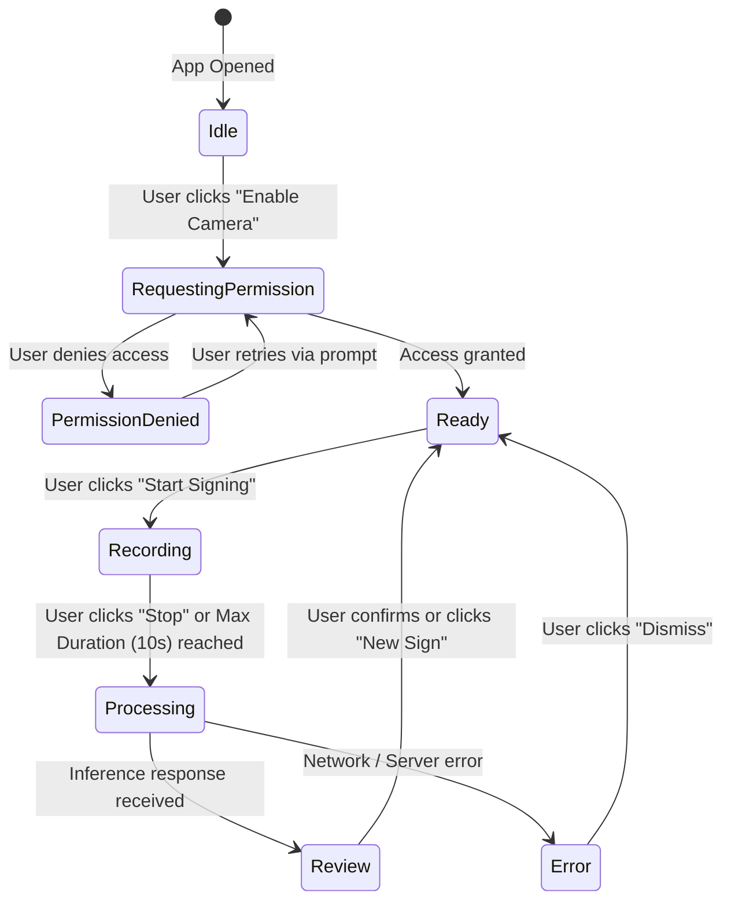

# SignBridge AI: Frontend Architecture & Implementation Plan

**Document ID:** `02-frontend-plan`  
**Status:** Planning & UI/UX Blueprint  
**Primary Reference:** `docs/project-blueprint.pdf` (Sections 5, 6, 8, 11, 14, 18)  
**Last Updated:** 2026-11-13  

---

## 1. Overview & Objectives

The frontend of **SignBridge AI** is a responsive single-page web application built with **React** and **Vite**. It provides the primary user interface for:
- Selecting communication contexts across seven distinct domains.
- Requesting camera access and previewing real-time video feed.
- Recording continuous Indian Sign Language (ISL) signing clips.
- Viewing translated text in English and Hindi with explicit confidence indicators.
- Reviewing, editing, and confirming translated sentences before audio playback.
- Triggering client-side text-to-speech (TTS) in English or Hindi.

---

## 2. Technology Stack & Tooling

| Component | Choice | Justification |
| :--- | :--- | :--- |
| **Framework** | React 18+ (Functional Components & Hooks) | Declarative UI, state management, wide ecosystem for WebRTC / media streaming. |
| **Build Tool** | Vite | Instant HMR, fast builds, modern ESM support. |
| **Styling** | Tailwind CSS | Consistent design tokens, rapid responsive layouts, accessibility-compliant colors. |
| **Icons** | Lucide-React | Clean, lightweight, and accessible SVG icons. |
| **Audio Synthesis** | Web Speech API (`SpeechSynthesis`) | Native browser capability, zero cloud bandwidth cost, low latency. |
| **HTTP Client** | Native `fetch` with typed API wrapper | Zero external bundle bloat, native `AbortController` support. |

---

## 3. Directory & Component Architecture

The `frontend/` directory structure will be organized as follows:

```text
frontend/
├── index.html
├── package.json
├── vite.config.js
├── tailwind.config.js
├── postcss.config.js
├── public/
│   ├── favicon.ico
│   └── sounds/                     # Subtle UX audio cues (record start/stop)
└── src/
    ├── main.jsx                    # Application entrypoint
    ├── App.jsx                     # Top-level application shell & routing/state
    ├── index.css                   # Global styles & Tailwind directives
    ├── assets/                     # Logos, illustrations
    ├── components/
    │   ├── common/
    │   │   ├── Header.jsx          # App branding, status badge, theme
    │   │   ├── Footer.jsx          # Disclaimer, privacy link, copyright
    │   │   ├── AlertBadge.jsx      # Warning / uncertainty indicator
    │   │   └── Modal.jsx           # Reusable accessible dialog
    │   ├── domain/
    │   │   ├── DomainSelector.jsx  # 7-domain card grid / dropdown
    │   │   ├── DomainHeader.jsx    # Selected domain context banner
    │   │   └── SuggestedPhrases.jsx# Sample phrases for chosen domain
    │   ├── camera/
    │   │   ├── CameraManager.jsx   # Orchestrates camera lifecycle
    │   │   ├── VideoPreview.jsx    # <video> element with framing guide overlay
    │   │   ├── CaptureControls.jsx # Start / Stop / Retake recording buttons
    │   │   └── PermissionPrompt.jsx# Guidance when camera is not yet granted
    │   ├── review/
    │   │   ├── ResultCard.jsx      # Shows recognized text & confidence score
    │   │   ├── SentenceEditor.jsx  # Editable textarea with confirm/cancel
    │   │   ├── LanguageToggle.jsx  # English / Hindi selector switch
    │   │   └── SpeechControls.jsx  # Play, pause, voice selector, speed control
    │   └── feedback/
    │       ├── ConfidenceIndicator.jsx # Visual gauge (High / Med / Low)
    │       ├── UncertaintyMessage.jsx  # "Please repeat signing" prompt
    │       └── ErrorBoundary.jsx   # Graceful crash handling
    ├── hooks/
    │   ├── useCamera.js            # MediaStream, permission states, device selection
    │   ├── useMediaRecorder.js     # MediaRecorder wrapper (WebM/MP4 chunks)
    │   ├── useSpeechSynthesis.js   # Browser TTS voice loading and speaking
    │   └── useTranslationAPI.js    # Communicates with FastAPI backend
    ├── services/
    │   └── api.js                  # Typed API fetch calls and error handling
    ├── utils/
    │   ├── constants.js            # Domain definitions, supported languages
    │   └── speechUtils.js          # Helper to filter native Hindi/English voices
```

---

## 4. Seven-Domain Selection & Navigation

### Domain Definition Schema
Each domain is defined with metadata in `src/utils/constants.js`:

```javascript
export const DOMAINS = [
  {
    id: 'education',
    title: 'Education',
    icon: 'GraduationCap',
    description: 'Classroom questions, explanations, attendance & learning support',
    samplePhrases: [
      'Can you explain this again?',
      'I have a question about the homework.',
      'Present, teacher.',
      'I need extra time for the exam.'
    ]
  },
  {
    id: 'healthcare',
    title: 'Healthcare',
    icon: 'HeartPulse',
    description: 'Symptoms, pain descriptions, appointments & medical requests',
    samplePhrases: [
      'Where is the emergency department?',
      'I am feeling severe pain in my chest.',
      'I have an appointment with the doctor.',
      'I need drinking water.'
    ]
  },
  {
    id: 'banking',
    title: 'Banking',
    icon: 'Building2',
    description: 'Counter requests, account inquiries & transaction guidance',
    samplePhrases: [
      'I want to open a new savings account.',
      'How do I deposit this cheque?',
      'My ATM card is blocked.',
      'I need an account statement.'
    ]
  },
  {
    id: 'workplace',
    title: 'Workplaces',
    icon: 'Briefcase',
    description: 'Introductions, meetings, team coordination & daily updates',
    samplePhrases: [
      'Good morning, nice to meet you.',
      'Can we schedule a quick sync?',
      'I have completed the assigned task.',
      'Please share the meeting notes.'
    ]
  },
  {
    id: 'travel',
    title: 'Travel & Transport',
    icon: 'PlaneTakeoff',
    description: 'Directions, train/bus tickets, transit guidance & hotel check-in',
    samplePhrases: [
      'Which platform does the train arrive on?',
      'I want to purchase a ticket to Mumbai.',
      'Can you direct me to the baggage counter?',
      'Where is the nearest taxi stand?'
    ]
  },
  {
    id: 'government',
    title: 'Government Services',
    icon: 'Landmark',
    description: 'Civic documentation, counter forms, certificates & public offices',
    samplePhrases: [
      'Where do I submit my pension application?',
      'I need to renew my identification card.',
      'Which counter handles certificate verification?',
      'What documents are required for this scheme?'
    ]
  },
  {
    id: 'everyday',
    title: 'Everyday Conversations',
    icon: 'MessagesSquare',
    description: 'Greetings, family discussions, time, feelings & casual social talk',
    samplePhrases: [
      'Hello, how are you today?',
      'Thank you very much for your help.',
      'What time are we meeting for dinner?',
      'I am really happy to see you.'
    ]
  }
];
```

### Domain UI Behavior
- The user can switch domains at any time via a clean horizontal pill bar or modal grid.
- Switching a domain adjusts the **suggested sample phrases** and **contextual hint banner**.
- **Important Rule:** Domain selection must **never force or artificially bias the translation** unless the AI model has been explicitly trained on domain-specific vocabulary.

---

## 5. Camera Management & Recording Lifecycle

### Finite State Machine (FSM)
The camera capture subsystem operates across well-defined lifecycle states:



### Detailed State Specifications

1. **`Idle`:** Camera is off. User sees a clear prompt explaining camera usage, privacy guarantees (no raw storage), and a prominent *"Turn on Camera"* button.
2. **`RequestingPermission`:** Browser native permission prompt is active. A friendly animated spinner informs the user to allow camera access.
3. **`PermissionDenied`:** Clear instructions explain how to re-enable camera in browser settings (Chrome/Edge/Firefox).
4. **`Ready`:** Real-time video preview is active. The user sees a semi-transparent **framing guide** (silhouettes of upper body and hands) to ensure proper positioning.
5. **`Recording`:** A prominent red recording badge flashes with an elapsed timer (0 to 10 seconds). Audio click confirms recording start.
6. **`Processing`:** The recorded video blob is uploaded to the backend. An accessible loading bar with encouraging text (*"Analyzing sign movement..."*) is displayed.
7. **`Review`:** The translation result is received. The camera pauses to save device resources while the user reviews the text.
8. **`Error` / `Uncertainty`:** If lighting was poor, hands were out of frame, or confidence was below threshold, an alert prompts: *"We couldn't clearly capture the sign. Please ensure your hands are inside the guide and try again."*

---

## 6. Translation Result, Review & Editing Workflow

### Human-in-the-Loop Architecture
Because sign language translation directly affects human communication in critical contexts (e.g. healthcare, banks), SignBridge AI requires explicit **human confirmation**:

```
[Received API Translation]
         │
         ▼
[Editable Text Area] ──► User can edit words or correct misunderstandings
         │
         ▼
[Language Switcher] ──► User toggles between [English] and [Hindi]
         │
         ▼
[Action Buttons]
  ├── [Confirm & Speak] ──► Triggers SpeechSynthesis
  ├── [Copy Text]        ──► Copies text to clipboard
  └── [Sign Again]       ──► Resets camera for next sentence
```

### Component Details: `SentenceEditor.jsx`
- Displays the translated English text and translated Hindi text.
- Provides a clean toggle button: `English | हिंदी`.
- When toggled, the user can edit the active language sentence before speaking.
- A confidence badge shows one of three tiers:
  - 🟢 **High Confidence ($>80\%$)**: Green check badge.
  - 🟡 **Moderate Confidence ($55\% - 80\%$)**: Amber warning badge (*"Please review carefully"*).
  - 🔴 **Low Confidence ($<55\%$)**: System automatically enters the **Abstention State**, showing: *"Sign not clearly recognized. Please repeat or type your message."*

---

## 7. Speech Playback Interface

### Web Speech API Architecture
Implemented in `src/hooks/useSpeechSynthesis.js`:

```javascript
// Speech Synthesis Core Logic
export const speakSentence = (text, language = 'en-US') => {
  if (!('speechSynthesis' in window)) {
    console.warn('Speech synthesis not supported in this browser.');
    return;
  }

  // Cancel any ongoing speech
  window.speechSynthesis.cancel();

  const utterance = new SpeechSynthesisUtterance(text);
  
  // Configure language code
  if (language === 'hi' || language === 'hi-IN') {
    utterance.lang = 'hi-IN';
  } else {
    utterance.lang = 'en-US';
  }

  // Attempt to select native voice
  const voices = window.speechSynthesis.getVoices();
  const matchedVoice = voices.find(v => v.lang.startsWith(utterance.lang));
  if (matchedVoice) {
    utterance.voice = matchedVoice;
  }

  utterance.rate = 0.95; // Slightly slower for enhanced clarity
  utterance.pitch = 1.0;

  window.speechSynthesis.speak(utterance);
};
```

### Voice Compatibility Safeguard
- On initial load, the frontend checks whether a native Hindi voice (`hi-IN`) is installed in the user's browser.
- If no Hindi voice is detected on the client operating system, the UI displays a gentle helper badge: *"Hindi audio uses default voice fallback. For best pronunciation, install Hindi language pack in system settings."*

---

## 8. Accessibility (a11y) & Responsive Layout

SignBridge AI is designed from the ground up for full accessibility:

1. **Deaf & Hard-of-Hearing Optimization:**
   - 100% of information conveyed visually (no audio-only prompts).
   - High-contrast visual cues for recording start, active state, and stop.
   - Large, clear typography (minimum 16px body, 24px headings).
2. **Keyboard Navigation:**
   - Full keyboard accessibility (Tab, Enter, Space, Escape).
   - Visible focus rings with high contrast outline (`focus:ring-2 focus:ring-blue-500`).
   - Shortcut keys (e.g., `Space` to start/stop recording when camera is active).
3. **Screen Reader Support:**
   - Semantic HTML elements (`<header>`, `<main>`, `<section>`, `<nav>`, `<button>`).
   - `aria-live="polite"` regions for dynamic translation updates.
   - Descriptive `aria-label` attributes on all icon buttons.
4. **Responsive Form Factors:**
   - **Desktop / Laptop:** Two-column split layout (Camera preview on left, Domain & Translation Review on right).
   - **Mobile / Tablet:** Single-column stacked layout with sticky capture controls at bottom for easy thumb access.

---

## 9. API Integration Specifications

### Endpoint Calls

#### 1. Translate Video Clip
- **Method:** `POST /api/v1/inference/translate`
- **Content-Type:** `multipart/form-data`
- **Request Parameters:**
  - `video`: Binary file (`video/webm` or `video/mp4`).
  - `domain`: String (e.g., `"healthcare"`).
  - `target_language`: String (`"en"` or `"hi"`).
- **Frontend Success Handling (`200 OK`):**
  ```json
  {
    "status": "success",
    "english_text": "I need help finding the doctor.",
    "hindi_text": "मुझे डॉक्टर को खोजने में मदद चाहिए।",
    "confidence": 0.88,
    "domain": "healthcare",
    "abstained": false,
    "landmarks_detected": true
  }
  ```
- **Frontend Abstention Handling (`200 OK` with low confidence):**
  ```json
  {
    "status": "abstain",
    "english_text": "",
    "hindi_text": "",
    "confidence": 0.32,
    "reason": "Hand landmarks occluded or unrecognized sign sequence.",
    "abstained": true,
    "guidance": "Please ensure your hands are clearly in view and repeat the sign."
  }
  ```
- **Frontend Error Handling (`4xx / 5xx`):**
  - Informative toast notification without technical jargon.
  - Retain previous state so user does not lose unsaved input.

