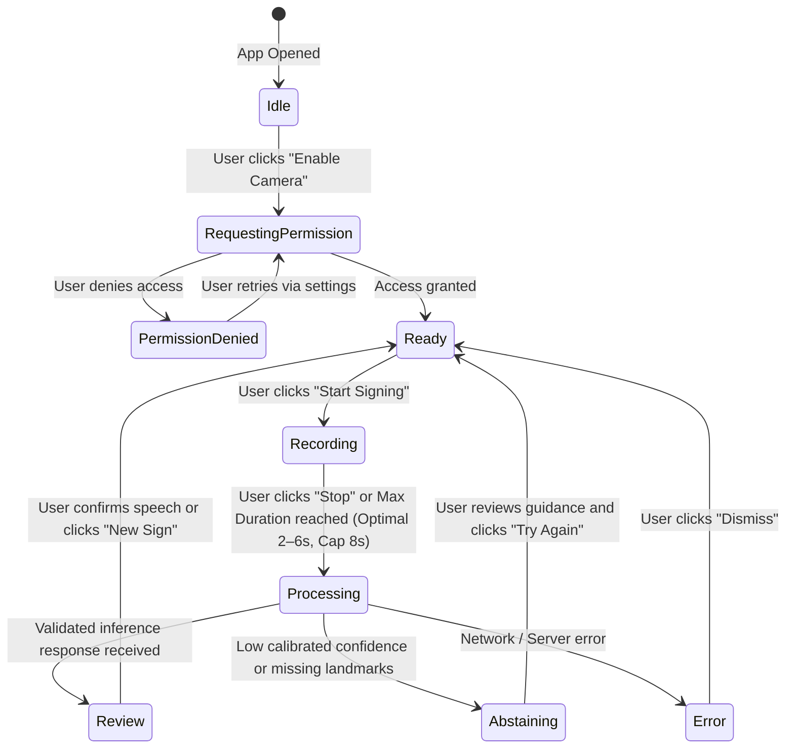
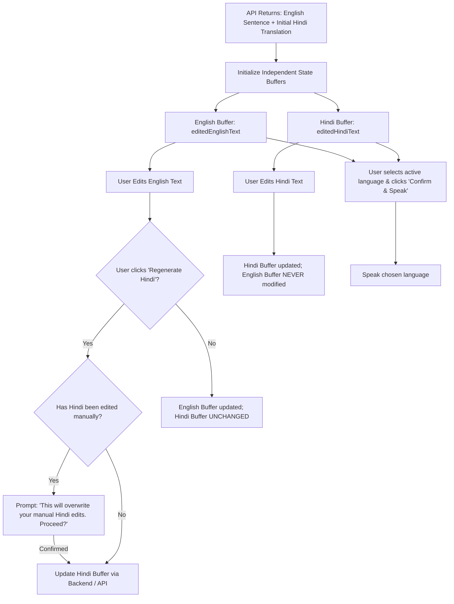

# SignBridge AI: Frontend Architecture & Implementation Plan

**Document ID:** `02-frontend-plan`
**Status:** Planning & UI/UX Blueprint (Technically Reviewed)
**Primary Reference:** `docs/project-blueprint.pdf` (Sections 5, 6, 8, 11, 14, 18)
**Last Updated:** 2026-11-13

---

## 1. Overview & Objectives

The frontend of **SignBridge AI** is a responsive single-page web application built with **React** and **Vite**. It provides the primary user interface for:
- Navigating communication contexts across seven distinct real-world domains.
- Managing camera permissions, previewing video feed, and guiding user framing.
- Recording continuous Indian Sign Language (ISL) signing clips within optimal temporal bounds.
- Displaying model predictions with validation-calibrated confidence indicators.
- Reviewing and editing bilingual text using independent, non-destructive editing buffers.
- Triggering client-side text-to-speech (TTS) in English or Hindi after explicit user confirmation.

---

## 2. Technology Stack & Tooling

| Component | Choice | Justification |
| :--- | :--- | :--- |
| **Framework** | React 18+ (Functional Components & Hooks) | Declarative UI, predictable state management, rich ecosystem for WebRTC / MediaStream handling. |
| **Build Tool** | Vite | Instant HMR, rapid development builds, optimized production bundling. |
| **Styling** | Tailwind CSS | Utility-first design tokens, responsive layouts, accessible WCAG-compliant color contrast. |
| **Icons** | Lucide-React | Clean, lightweight, tree-shakable SVG icons with accessibility labels. |
| **Audio Synthesis** | Web Speech API (`SpeechSynthesis`) | Native browser capability, zero network latency, no external paid API dependencies. |
| **HTTP Client** | Native `fetch` with typed API wrapper | Zero external bundle overhead, built-in `AbortController` support for request cancellation. |

---

## 3. Directory & Component Architecture

The `frontend/` directory structure is organized as follows:

```text
frontend/
├── index.html
├── package.json
├── vite.config.js
├── tailwind.config.js
├── postcss.config.js
├── public/
│   ├── favicon.ico
│   └── sounds/                     # Optional subtle UX audio cues (record start/stop)
└── src/
    ├── main.jsx                    # Application entrypoint
    ├── App.jsx                     # Top-level shell, state coordination & navigation
    ├── index.css                   # Global styles & Tailwind directives
    ├── assets/                     # Logos, illustrations, framing silhouettes
    ├── components/
    │   ├── common/
    │   │   ├── Header.jsx          # Branding, model status badge, scope disclaimer
    │   │   ├── Footer.jsx          # Privacy disclosure, limitations banner, copyright
    │   │   ├── AlertBadge.jsx      # Calibrated confidence / uncertainty badge
    │   │   └── Modal.jsx           # Reusable accessible dialog (confirmations, errors)
    │   ├── domain/
    │   │   ├── DomainSelector.jsx  # 7-domain card grid / tab bar
    │   │   ├── DomainHeader.jsx    # Selected domain context banner & scope indicator
    │   │   └── SuggestedPhrases.jsx# Sample phrases (tagged as 'Model Validated' vs 'Roadmap')
    │   ├── camera/
    │   │   ├── CameraManager.jsx   # Orchestrates camera lifecycle and media streams
    │   │   ├── VideoPreview.jsx    # <video> element with upper-body framing guide overlay
    │   │   ├── CaptureControls.jsx # Start / Stop / Retake recording controls
    │   │   └── PermissionPrompt.jsx# Accessible guidance when camera access is pending/denied
    │   ├── review/
    │   │   ├── ResultCard.jsx      # Displays recognized bilingual output & calibrated confidence
    │   │   ├── SentenceEditor.jsx  # Non-destructive dual-language editor with independent buffers
    │   │   ├── LanguageToggle.jsx  # English / Hindi active speech selector
    │   │   └── SpeechControls.jsx  # Play, pause, rate control, and voice selector
    │   └── feedback/
    │       ├── ConfidenceIndicator.jsx # Visual gauge (Calibrated High / Moderate / Abstain)
    │       ├── UncertaintyMessage.jsx  # Clear repeat-signing guidance when abstaining
    │       └── ErrorBoundary.jsx   # Graceful React crash recovery
    ├── hooks/
    │   ├── useCamera.js            # MediaStream lifecycle, permissions, and device enumeration
    │   ├── useMediaRecorder.js     # MediaRecorder wrapper with duration timers & format selection
    │   ├── useSpeechSynthesis.js   # Browser TTS voice discovery, selection, and speech synthesis
    │   └── useTranslationAPI.js    # Communicates with FastAPI backend and handles loading/abstention states
    ├── services/
    │   └── api.js                  # Typed API fetch calls and network error parsing
    ├── utils/
    │   ├── constants.js            # Domain metadata, sample phrases, validated scope tags
    │   └── speechUtils.js          # Helper to filter native Hindi/English voices and manage fallbacks
```

---

## 4. Seven-Domain Selection & Scope Transparency

### Domain Definitions & Scope Tagging
Each domain is defined with metadata in `src/utils/constants.js`. Crucially, suggested phrases carry an explicit scope tag indicating whether they are **experimentally validated in the trained model** or represent **aspirational product scope**:

```javascript
// NOTE: The 'validated: true/false' flags below are illustrative UI mock data used to demonstrate
// badge rendering and state handling in the frontend prototype. They DO NOT imply that any phrase
// has already been validated by a trained ML model. Actual model-validated status will be populated
// strictly from empirical evaluation results after Phase 2 training.
export const DOMAINS = [
  {
    id: 'education',
    title: 'Education',
    icon: 'GraduationCap',
    description: 'Classroom questions, explanations, attendance & learning support',
    samplePhrases: [
      { text: 'Can you explain this again?', validated: false },
      { text: 'I have a question.', validated: true },
      { text: 'Present, teacher.', validated: false },
      { text: 'I need extra time.', validated: false }
    ]
  },
  {
    id: 'healthcare',
    title: 'Healthcare',
    icon: 'HeartPulse',
    description: 'Symptoms, pain descriptions, appointments & medical requests',
    samplePhrases: [
      { text: 'Where is the doctor?', validated: true },
      { text: 'I have severe pain.', validated: true },
      { text: 'I need medicine.', validated: true },
      { text: 'I need drinking water.', validated: false }
    ]
  },
  {
    id: 'banking',
    title: 'Banking',
    icon: 'Building2',
    description: 'Counter requests, account inquiries & transaction guidance',
    samplePhrases: [
      { text: 'I want to deposit money.', validated: true },
      { text: 'My card is blocked.', validated: false },
      { text: 'I need an account statement.', validated: false }
    ]
  },
  {
    id: 'workplace',
    title: 'Workplaces',
    icon: 'Briefcase',
    description: 'Introductions, meetings, team coordination & daily updates',
    samplePhrases: [
      { text: 'Good morning, nice to meet you.', validated: true },
      { text: 'Can we schedule a meeting?', validated: false },
      { text: 'Task completed.', validated: false }
    ]
  },
  {
    id: 'travel',
    title: 'Travel & Transport',
    icon: 'PlaneTakeoff',
    description: 'Directions, train/bus tickets, transit guidance & hotel check-in',
    samplePhrases: [
      { text: 'Where is the train platform?', validated: true },
      { text: 'I want to buy a ticket.', validated: true },
      { text: 'Where is the exit?', validated: false }
    ]
  },
  {
    id: 'government',
    title: 'Government Services',
    icon: 'Landmark',
    description: 'Civic documentation, counter forms, certificates & public offices',
    samplePhrases: [
      { text: 'Where do I submit this form?', validated: false },
      { text: 'I need an identity card.', validated: false },
      { text: 'Please help me.', validated: true }
    ]
  },
  {
    id: 'everyday',
    title: 'Everyday Conversations',
    icon: 'MessagesSquare',
    description: 'Greetings, family discussions, time, feelings & casual social talk',
    samplePhrases: [
      { text: 'Hello, how are you?', validated: true },
      { text: 'Thank you very much.', validated: true },
      { text: 'What is the time?', validated: false },
      { text: 'See you tomorrow.', validated: true }
    ]
  }
];
```

### Domain UI Principles
- **No Artificial Translation Forcing:** Switching a domain contextualizes UI suggestions and phrase filtering; it **does not force the underlying ML model** to predict that domain if the visual gesture does not match.
- **Transparent Status Badges:** The UI displays a pill badge beside each phrase:
  - 🟢 `Validated Model Phrase`
  - ⚪ `Future Scope / Suggestion Only`
- **Medical & High-Stakes Banner:** Selecting Healthcare or Banking displays an explicit assistive aid disclaimer: *"This prototype is an assistive aid and not a certified medical or legal interpreter."*

---

## 5. Camera Management & Temporal Capture Lifecycle

### Finite State Machine (FSM)
The camera capture subsystem operates across well-defined lifecycle states:



### Temporal Preprocessing & Recording Duration
- **Temporal Duration Alignment:** Continuous ISL sentences typically require **2 to 6 seconds** of natural signing. The frontend sets a soft recommended duration indicator (2–6s) with a hard cut-off cap at **8.0 seconds** (preventing transmission of massive, unprocessable video buffers).
- **Target Frame Rate:** The browser captures video via `MediaRecorder` targeting 25–30 FPS. The backend standardizes temporal sampling to match model requirements.
- **Framing Guidance Overlay:** The `VideoPreview.jsx` component renders a semi-transparent SVG silhouette indicating where the signer's head, shoulders, and hands should remain.
- **Framing Quality Feedback:** If the user records while standing too close or outside the bounding area, backend quality checks detect low landmark coverage and prompt the user to re-frame.

---

## 6. Translation Result, Review & Safe Editing Workflow

### Non-Destructive Dual-Language Editing Architecture
To avoid silent overwrites or corrupted state, SignBridge AI implements a **non-destructive, decoupled editing workflow**:



### Component Details: `SentenceEditor.jsx`
1. **Independent Textfields:**
   - English editor (`<textarea>`) showing recognized English text.
   - Hindi editor (`<textarea>`) showing translated Hindi text.
2. **Explicit Directional Actions:**
   - **Editing English:** Modifies `editedEnglishText`. A distinct button *"Regenerate Hindi from English"* is enabled. Clicking it re-translates the modified English. If the user had already customized the Hindi text, an accessible confirmation dialog warns: *"You have unsaved changes in Hindi. Overwrite with new translation?"*
   - **Editing Hindi:** Modifies `editedHindiText` directly. This action **never silently alters, replaces, or re-translates English**.
3. **Active Language Selector:**
   - Toggle buttons (`English (EN)` | `हिंदी (HI)`) decide which text is read aloud when the user clicks **"Confirm & Speak"**.
4. **No Auto-Speech Playback:**
   - Audio is never played automatically upon receiving inference results. Playback strictly requires manual user confirmation.

---

## 7. Calibrated Confidence & Abstention Indicators

### Visual Uncertainty Indicators
Rather than displaying deceptive raw softmax scores, the UI receives **validation-calibrated confidence** scores and presents them through three distinct tiers:

| Calibrated Tier | Score Range | UI Representation | Behavioral Action |
| :--- | :--- | :--- | :--- |
| **High Confidence** | $\ge 0.75$ | 🟢 Green badge: *"High Confidence"* | Translation displayed; user may review, edit, and confirm. |
| **Moderate Confidence** | $0.50 - 0.74$ | 🟡 Amber badge: *"Moderate Confidence — Please Review"* | Translation displayed with prominent advice to double-check words before speaking. |
| **Abstention State** | $< 0.50$ (or landmark ratio $< 0.60$) | 🔴 Red badge: *"Sign Not Clearly Recognized"* | **Translation withheld.** UI prompts user to repeat the sign or type directly. |

### Landmark Detection Ratio Calculation:
The provisional $0.60$ (60%) detection ratio is a separate application-level quality gate calculated from actual hand landmark detection results across the clip, and remains configurable pending empirical testing:
- **Active-Hand Tracking (`any_hand`, Default):** A frame is counted as valid if valid landmarks are successfully returned for at least one hand. This ensures valid unimanual (one-handed) ISL signs are not falsely rejected.
- **Bimanual Tracking (`both_hands`):** Required only when an individual sign or phrase's lexical annotation or validated requirement specifies two hands (hand requirements depend on individual signs, not the broad application domain).
- If $R_{\text{active}} = \frac{N_{\text{valid frames}}}{N_{\text{total frames}}} < 0.60$, the system enters the Abstention State.
- *Distinction:* This application-level quality ratio ($0.60$) is distinct from MediaPipe's internal detector configuration defaults (such as initial 0.5 palm detection, hand presence, and tracking IoU defaults).

### Clear Guidance in `UncertaintyMessage.jsx`:
When the system abstains, it provides specific actionable diagnostics:
- *"Hands were outside the camera frame for a large portion of the clip."*
- *"Lighting appears too dim for accurate hand tracking."*
- *"Signing movement was ambiguous or outside currently trained vocabulary."*
- Quick action button: *"Try Signing Again"* (resets camera) or *"Type Message Manually"*.

---

## 8. Speech Playback & Native Voice Handling

### Web Speech API Architecture (`useSpeechSynthesis.js`)
```javascript
export const speakSentence = (text, language = 'en-US') => {
  if (!('speechSynthesis' in window)) {
    console.warn('Speech synthesis not supported in this browser.');
    return;
  }

  // Cancel any previous utterance to avoid queuing lag
  window.speechSynthesis.cancel();

  const utterance = new SpeechSynthesisUtterance(text);
  utterance.lang = (language === 'hi' || language === 'hi-IN') ? 'hi-IN' : 'en-US';

  // Discover and bind matching voice
  const voices = window.speechSynthesis.getVoices();
  const matchedVoice = voices.find(v =>
    v.lang.toLowerCase().replace('_', '-').startsWith(utterance.lang.toLowerCase())
  );

  if (matchedVoice) {
    utterance.voice = matchedVoice;
  }

  utterance.rate = 0.95; // Slightly measured rate for maximum intelligibility
  utterance.pitch = 1.0;

  window.speechSynthesis.speak(utterance);
};
```

### Voice Availability Safeguards
- If no native Hindi voice is available on the client device, the interface displays an informational notice: *"Hindi voice is using default system synthesis. For enhanced pronunciation, install the Hindi voice package in system settings, or copy the text directly."*
- A "Copy Text" button is always available as an accessible fallback.

---

## 9. Accessibility (a11y) & Layout Guidelines

1. **Visual Clarity for Deaf & Hard-of-Hearing Users:**
   - All state transitions (camera active, recording, processing, ready) have high-visibility visual indicators.
   - Flashing red recording indicator with a running second timer.
   - No audio-only cues; every sound has an accompanying visual toast or badge.
2. **Keyboard Navigation & Focus Management:**
   - Fully navigable via `Tab`, `Shift+Tab`, `Space`, `Enter`, and `Escape`.
   - Distinct, accessible focus outlines (`focus-visible:ring-2 focus-visible:ring-blue-600`).
   - Keyboard shortcuts: `Space` to start/stop recording when camera preview is focused.
3. **Screen Reader Semantic Structure:**
   - ARIA live regions (`aria-live="polite"`) for dynamic translation output.
   - Clear accessible labels on all interactive controls (`aria-label="Start recording sign sequence"`).
4. **Responsive Layout:**
   - **Desktop / Laptop:** Side-by-side view (Camera & Framing Guide on left; Domain Context & Editable Translation on right).
   - **Mobile / Tablet:** Vertically stacked view with fixed bottom controls for convenient thumb reach.

---

## 10. API Client Specifications

### Ingestion Request
- **Endpoint:** `POST /api/v1/inference/translate`
- **Content-Type:** `multipart/form-data`
- **Payload:**
  - `video`: Binary file (`video/webm` or `video/mp4`, max 25 MB).
  - `domain`: String (e.g. `"healthcare"`).
  - `target_language`: String (`"en"` or `"hi"`).

### Standardized Response Schemas

#### Successful Inference Response (`200 OK`)
```json
{
  "status": "success",
  "domain": "healthcare",
  "english_text": "Where is the doctor?",
  "hindi_text": "डॉक्टर कहाँ हैं?",
  "calibrated_confidence": 0.84,
  "confidence_tier": "high",
  "abstained": false,
  "latency_ms": 312,
  "quality_metadata": {
    "frames_processed": 90,
    "landmarks_detected_ratio": 0.94,
    "duration_sec": 3.6
  }
}
```

#### Honest Abstention Response (`200 OK`)
```json
{
  "status": "abstained",
  "domain": "healthcare",
  "english_text": "",
  "hindi_text": "",
  "calibrated_confidence": 0.38,
  "confidence_tier": "low",
  "abstained": true,
  "reason": "Uncertain prediction or insufficient landmark detection.",
  "guidance": "Please ensure both hands are visible within the camera guide and repeat your sign clearly.",
  "quality_metadata": {
    "frames_processed": 60,
    "landmarks_detected_ratio": 0.42,
    "duration_sec": 2.4
  }
}
```

#### Re-Translation Request (English to Hindi)
- **Endpoint:** `POST /api/v1/inference/retranslate`
- **Content-Type:** `application/json`
- **Payload:** `{"english_text": "Where is the pharmacy?", "domain": "healthcare"}`
- **Response:** `{"hindi_text": "फार्मेसी कहाँ है?", "method": "dictionary_lookup"}`
