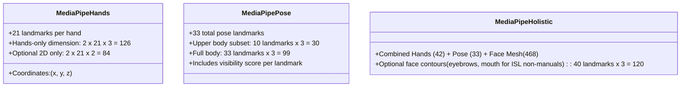

# SignBridge AI: Backend Architecture & Implementation Plan

**Document ID:** `03-backend-plan`
**Status:** Planning & API Blueprint (Technically Reviewed)
**Primary Reference:** `docs/project-blueprint.pdf` (Sections 7, 8, 11, 12, 14, 18)
**Last Updated:** 2026-11-13

---

## 1. Overview & Objectives

The backend service for **SignBridge AI** is built using **Python 3.10+** and **FastAPI**. It functions as the gateway and orchestration engine responsible for:
- Providing secure, validated REST endpoints for web clients.
- Managing video ingestion with strict ephemeral temporary buffering and deterministic cleanup.
- Preprocessing video frames with an experimentally justified temporal sampling strategy.
- Extracting geometric skeletal landmarks via MediaPipe (evaluating candidate feature dimensions).
- Executing candidate baseline sequence models in PyTorch without pre-approving an architecture prematurely.
- Applying validation-based confidence calibration and input quality checks to govern abstention.
- Generating bilingual outputs (English text and Hindi translation) via human-verified phrase mappings or evaluated NMT.
- Managing domain context without artificially forcing translations.

---

## 2. Project Directory Structure

The `backend/` directory follows a modular, layered FastAPI architecture:

```text
backend/
├── app/
│   ├── __init__.py
│   ├── main.py                     # FastAPI application factory & lifespan context
│   ├── core/
│   │   ├── __init__.py
│   │   ├── config.py               # Pydantic Settings (env vars, temporal limits, thresholds)
│   │   ├── security.py             # CORS origins, rate limits, request header validation
│   │   └── calibration.py          # Temperature scaling & confidence calibration utilities
│   ├── api/
│   │   ├── __init__.py
│   │   ├── router.py               # Main API router mounting all v1 routes
│   │   └── v1/
│   │       ├── __init__.py
│   │       ├── health.py           # Health check, model status & device diagnostics
│   │       ├── domains.py          # Domain list and validated scope metadata
│   │       └── inference.py        # Video ingestion, translation & re-translation endpoints
│   ├── schemas/
│   │   ├── __init__.py
│   │   ├── health.py               # Schemas for system health & readiness
│   │   ├── domains.py              # Schemas for domain definitions & phrase metadata
│   │   └── inference.py            # Schemas for requests, calibrated results & abstentions
│   └── services/
│       ├── __init__.py
│       ├── video_processor.py      # OpenCV video decoding, temporal sampling & cleanup
│       ├── feature_extractor.py    # MediaPipe landmark extraction & normalization
│       ├── model_runner.py         # PyTorch inference wrapper (candidate baseline models)
│       └── translator.py           # English to Hindi translation service (lookup + NMT)
├── tests/
│   ├── __init__.py
│   ├── conftest.py                 # Pytest fixtures & mock video generators
│   ├── test_health.py              # Health check test cases
│   ├── test_domains.py             # Domain endpoint test cases
│   ├── test_video_processing.py    # Frame sampling, temporal limits & file cleanup tests
│   ├── test_calibration.py         # Confidence calibration & temperature scaling tests
│   └── test_inference.py           # Inference flow, quality gating & abstention tests
├── requirements.txt                # Production dependencies
├── requirements-dev.txt            # Development, linting & testing dependencies
├── Dockerfile                      # Container definition for reproducible deployment
└── .env.example                    # Template for environment configuration
```

---

## 3. Configuration & Environment Variables

All runtime settings are managed through Pydantic's `BaseSettings` in `app/core/config.py`:

```python
from pydantic_settings import BaseSettings
from typing import List

class Settings(BaseSettings):
    PROJECT_NAME: str = "SignBridge AI Backend"
    API_V1_STR: str = "/api/v1"
    DEBUG: bool = False

    # CORS Configuration
    ALLOWED_ORIGINS: List[str] = [
        "http://localhost:5173",
        "http://127.0.0.1:5173"
    ]

    # Temporal Preprocessing & Video Ingestion Limits
    MAX_VIDEO_SIZE_MB: int = 25
    MIN_VIDEO_DURATION_SEC: float = 1.0
    MAX_VIDEO_DURATION_SEC: float = 8.0     # Realistic upper bound for phrase signing
    TARGET_SAMPLE_FPS: int = 20            # Balanced sampling to preserve hand motion without frame explosion
    MAX_SEQUENCE_LENGTH: int = 160         # Full 8.0s @ 20 FPS (8.0 * 20 = 160 frames)

    # Calibrated Confidence & Quality Gating
    CALIBRATED_CONFIDENCE_THRESHOLD: float = 0.50  # Validation-calibrated decision threshold
    MIN_LANDMARK_DETECTION_RATIO: float = 0.60     # Must detect hands in >= 60% of processed frames
    HAND_DETECTION_MODE: str = "any_hand"          # "any_hand" (default for unimanual/bimanual), or "both_hands"
    TEMPERATURE_SCALING_FACTOR: float = 1.0        # Learned post-hoc temperature parameter

    # Model Artifact Configuration
    MODEL_WEIGHTS_PATH: str = "models/weights/baseline_isl.pth"
    DEVICE: str = "cpu"                    # "cuda" if dedicated GPU available

    class Config:
        env_file = ".env"
        case_sensitive = True

settings = Settings()
```

---

## 4. API Endpoint Specifications

### 4.1. Health & Readiness (`GET /api/v1/health`)
- **Purpose:** Verifies service health, active device, and model readiness.
- **Response (`200 OK`):**
  ```json
  {
    "status": "healthy",
    "version": "1.0.0",
    "model_loaded": true,
    "model_architecture": "BiLSTM-Baseline (Candidate)",
    "device": "cpu",
    "supported_domains": 7
  }
  ```

### 4.2. Domains & Scope Metadata (`GET /api/v1/domains`)
- **Purpose:** Returns the seven domains, distinguishing validated model scope from future UI scope.
- **Response (`200 OK`):**
  ```json
  {
    "domains": [
      {
        "id": "healthcare",
        "name": "Healthcare",
        "validated_phrases_count": 5,
        "is_model_backed": true,
        "disclaimer": "Assistive communication prototype only. Not certified for medical emergency or diagnosis."
      },
      {
        "id": "education",
        "name": "Education",
        "validated_phrases_count": 4,
        "is_model_backed": true,
        "disclaimer": "Assistive communication prototype only."
      }
    ]
  }
  ```

### 4.3. Video Translation Inference (`POST /api/v1/inference/translate`)
- **Consumes:** `multipart/form-data`
- **Parameters:**
  - `video`: Binary video clip (`video/webm` or `video/mp4`, max 25 MB).
  - `domain`: String identifier (e.g. `"healthcare"`).
  - `target_language`: String (`"en"` or `"hi"`).

#### Success Response (`200 OK`)
```json
{
  "status": "success",
  "domain": "healthcare",
  "english_text": "Where is the doctor?",
  "hindi_text": "डॉक्टर कहाँ हैं?",
  "calibrated_confidence": 0.82,
  "confidence_tier": "high",
  "abstained": false,
  "inference_latency_ms": 320,
  "quality_metadata": {
    "duration_sec": 3.4,
    "frames_processed": 68,
    "landmarks_detected_ratio": 0.95
  }
}
```

#### Honest Abstention Response (`200 OK`)
Triggered when calibrated confidence falls below threshold or hand tracking is degraded:
```json
{
  "status": "abstained",
  "domain": "healthcare",
  "english_text": "",
  "hindi_text": "",
  "calibrated_confidence": 0.36,
  "confidence_tier": "low",
  "abstained": true,
  "reason": "Calibrated confidence below decision threshold or hands occluded.",
  "guidance": "Please ensure both hands remain inside the camera guide and repeat your sign clearly.",
  "quality_metadata": {
    "duration_sec": 2.1,
    "frames_processed": 42,
    "landmarks_detected_ratio": 0.45
  }
}
```

### 4.4. Bilingual Re-Translation (`POST /api/v1/inference/retranslate`)
- **Purpose:** Allows user to explicitly re-generate Hindi text from a manually edited English sentence.
- **Consumes:** `application/json` (`{"english_text": "Where is the nurse?", "domain": "healthcare"}`)
- **Response (`200 OK`):**
  ```json
  {
    "english_text": "Where is the nurse?",
    "hindi_text": "नर्स कहाँ हैं?",
    "method": "human_verified_dictionary",
    "domain": "healthcare"
  }
  ```

---

## 5. Temporal Preprocessing & Video Ingestion Pipeline

### Resolving the Sampling Rate vs. Sequence Length Mismatch
Previous draft specifications contained a severe mathematical contradiction: claiming $25\text{ FPS}$, a sequence length of $T=60$, and a $12\text{ second}$ maximum clip.
- At $25\text{ FPS}$, $12\text{ seconds}$ equals $300\text{ frames}$.
- Truncating $300\text{ frames}$ to $60$ retains only the first $2.4\text{ seconds}$ (discarding up to $80\%$ of the sign sentence).
- Conversely, downsampling $12\text{ seconds}$ into $60\text{ frames}$ drops the frame rate to $5\text{ FPS}$, causing severe motion aliasing that obscures finger transitions.

```mermaid
flowchart LR
    Upload[Uploaded Video WebM/MP4] --> Ephem[Ephemeral Temp File on Disk]
    Ephem --> CV[OpenCV VideoCapture]
    CV --> DurCheck{Duration Check: 1.0s to 8.0s?}
    DurCheck -- No --> Reject[400 Bad Request]
    DurCheck -- Yes --> Sample[Uniform Temporal Sampling @ 20 FPS]
    Sample --> Clean[Deterministic Temp File Deletion via finally block]
    Sample --> MP[MediaPipe Landmark Extraction]
    MP --> Tensor[Feature Tensor (1, T, D) with Masking]
```

### Proposed Preprocessing Strategy:
1. **Realistic Clip Duration Bound:** Enforce client and server clip bounds of **$1.0\text{ to }8.0\text{ seconds}$**, which fully covers typical sentence-level phrases.
2. **Standardized Sampling Rate ($20\text{ FPS}$):** Sampling at $20\text{ FPS}$ captures rapid hand articulations without generating excessive computational load ($20\text{ FPS} \times 4\text{s} = 80\text{ frames}$).
3. **Dynamic Sequence Handling:**
   - Rather than rigidly truncating all inputs to 60 frames, the pipeline uses variable sequence handling:
   - For recurrent architectures (LSTM/GRU), sequences are padded up to the maximum batch length and processed with PyTorch's `pack_padded_sequence`.
   - For temporal convolution / attention architectures, a dynamic boolean attention mask is applied to ignore padded frames.
   - The final maximum sequence bound ($T_{\max}$) will be set after analyzing the duration histogram of the chosen training dataset.

---

## 6. Visual Feature Extraction: MediaPipe Candidate Dimensions

### Defining the Feature Representation Rigorously
The feature vector dimension must not be treated as a fixed constant ($156$) without experimental verification. MediaPipe offers multiple tracking solutions with distinct coordinate semantics and landmark counts:



### MediaPipe Hand Landmarker Configuration Parameters:
When configuring the MediaPipe Hand Landmarker (`mediapipe.tasks.vision.HandLandmarker`), three distinct operational parameters govern detection and tracking:
1. `min_hand_detection_confidence`: Minimum confidence score required by the palm detection model to consider palm detection successful in an image.
2. `min_hand_presence_confidence`: Minimum confidence score required by the hand landmark detector model to confirm hand presence and output hand landmark coordinates.
3. `min_tracking_confidence`: Minimum tracking confidence; in the MediaPipe Tasks API, this specifies the bounding-box IoU (Intersection-over-Union threshold between predicted bounding boxes across successive video frames) required to continue tracking without re-triggering palm detection.

*Initial Configuration Defaults:* In MediaPipe Tasks, these three parameters default to `0.5`. These values serve strictly as initial library configuration defaults, not as experimentally validated SignBridge AI thresholds. Optimal operating thresholds must be tuned empirically during feature extraction experiments on the target video dataset.

### Candidate Feature Configurations to Evaluate:
1. **Configuration A (Hands Only — Minimal Baseline):**
   - Left Hand ($21 \times 3$) + Right Hand ($21 \times 3$) = **$126\text{ dimensions}$**.
   - *Rationale:* Focuses purely on manual gestures; highly robust to clothing and body size variations.
2. **Configuration B (Hands + Upper Body Pose — Proposed Baseline / Unresolved Formulation):**
   - Left Hand ($63$) + Right Hand ($63$) = $126$ hand coordinates.
   - For an exact $156$-dimensional vector, $30$ pose values are required, corresponding to **exactly 10 distinct MediaPipe Pose landmarks** ($10 \times 3 = 30$).
   - A symmetrical 10-landmark candidate subset comprises 5 bilateral landmark pairs:
     1. Left shoulder (landmark `11`)
     2. Right shoulder (landmark `12`)
     3. Left elbow (landmark `13`)
     4. Right elbow (landmark `14`)
     5. Left wrist (landmark `15`)
     6. Right wrist (landmark `16`)
     7. Left hip (landmark `23`)
     8. Right hip (landmark `24`)
     9. Left ear (landmark `7`)
     10. Right ear (landmark `8`)
   - *Anatomical Note & Unresolved Status:* In sign language, `nose` (landmark `0`) is commonly used as a central head and gaze anchor. However, because human upper-body anatomy is bilaterally symmetrical around the nose, adding `nose` to bilateral pairs produces an odd landmark count:
     - 7 landmarks ($7 \times 3 = 21$ values $\to \mathbf{147\text{-D}}$): Nose (`0`), Shoulders (`11, 12`), Elbows (`13, 14`), Wrists (`15, 16`).
     - 9 landmarks ($9 \times 3 = 27$ values $\to \mathbf{153\text{-D}}$): Above 7 + Hips (`23, 24`).
     - 11 landmarks ($11 \times 3 = 33$ values $\to \mathbf{159\text{-D}}$): Above 9 + Ears (`7, 8`).
   - Consequently, the exact upper-body landmark subset and its resulting dimension (126-D, 147-D, 153-D, 156-D, or 159-D) is officially marked as **unresolved**. It will be determined through empirical ablation experiments on the target dataset during Phase 2.
3. **Configuration C (Hands + Pose + Face Non-Manual Markers):**
   - Hands ($126$) + Upper Pose ($30$) + Selected Facial Contours ($20\text{ lip/eyebrow landmarks} \times 3 = 60$) = **$216\text{ dimensions}$**.
   - *Rationale:* Captures grammatical facial cues in ISL (questions, negations).

> **Architectural Decision:** The candidate baseline begins with **Configuration A ($126$-d)** or an experimentally justified upper-pose subset (**Configuration B: 147-d to 156-d**). The final feature dimension will be decided empirically during Phase 2 feature extraction benchmarks, balancing tracking reliability, missingness rates, and model accuracy.

### Coordinate Normalization:
- **Center of Mass Normalization:** Translate all coordinates relative to the midpoint between left and right shoulders:
  $$\vec{p}_{\text{norm}} = \vec{p} - \vec{p}_{\text{mid-shoulder}}$$
- **Scale Invariance:** Normalize by the Euclidean distance between shoulders (shoulder width).
- **Missing Hand Handling:** When a hand is not detected (e.g. one-handed sign), set coordinate values to $0.0$ and append a binary hand-presence indicator flag.

---

## 7. Machine Learning Inference & Architecture Feasibility

### Status of Sequence Modeling Architectures
- **Baseline Candidate:** A lightweight Bidirectional GRU or BiLSTM with temporal attention pooling is retained as a primary baseline candidate.
- **Alternative Baselines:** 1D Temporal Convolutional Networks (1D-CNN / TCN) and small Transformer encoders will be compared alongside RNN baselines.
- **Decision Rule:** No architecture is permanently approved until dataset feasibility, annotation type (closed-set classes vs. continuous glosses vs. text), and training stability have been empirically established.

### Distinguishing Model Paradigms in Code:
```python
# Baseline Closed-Set Classification Head (Suitable for initial bounded prototype)
class ISLSequenceClassifier(nn.Module):
    def __init__(self, input_dim: int, hidden_dim: int, num_classes: int):
        super().__init__()
        self.embedding = nn.Linear(input_dim, hidden_dim)
        self.rnn = nn.GRU(hidden_dim, hidden_dim, batch_first=True, bidirectional=True)
        self.attention = nn.Linear(hidden_dim * 2, 1)
        self.classifier = nn.Linear(hidden_dim * 2, num_classes)

    def forward(self, x, lengths=None):
        # x: (B, T, D)
        embeds = torch.relu(self.embedding(x))
        out, _ = self.rnn(embeds)
        weights = torch.softmax(self.attention(out), dim=1)
        pooled = torch.sum(out * weights, dim=1)
        logits = self.classifier(pooled)
        return logits
```
*Note: If the selected dataset supports sequence-to-sequence translation (e.g. ISLTranslate), the classification head is replaced with an autoregressive text decoder.*

---

## 8. Calibrated Confidence & Abstention Gating

### Why Raw Softmax is Inadequate
Standard neural networks trained with cross-entropy loss produce uncalibrated softmax scores:
$$P(\hat{y} = k \mid x) = \frac{e^{z_k / 1.0}}{\sum_j e^{z_j}}$$
Modern deep models frequently output high probabilities ($>0.95$) on ambiguous, corrupted, or out-of-distribution (OOD) inputs. Relying on raw softmax as "confidence" leads to severe false-positive predictions.

### Calibration & Abstention Strategy:
1. **Temperature Scaling:** Learn a scalar parameter $T_s > 0$ on held-out validation data to calibrate logits:
   $$\hat{P}_k = \frac{e^{z_k / T_s}}{\sum_j e^{z_j / T_s}}$$
   Optimize $T_s$ to minimize Negative Log-Likelihood (NLL) and Expected Calibration Error (ECE).
2. **Quality-Aware Multi-Criteria Abstention:**
   The backend abstains and returns an informative prompt if **any** of the following conditions occur:
   - Calibrated Confidence $\hat{P}_{\max} < \tau$ (e.g., $\tau = 0.50$).
   - Landmark detection ratio $< 0.60$ under the active detection mode.
   - Video duration $< 1.0\text{s}$ or $> 8.0\text{s}$.
   - Hand motion energy is near zero (static posture with no movement).

3. **Definition & Calculation of Landmark Detection Ratio:**
   Indian Sign Language encompasses both unimanual (one-handed) and bimanual (two-handed) signs. Hand requirements vary by individual lexical sign rather than by broad application domain (a single domain such as Healthcare contains both unimanual signs like "Water" and bimanual signs like "Doctor").

   Importantly, the $0.60$ (60%) detection ratio is a separate application-level quality gate calculated from actual hand landmark detection outputs (whether valid 21-point landmark collections were successfully extracted for a frame), distinct from MediaPipe's internal detector confidence thresholds. The detection ratio is formulated as:
   - **Active-Hand Mode (`HAND_DETECTION_MODE = "any_hand"`, Default):**
     $$R_{\text{active}} = \frac{1}{T} \sum_{t=1}^{T} \mathbb{I}(\text{Left Hand landmarks present} \lor \text{Right Hand landmarks present}) \ge 0.60$$
     A frame is valid if valid landmark outputs are returned for at least one hand.
   - **Bimanual Mode (`HAND_DETECTION_MODE = "both_hands"`):**
     $$R_{\text{bimanual}} = \frac{1}{T} \sum_{t=1}^{T} \mathbb{I}(\text{Left Hand landmarks present} \land \text{Right Hand landmarks present}) \ge 0.60$$
     Selected when an individual sign's lexical annotation or validated requirement specifies mandatory two-handed signing.
   - **Provisional Status & Limitations:** The $0.60$ threshold is a provisional, application-level quality gate and remains configurable via `MIN_LANDMARK_DETECTION_RATIO = 0.60` until empirical testing on dataset dropouts. Fast motion blur, hand-over-hand self-occlusion, or edge-of-frame positions can cause temporary tracking losses.

---

## 9. Privacy Architecture & Ephemeral Processing

### Correcting the "Zero Disk Storage" Myth
Video decoders (OpenCV with FFmpeg backends) typically require a seekable filesystem path or temporary file descriptor to demux container headers (WebM EBML / MP4 atoms). Claiming "zero disk storage" while using temporary files is contradictory.

### Accurate Privacy & Ephemeral Processing Guarantees:
1. **Ephemeral Temporary Buffering:** Ingested video bytes are written to an ephemeral temporary file located in the operating system's temporary directory (`tempfile.NamedTemporaryFile`).
2. **Deterministic Cleanup via `try ... finally`:**
   ```python
   temp_path = None
   try:
       with tempfile.NamedTemporaryFile(delete=False, suffix=".webm") as temp_file:
           temp_path = temp_file.name
           temp_file.write(await video.read())
           temp_file.flush()

       # Execute OpenCV decoding and frame sampling
       frames = sample_video_frames(temp_path, target_fps=settings.TARGET_SAMPLE_FPS)
   finally:
       # Deterministic immediate unlinking
       if temp_path and os.path.exists(temp_path):
           try:
               os.remove(temp_path)
           except OSError as e:
               logger.error(f"Failed to delete ephemeral file {temp_path}: {e}")
   ```
3. **No Long-Term Video Persistence:** Video files are never uploaded to cloud buckets (S3/GCS), never saved to persistent database records, and never written to permanent disk paths.
4. **Minimal Privacy-Preserving Logging:** Backend request logs record only timestamps, domain IDs, frame counts, and processing latency. Raw video frames, user facial images, and recognized text are never written to disk logs.
5. **In-Transit Security:** All client-backend communication in production is enforced over HTTPS with TLS 1.3.

---

## 10. Backend Testing Strategy

Comprehensive automated tests will be executed with **`pytest`**:

| Test Module | Path | Objectives & Assertions |
| :--- | :--- | :--- |
| **Health & Config** | `tests/test_health.py` | Verify `/health` returns 200, checks model load status, CORS headers. |
| **Domain Metadata** | `tests/test_domains.py` | Verify all 7 domains are returned with scope indicators and disclaimers. |
| **Video Preprocessing** | `tests/test_video_processing.py` | Verify duration clipping, rejection of non-video formats, frame rate resampling, and zero lingering files in temp folder. |
| **Calibration & Gating** | `tests/test_calibration.py` | Verify temperature scaling produces calibrated probabilities and evaluates ECE on validation sets. |
| **Inference & Abstention** | `tests/test_inference.py` | Verify that low-confidence clips and clips without detected hands return `status: "abstained"` with clear guidance. |
| **Re-Translation** | `tests/test_inference.py` | Verify `/retranslate` correctly looks up or translates edited English sentences into Hindi without altering English state. |
| **Ephemeral File Deletion** | `tests/test_video_processing.py` | Verify that even if OpenCV raises an exception during decoding, the temporary file on disk is guaranteed deleted by the `finally` block. |
