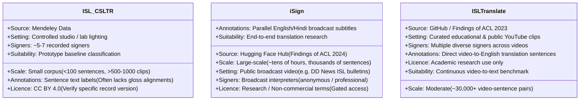
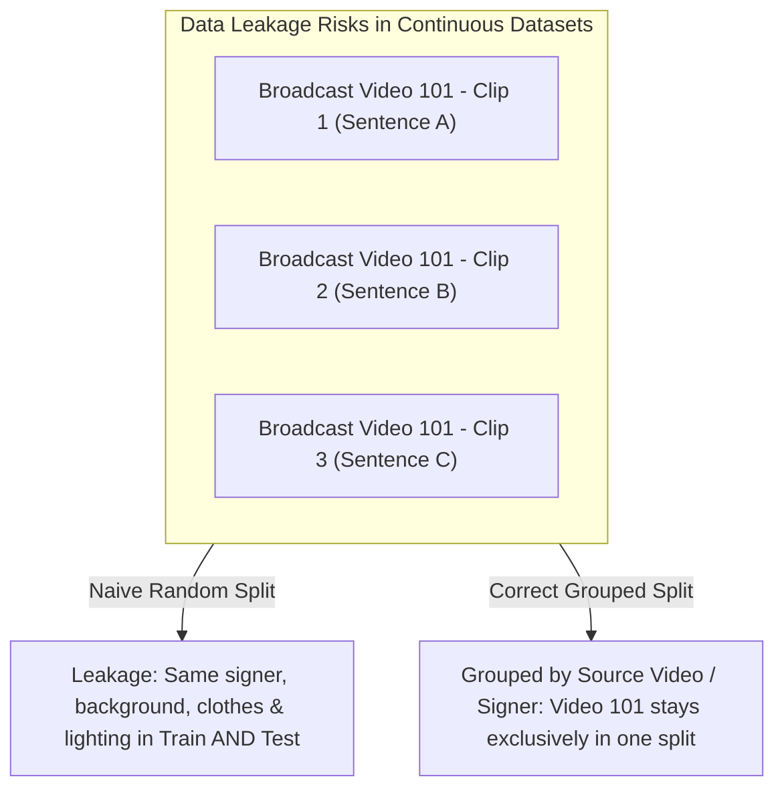
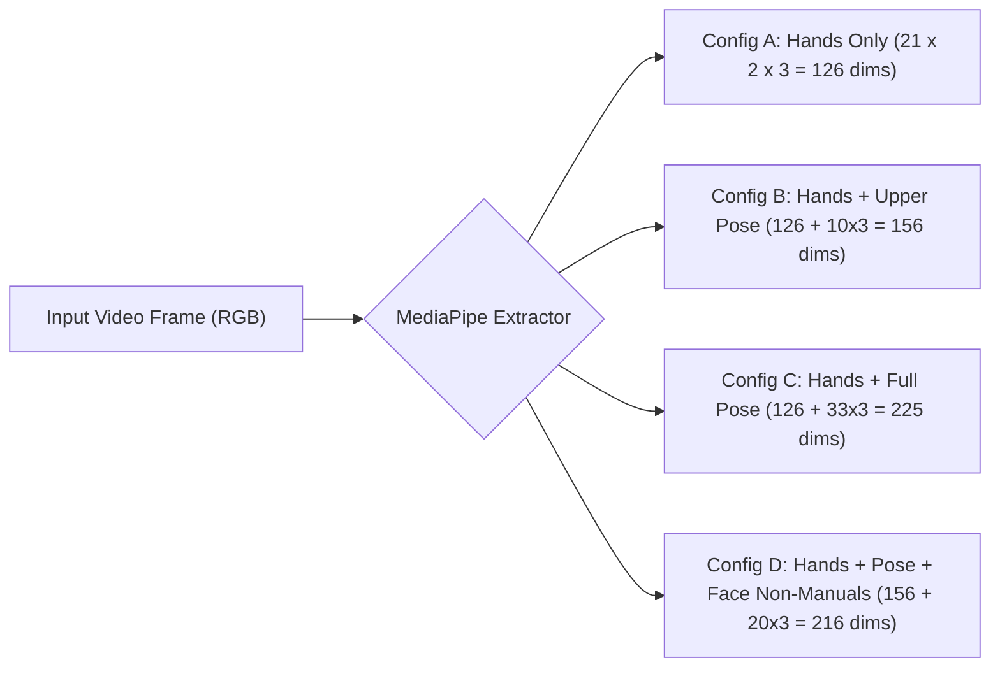
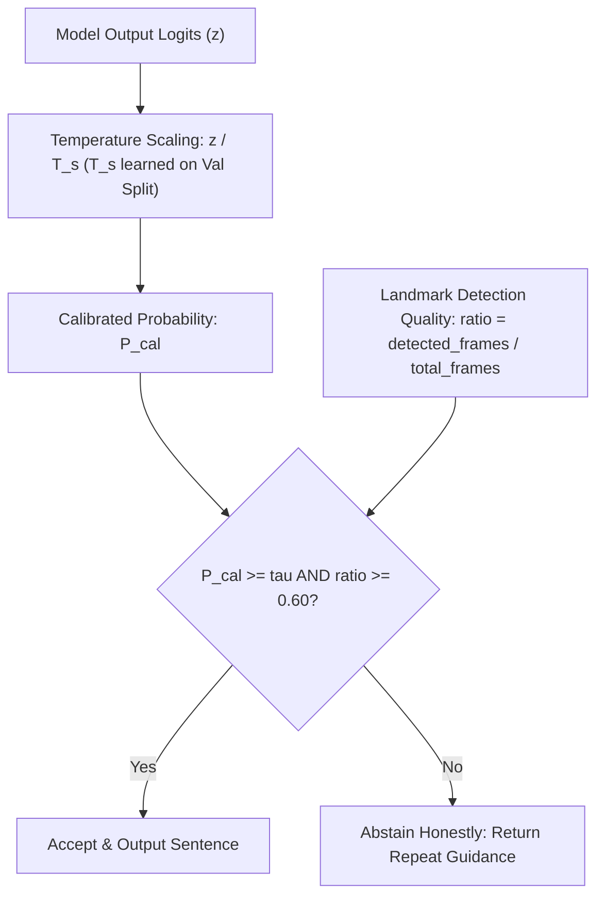

# SignBridge AI: Dataset Research & Machine Learning Plan

**Document ID:** `04-dataset-and-ml-plan`
**Status:** Planning & ML Research Blueprint (Technically Reviewed)
**Primary Reference:** `docs/project-blueprint.pdf` (Sections 9, 10, 14, 15, 20)
**Last Updated:** 2026-11-13

---

## 1. Overview & Machine Learning Objectives

SignBridge AI investigates machine learning methods to interpret Indian Sign Language (ISL) signing sequences and produce meaningful written text. Real-world sign communication involves continuous hand movement, fluid transitions between signs (coarticulation), two-handed coordination, facial expressions, and upper-body posture.

### Clear Distinction of Machine Learning Paradigms
To avoid conflating distinct computer vision and NLP tasks, the project defines and separates three distinct paradigms:

```mermaid
flowchart TD
    subgraph Paradigm1 ["1. Closed-Set / Fixed Sentence Classification"]
        P1In["Input: Full video clip of signing sequence"]
        P1Model["Temporal Model (e.g. BiLSTM / 1D-CNN) + Pooling"]
        P1Out["Output: 1-of-K predefined sentence labels (e.g., K=50)"]
        P1In --> P1Model --> P1Out
    end

    subgraph Paradigm2 ["2. Gloss-Based Recognition & Translation (CSLR + SLT)"]
        P2In["Input: Video frame sequence"]
        P2CSLR["CSLR Model (CTC Loss) -> Discrete Gloss Sequence [D-O-C-T-O-R, PAIN]"]
        P2SLT["SLT Model (Seq2Seq / Grammar) -> Fluent Spoken Text"]
        P2In --> P2CSLR --> P2SLT
    end

    subgraph Paradigm3 ["3. Continuous Video-to-Text Translation (End-to-End SLT)"]
        P3In["Input: Visual feature sequence (T, D)"]
        P3Seq2Seq["Direct Encoder-Decoder / Cross-Modal Transformer"]
        P3Out["Output: Tokenized Natural Text (English / Hindi)"]
        P3In --> P3Seq2Seq --> P3Out
    end
```

- **Scientific Boundary:** A 50-class sentence classifier is **closed-set sentence classification**, **not** unrestricted continuous sign language translation. While an initial prototype baseline may use closed-set classification over validated domain phrases for feasibility, it must be documented honestly as such.

---

## 2. In-Depth Audit of Candidate ISL Datasets

The implementation blueprint identifies three primary candidate resources. Each dataset exhibits distinct properties, licensing constraints, annotation structures, and research limitations:

### Detailed Dataset Comparison & Characteristics

| Parameter / Dimension | **ISL-CSLTR** | **iSign** | **ISLTranslate** |
| :--- | :--- | :--- | :--- |
| **Hosting Platform** | Mendeley Data | Hugging Face Hub | GitHub / Academic Repository |
| **Academic Reference** | Continuous Sign Language Research | Findings of ACL 2024 | Findings of ACL 2023 |
| **Primary Domain** | Controlled daily phrases | News broadcasts, public announcements | Educational, public domain topics |
| **Annotation Level** | Sentence-level text labels | Parallel sentence translations | Parallel sentence-pair translations |
| **Gloss Availability** | ⚠️ **Unverified** (Do not assume tokenized glosses exist) | ❌ **No glosses** (Direct speech/subtitle text) | ❌ **No glosses** (Direct video-to-text pairs) |
| **Visual Environment** | Controlled studio, uniform background | Mixed broadcast insets, news overlays, compression | Web video, variable resolutions, lighting |
| **Signer Metadata** | Signer IDs usually documented | Anonymous interpreters; repeated broadcast signers | Signers not individually tagged across all clips |
| **Licence & Access** | Open access (CC BY 4.0) | Gated access via Hugging Face token; research only | Non-commercial research licence; citation required |
| **Major Limitations** | Small vocabulary, limited signer diversity | Domain shift (news signing $\neq$ colloquial conversational ISL) | Signer identity not cleanly isolated across clips |

> ### 🛑 Rules for Dataset Handling
> 1. **Do Not Assume Gloss Annotations Exist:** Neither iSign nor ISLTranslate contains verified, frame-aligned gloss sequences. They are parallel video-to-text corpora. Gloss-based CTC architectures cannot be applied unless gloss annotations are explicitly verified.
> 2. **Do Not Combine Datasets Arbitrarily:** Datasets originate from different signers, regional dialects of ISL, frame rates, and visual conditions. They must not be pooled without rigorous domain adaptation and alignment checks.
> 3. **Verify Download Licences:** Commercial use or public deployment of models trained on academic-only datasets is prohibited without explicit licensing compliance.

---

## 3. Signer-Independent Splitting & Video Grouping Strategy

### Correcting the Hypothetical S1–S10 Split
Previous drafts utilized an invented toy example (`S1–S10`). In real-world sign language modeling, naive random splitting or fictional signer lists cause catastrophic data leakage:

### Real-World Partitioning Rules:
1. **Source Video & Broadcast Grouping:**
   - Where a dataset derives from segmented broadcast or continuous recordings (e.g. iSign, ISLTranslate), multiple sentence clips originate from the exact same recording session, signer, lighting setup, and camera angle.
   - **Mandatory Rule:** All clips originating from the same source video identifier (`video_id` or `channel_id`) must be assigned to the **same split**. Placing one clip in train and another in test constitutes severe background and signer leakage.
2. **Explicit Signer Separation (ISL-CSLTR):**
   - For datasets with verified signer identifiers, partitioning must be strictly disjoint across signers:
     - **Training Set ($\sim 70\%$ of signers):** Used for parameter optimization.
     - **Validation Set ($\sim 15\%$ of signers):** Used for hyperparameter tuning and post-hoc confidence calibration.
     - **Test Set ($\sim 15\%$ of signers):** Held-out signers evaluated strictly once for final reporting.
3. **Report Split Distributions Honestly:**
   - Documentation must report the actual number of signers, total clips, and vocabulary coverage for each split.

---

## 4. Temporal Preprocessing & Sampling Strategy

### Analysis of Frame Rates, Duration, and Sequence Lengths
To resolve the contradiction between frame rates ($20\text{--}25\text{ FPS}$), sequence lengths ($T$), and video durations ($1\text{--}8\text{ seconds}$):

$$\text{Total Frames} = \text{Duration (seconds)} \times \text{Sampling Rate (FPS)}$$

| Video Duration | At 25 FPS | At 20 FPS | At 15 FPS |
| :--- | :--- | :--- | :--- |
| **2.0 seconds** (Short phrase) | 50 frames | 40 frames | 30 frames |
| **4.0 seconds** (Average sentence) | 100 frames | 80 frames | 60 frames |
| **6.0 seconds** (Long sentence) | 150 frames | 120 frames | 90 frames |
| **8.0 seconds** (Maximum bound) | 200 frames | 160 frames | 120 frames |

### Experimentally Justified Strategy:
1. **Avoid Extreme Downsampling:** Hand and finger articulators in ISL move at speeds requiring at least **$15\text{ to }20\text{ FPS}$** to prevent motion aliasing. Downsampling to $5\text{ FPS}$ destroys sign clarity.
2. **Standardize Target Sampling Rate ($20\text{ FPS}$):** Provides a robust compromise between capturing fluid gestures and bounding sequence length.
3. **Dynamic Sequence Handling:**
   - Rather than forcing all clips to an arbitrary fixed 60 frames, the DataLoader will pad clips dynamically to the maximum length within each batch (`torch.nn.utils.rnn.pad_sequence`).
   - For recurrent models, `pack_padded_sequence` ensures that zero-padding does not distort recurrent hidden states.
   - The maximum sequence upper bound is set to $T_{\max} = 160$ frames (corresponding to the full 8.0-second video duration cap at 20 FPS).

---

## 5. Visual Feature Extraction: MediaPipe Candidate Representations

### MediaPipe Hand Landmarker Configuration Parameters:
When configuring the MediaPipe Hand Landmarker (`mediapipe.tasks.vision.HandLandmarker`), three distinct parameters control extraction stages:
1. `min_hand_detection_confidence`: Minimum confidence score for the palm detection model to consider palm detection successful.
2. `min_hand_presence_confidence`: Minimum confidence score for the hand landmark detector model to confirm hand presence and produce coordinates.
3. `min_tracking_confidence`: Minimum tracking confidence; in the MediaPipe Tasks API, this represents the bounding-box IoU (Intersection-over-Union) threshold between predicted hand boxes across consecutive frames required to maintain tracking without re-triggering palm detection.

*Configuration Defaults:* These three parameters default to `0.5` in MediaPipe Tasks. These represent initial library defaults, not experimentally validated SignBridge AI thresholds, and will be tuned during Phase 2 extraction benchmarks.

### Candidate Landmark Representations
Do not assume that the 156-dimensional representation is fixed or optimal. MediaPipe provides several distinct extractors:

### Architectural Trade-offs:
1. **Config A (126-d, Hands Only):** Highly robust, completely invariant to clothing and body shapes; misses signs dependent on chest/head spatial indexing.
2. **Config B (Hands + Upper Pose — 156-d or Unresolved Symmetrical Subset):**
   - The 156-D proposal ($126$ hand coords $+ 30$ pose coords) requires **exactly 10 distinct MediaPipe Pose landmarks** ($10 \times 3 = 30$).
   - A symmetrical 10-landmark candidate subset comprises 5 bilateral pairs:
     1. Left & Right shoulders (landmarks `11, 12`)
     2. Left & Right elbows (landmarks `13, 14`)
     3. Left & Right wrists (landmarks `15, 16`)
     4. Left & Right hips (landmarks `23, 24` — torso frame)
     5. Left & Right ears (landmarks `7, 8` — head orientation)
   - *Anatomical Dilemma & Unresolved Status:* Central head anchor `nose` (`0`) is essential for sign gaze/head location. However, adding `nose` to bilateral pairs produces odd landmark counts:
     - 7 landmarks ($147$-D): Nose (`0`), Shoulders (`11, 12`), Elbows (`13, 14`), Wrists (`15, 16`).
     - 9 landmarks ($153$-D): Above 7 + Hips (`23, 24`).
     - 11 landmarks ($159$-D): Above 9 + Ears (`7, 8`).
   - Consequently, the exact upper-body landmark subset and final dimension (126-D, 147-D, 153-D, 156-D, or 159-D) is officially marked **unresolved**, to be decided via empirical ablation experiments during Phase 2.
3. **Config C (225-d, Hands + Full 33-point Pose):** Includes hips, knees, and lower body (adds unnecessary noise for seated/standing desktop signing).
4. **Config D (216-d, Hands + Upper Pose + Face Mesh Contours):** Adds 20 selected facial landmarks (eyebrows, mouth) to track non-manual grammatical markers. Increases landmark extraction latency.

> **Decision Rule:** Candidate configurations A (126-D), B (147-D to 156-D), and D (216-D) will be evaluated in Phase 2 feature extraction benchmarks. The final dimension will be selected based on detection reliability, extraction latency, and downstream accuracy.

### Coordinate Normalization & Missing Data Strategy:
- **Torso Normalization:** Subtract the midpoint between left and right shoulders from all $(x, y, z)$ coordinates.
- **Scale Invariance:** Normalize all coordinates by the inter-shoulder distance.
- **Missing Landmark Masking:** When a hand is not detected, set coordinates to $0.0$ and provide an explicit binary presence mask channel to the model.

---

## 6. Sequence Modeling Baselines & Candidate Architectures

### Evaluation of Candidate Baselines
No architecture will be permanently approved until dataset feasibility is confirmed through baseline experiments. The following architectures will be evaluated under identical signer-independent splits:

1. **Candidate 1: Bidirectional GRU / LSTM with Temporal Attention:**
   - *Strengths:* Parameter-efficient ($\sim 500\text{k}$ weights), less prone to overfitting on small datasets, robust sequence modeling.
   - *Role:* Primary baseline candidate.
2. **Candidate 2: 1D Temporal Convolutional Network (TCN):**
   - *Strengths:* Parallelizable over time, captures local temporal receptive fields, stable gradients.
   - *Role:* High-throughput alternative baseline.
3. **Candidate 3: Lightweight Transformer Encoder:**
   - *Strengths:* Global attention across all frames.
   - *Risks:* High sample inefficiency; prone to severe overfitting on small-scale sign datasets without extensive pretraining.

---

## 7. Confidence Calibration & Abstention Strategy

### Correcting Softmax Overconfidence
Raw softmax maximum probabilities from deep networks are uncalibrated and cannot be trusted as confidence measures.

### Calibration Protocol:
1. **Temperature Scaling ($T_s$):** Optimize a single temperature scalar $T_s > 0$ on the held-out validation set using negative log-likelihood (NLL).
2. **Expected Calibration Error (ECE):** Measure ECE across 10 confidence bins before and after calibration:
   $$\text{ECE} = \sum_{m=1}^{M} \frac{|B_m|}{N} \left| \text{acc}(B_m) - \text{conf}(B_m) \right|$$
   A calibrated model ensures that an output probability of $0.80$ corresponds to an actual accuracy of approximately $80\%$.
3. **Multi-Criteria Quality Abstention & Detection Ratio:**
   The model abstains if calibrated confidence is below threshold $\tau$ (e.g. $0.50$) or landmark tracking ratio falls below the provisional $0.60$ threshold.
   - **Calculation of Landmark Detection Ratio ($R_{\text{detect}}$):**
     Hand requirements vary by individual lexical sign rather than application domain. A frame is counted as valid if MediaPipe successfully returns a complete 21-point hand landmark collection for that frame, independent of the specific internal detector/presence confidence values used.
     - *Active-Hand Mode (`any_hand`, Default):* $R_{\text{active}} = \frac{1}{T} \sum_{t=1}^{T} \mathbb{I}(\text{Left Hand present} \lor \text{Right Hand present}) \ge 0.60$.
     - *Bimanual Mode (`both_hands`):* $R_{\text{bimanual}} = \frac{1}{T} \sum_{t=1}^{T} \mathbb{I}(\text{Left Hand present} \land \text{Right Hand present}) \ge 0.60$, selected according to individual sign annotations.
   - The $0.60$ threshold is provisional and configurable via `MIN_LANDMARK_DETECTION_RATIO`.
   - *Limitations:* Self-occlusion during two-handed interactions and fast motion blur can cause temporary tracking losses.

---

## 8. Provisional Evaluation Targets & Benchmarks

All evaluation figures previously stated as guaranteed targets are now explicitly marked as **provisional research targets** requiring experimental validation:

| Metric | Proposed Evaluation Focus | Provisional Target (To be verified empirically) |
| :--- | :--- | :--- |
| **Signer-Independent Accuracy** | Exact sentence match on held-out test signers | Provisional target: $>70\%$ on validated phrase subsets |
| **Word Error Rate (WER)** | Token-level editing distance on translated text | Provisional target: $<30\%$ on supported domain vocabulary |
| **BLEU-4 / chrF++** | Translation fluency against parallel reference texts | Provisional target: Benchmark against standard NMT baselines |
| **Abstention Rate on OOD / Noise** | Correct rejection of random waving, out-of-frame, or noise clips | Provisional target: $>85\%$ correct abstention |
| **Expected Calibration Error (ECE)** | Alignment between confidence scores and true accuracy | Provisional target: $\text{ECE} < 0.10$ post-calibration |
| **Inference Latency** | Time from video ingestion to prediction on CPU | Provisional target: $<500\text{ ms}$ |

*Note: Final benchmark targets will be established following the Phase 2 baseline experiments and documented in the Dataset Feasibility Report.*
