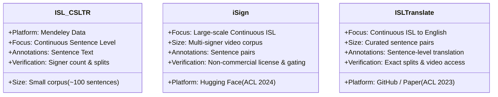
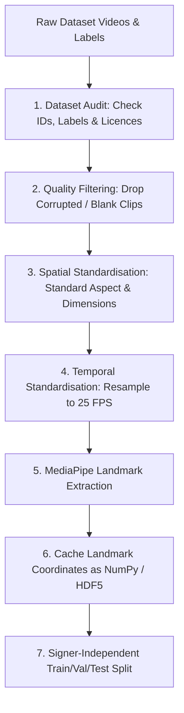
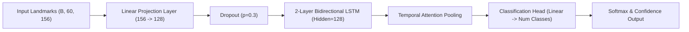

# SignBridge AI: Dataset Research & Machine Learning Plan

**Document ID:** `04-dataset-and-ml-plan`  
**Status:** Planning & ML Research Blueprint  
**Primary Reference:** `docs/project-blueprint.pdf` (Sections 9, 10, 14, 15, 20)  
**Last Updated:** 2026-11-13  

---

## 1. Overview & Machine Learning Objectives

SignBridge AI aims to solve **continuous, sentence-level Indian Sign Language (ISL) translation**. Real-world sign communication does not occur as isolated fingerspelled characters; it involves continuous gestures, fluid transitions between signs (coarticulation), two-handed coordination, facial expressions, and upper-body posture.

### Core ML Goals
1. **Investigate candidate ISL datasets** to identify verifiable licences, annotation schemes, and signer diversity.
2. **Standardize visual feature extraction** using MediaPipe keypoints (hands, pose, and face) to decouple model training from raw video background noise and lighting variances.
3. **Train a reproducible baseline temporal model** (BiLSTM / GRU / 1D-CNN) that maps temporal coordinate sequences into sentence predictions.
4. **Implement rigorous signer-independent evaluation** to measure real generalization and eliminate data leakage.
5. **Establish clear uncertainty boundaries** to abstain from predicting when confidence is inadequate.

---

## 2. Research & Comparison of Candidate ISL Datasets

The implementation blueprint highlights three candidate datasets for investigation. Each requires thorough verification before downloading or training:



### Detailed Dataset Comparison

| Feature / Criterion | **ISL-CSLTR** | **iSign** | **ISLTranslate** |
| :--- | :--- | :--- | :--- |
| **Hosting Platform** | Mendeley Data | Hugging Face Hub | GitHub / Academic Repository |
| **Academic Reference** | Continuous Sign Language Research | Findings of ACL 2024 | Findings of ACL 2023 |
| **Annotation Level** | Sentence-level text labels | Sentence-pair translations | Sentence-pair translations |
| **Gloss Availability** | ⚠️ **Unverified** (Do not assume glosses exist) | ⚠️ **Unverified** (Likely direct sentence pairs) | ⚠️ **Unverified** (Likely direct sequence-to-text) |
| **Corpus Scale** | Small / Moderate (~hundreds of clips) | Substantial / Multi-hour | Moderate to Large |
| **Signer Diversity** | Limited set of signers | Broad diverse signers | Multiple verified signers |
| **Licence Requirements** | Open access / Mendeley licence to verify | Gated Hugging Face access; research licence | Academic research only; citation required |
| **Verification Checklist** | Check video format, resolution, and signer IDs | Check Hugging Face terms, data access token requirements | Check exact video availability and download URLs |

> ### 🛑 Critical Rules for Dataset Handling
> 1. **Do Not Assume Gloss Annotations Exist:** Many modern sign language datasets provide video clips paired directly with full sentence translations, **without intermediate gloss annotations**. If glosses are absent, do not attempt gloss-to-text pipelines; use direct sequence-to-text modeling.
> 2. **Do Not Combine Datasets Without Verification:** Different ISL corpora may use regional signing variations, conflicting sign boundaries, different frame rates, or incompatible licences. Datasets must be evaluated independently first.

---

## 3. Data Audit, Cleaning & Preprocessing Workflow

Before passing any video into a neural network, a rigorous data audit and cleaning pipeline must be executed:



### Data Preprocessing Steps:
1. **Metadata Verification:** Parse CSV/JSON annotation files. Validate that every video file referenced actually exists on disk and is not 0 bytes.
2. **Video Integrity Check:** Run an OpenCV sanity check on every clip (`cv2.VideoCapture`). Drop unreadable or truncated video files.
3. **Temporal Uniformity:** Resample videos to a consistent frame rate ($25\text{ FPS}$). Calculate the distribution of sequence lengths; clip outliers exceeding 12 seconds.
4. **Signer ID Extraction:** Extract signer identity tags to enable independent train/validation/test partitions.

---

## 4. Visual Feature Extraction: MediaPipe Pipeline

Training deep 3D-CNNs directly on raw RGB video requires massive GPU compute and causes models to overfit to background environments, lighting, and clothing. We extract **geometric 3D skeletal landmarks** using **MediaPipe**:

```
Frame (RGB) ──► MediaPipe Hands & Pose ──► Coordinate Extraction ──► Normalization
```

### Extracted Landmark Dimensions per Frame:
- **Left Hand:** 21 landmarks $\times (x, y, z) = 63$ float values.
- **Right Hand:** 21 landmarks $\times (x, y, z) = 63$ float values.
- **Upper Body Pose:** 10 selected landmarks (Nose, left/right shoulders, left/right elbows, left/right wrists, left/right pinky/index) $\times (x, y, z) = 30$ float values.
- **Total Feature Vector ($D$):** $156$ floating-point features per frame.

### Coordinate Normalization Strategy
To ensure the model is invariant to where the signer stands in front of the camera:
1. **Center of Mass Normalization:** Translate coordinates relative to the midpoint between left and right shoulders:
   $$\vec{p}_{\text{norm}} = \vec{p} - \vec{p}_{\text{mid-shoulder}}$$
2. **Scale Invariance:** Divide by the Euclidean distance between shoulders (shoulder width) so that signers closer or further from the camera have comparable feature scales.
3. **Missing Hand Imputation:** If a one-handed sign is performed and the other hand is at the side/undetected, pad the missing hand coordinates with zeros (or a dedicated missingness mask).

---

## 5. Temporal Modeling Strategy & Baseline Architecture

### Why a Lightweight Baseline First?
Starting directly with a massive Transformer or 3D-ResNet often leads to severe overfitting on small-to-medium sign datasets. Following the blueprint, we first implement a robust, lightweight **Bidirectional LSTM / GRU** baseline.



### Baseline Model Architecture Details (`ISLTemporalModel`):
```python
import torch
import torch.nn as nn

class ISLTemporalModel(nn.Module):
    def __init__(self, input_dim=156, hidden_dim=128, num_layers=2, num_classes=50, dropout=0.3):
        super(ISLTemporalModel, self).__init__()
        
        # Projection layer
        self.embedding = nn.Sequential(
            nn.Linear(input_dim, hidden_dim),
            nn.ReLU(),
            nn.Dropout(dropout)
        )
        
        # Bidirectional GRU / LSTM
        self.rnn = nn.GRU(
            input_size=hidden_dim,
            hidden_size=hidden_dim,
            num_layers=num_layers,
            batch_first=True,
            bidirectional=True,
            dropout=dropout if num_layers > 1 else 0
        )
        
        # Self-attention pooling over time
        self.attention = nn.Linear(hidden_dim * 2, 1)
        
        # Final classification head
        self.fc = nn.Linear(hidden_dim * 2, num_classes)
        
    def forward(self, x):
        # x shape: (batch_size, seq_len, input_dim)
        embeds = self.embedding(x)
        out, _ = self.rnn(embeds)  # out shape: (batch_size, seq_len, hidden_dim * 2)
        
        # Attention weights
        attn_weights = torch.softmax(self.attention(out), dim=1)  # (batch_size, seq_len, 1)
        context = torch.sum(out * attn_weights, dim=1)           # (batch_size, hidden_dim * 2)
        
        logits = self.fc(context)  # (batch_size, num_classes)
        return logits
```

---

## 6. Training, Signer Separation & Validation Strategy

### Signer-Independent Partitioning
A common flaw in academic sign language prototypes is mixing the same signer across training and test splits. This results in inflated test accuracy that collapses in real-world usage.

```
Total Signers: S = {S1, S2, S3, S4, S5, S6, S7, S8, S9, S10}
├── Training Set (70%): S1, S2, S3, S4, S5, S6, S7
├── Validation Set (15%): S8, S9
└── Test Set (Held-Out) (15%): S10 (Completely unseen signer)
```

### Hyperparameters & Training Protocol:
- **Optimizer:** AdamW ($\text{lr} = 1\times 10^{-3}$, weight decay $= 1\times 10^{-4}$).
- **Scheduler:** CosineAnnealingLR or ReduceLROnPlateau.
- **Loss Function:** Label Smoothing Cross-Entropy (helps prevent overconfidence).
- **Batch Size:** 16 or 32.
- **Regularization:** Random frame dropout (simulates missed frames) and small Gaussian jitter on landmark coordinates.

---

## 7. Evaluation Metrics & Abstention Benchmark

To evaluate continuous translation quality honestly:

| Metric | Purpose | Target Benchmark |
| :--- | :--- | :--- |
| **Top-1 Sentence Accuracy** | Exact match on validated phrase set | $>75\%$ on held-out signers |
| **Word Error Rate (WER)** | $\text{WER} = \frac{S + D + I}{N}$ (Substitutions, Deletions, Insertions) | $<25\%$ on supported domain phrases |
| **BLEU-4 / ROUGE-L** | N-gram overlap for sentence translation fluency | $>0.50$ BLEU on test references |
| **Abstention Rate on OOD** | Rate of correctly rejecting out-of-domain / random signing | $>90\%$ correct abstention |
| **Latency per Inference** | Time from video ingestion to prediction on CPU | $<400\text{ ms}$ |

---

## 8. Limitations & Fallback Strategy

1. **Unseen Vocabulary Handling:** If the predicted class probability is below threshold ($\tau = 0.55$), the model emits an `ABSTAIN` token. The system never guesses.
2. **Low Lighting Fallback:** If MediaPipe confidence drops below $0.5$ for more than $40\%$ of frames, prompt: *"Lighting is too low or hands are not visible."*
3. **No Fabricated Predictions:** Test suites must verify that noise videos or blank videos yield abstention rather than valid sentences.

