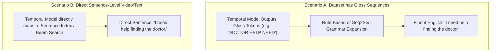
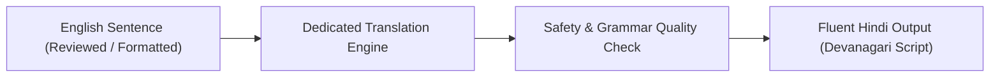
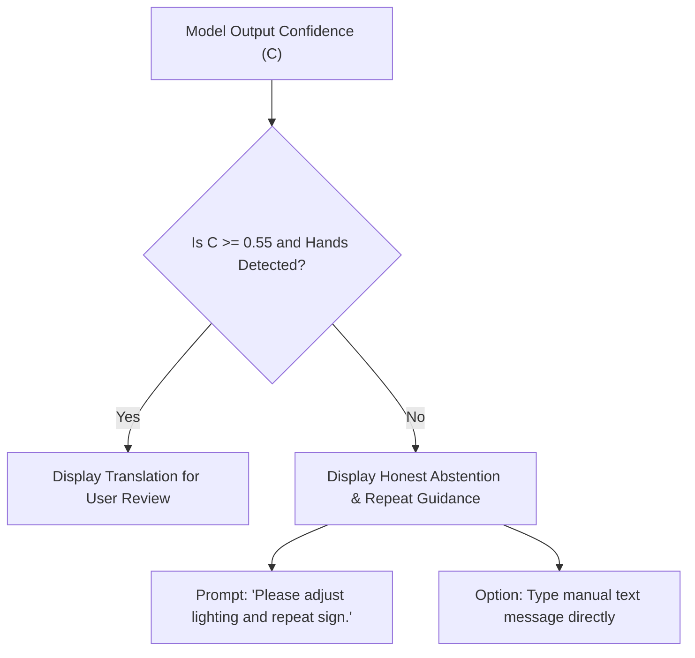

# SignBridge AI: Translation & Speech Synthesis Plan

**Document ID:** `05-translation-and-speech-plan`  
**Status:** Planning & Natural Language / Audio Blueprint  
**Primary Reference:** `docs/project-blueprint.pdf` (Sections 3, 5, 6, 8, 10, 11, 16)  
**Last Updated:** 2026-11-13  

---

## 1. Overview & Dual-Language Objectives

Indian Sign Language (ISL) has its own distinct grammatical rules, syntax, and spatial discourse markers, which do not follow standard English or Hindi word order (ISL generally follows Subject-Object-Verb / SOV structure, with spatial indexing). 

To ensure effective communication between deaf signers and hearing non-signers, **SignBridge AI** provides:
1. **Sentence-Level English Generation:** Synthesizing grammatically fluent, readable English text from recognized signing sequences.
2. **Evaluated Hindi Translation:** Translating the validated English text into natural, accurate Hindi text.
3. **Bilingual Speech Playback:** Enabling native client-side speech output in both English and Hindi.
4. **Mandatory Review & Confirmation Gate:** Requiring user review before audio playback to eliminate misunderstandings.
5. **Safe Handling of Sensitive Domains:** Enforcing strict safeguards for medical, legal, and financial conversations.

---

## 2. ISL Recognition Output to Sentence-Level Text

The translation pipeline operates differently depending on the annotation format of the underlying dataset:



### Text Formatting & Normalization
Regardless of whether Scenario A or B is active:
- Text is cleaned: punctuation is normalized, capitalization is corrected, and common grammatical contractions are regularized.
- The system formats the English sentence with appropriate polite phrasing suitable for public communication.

---

## 3. English to Hindi Translation Architecture

### Translation Strategy Selection
Because Hindi is one of India's most widely spoken languages, providing accurate Hindi text and audio is a core requirement of SignBridge AI.



### Evaluated Translation Approaches:

1. **Approach 1: Domain-Mapped Parallel Vocabulary (Recommended for Prototype Baseline)**
   - For the initial validated scope across the 7 domains, maintain a curated, human-verified bilingual dictionary and phrase pairing lookup.
   - **Advantage:** $100\%$ grammatical accuracy, zero hallucinations, instant latency, zero cloud translation API costs.
   - **Suitability:** Perfect for Phase 2–3 prototype scope.

2. **Approach 2: Neural Machine Translation (NMT) Pipeline (For Scaled Vocabulary)**
   - Integrate an open-source, lightweight multilingual model optimized for Indian languages, such as **IndicTrans2** or **MarianMT (`Helsinki-NLP/opus-mt-en-hi`)**.
   - Can run locally in the Python backend via Hugging Face `transformers`.
   - **Evaluation Requirement:** Every candidate model must be benchmarked on representative healthcare, banking, and transit sentences to verify that domain-critical words (e.g., "prescription", "withdrawal", "emergency") are not mistranslated.

---

## 4. English & Hindi Text-to-Speech (TTS) Architecture

### Browser Web Speech API (`SpeechSynthesis`)
SignBridge AI prioritizes client-side speech synthesis using the standard browser Web Speech API. This guarantees:
- Zero audio bandwidth usage over the network.
- Immediate playback without waiting for audio file downloads.
- Works offline once the frontend bundle is loaded.

```javascript
/**
 * Executes bilingual speech playback with safety checks
 * @param {string} text - Text to speak
 * @param {string} langCode - 'en-US' or 'hi-IN'
 * @param {function} onEndCallback - Triggered when playback finishes
 */
export function playSynthesizedSpeech(text, langCode, onEndCallback) {
  if (!window.speechSynthesis) {
    alert("Speech synthesis is not supported on this device.");
    return;
  }

  // Stop any active utterance
  window.speechSynthesis.cancel();

  const utterance = new SpeechSynthesisUtterance(text);
  utterance.lang = langCode;
  utterance.rate = 0.95; // Clear, comfortable cadence

  // Voice selection strategy
  const availableVoices = window.speechSynthesis.getVoices();
  const selectedVoice = availableVoices.find(voice => 
    voice.lang.toLowerCase().replace('_', '-').startsWith(langCode.toLowerCase())
  );

  if (selectedVoice) {
    utterance.voice = selectedVoice;
  } else {
    console.warn(`Native voice for ${langCode} not found. Falling back to default system voice.`);
  }

  utterance.onend = () => {
    if (onEndCallback) onEndCallback();
  };

  utterance.onerror = (event) => {
    console.error("Speech synthesis error:", event);
  };

  window.speechSynthesis.speak(utterance);
}
```

### Hindi Voice Availability Strategy across Platforms
- **Windows / Edge / Chrome:** Standard Microsoft / Google Hindi voices (`hi-IN`) are widely pre-installed.
- **Android:** Google Text-to-Speech engine provides fluent Hindi speech natively.
- **macOS / iOS:** Lekha / Hindi system voices available.
- **Fallback:** If a browser lacks a Hindi voice pack, the UI informs the user and offers copy-to-clipboard functionality so the user can paste into external assistive speech tools.

---

## 5. Human-in-the-Loop Review & Confirmation Workflow

To prevent awkward or dangerous miscommunications, **SignBridge AI enforces a mandatory confirmation step**:

```
[Inference Completes]
         │
         ▼
[Display Sentence Card]
  ├── English: "Where is the emergency department?"
  └── Hindi:   "आपातकालीन विभाग कहाँ है?"
         │
         ▼
[User Review Action]
  ├── User can click [Edit] to modify wording
  ├── User toggles language selection [English / Hindi]
  └── User clicks [Confirm & Speak]
         │
         ▼
[Speech Synthesizer Plays Confirmed Audio]
```

### Safety Principles:
1. **No Automatic Speech Playback:** Audio **never** plays automatically upon video upload. The user must review the text and explicitly click "Confirm & Speak".
2. **Bidirectional Synchronization:** If a bilingual user edits the English text, the system provides a one-click button to re-generate the Hindi text (or vice versa).
3. **Clear Recording Reset:** Once spoken, a prominent "New Sign" button clears the review card and re-activates the camera preview.

---

## 6. Confidence Scoring & Uncertainty Management

The platform adheres to an honest **Abstention Policy**:

$$\text{Confidence Score } C = P(\hat{y} \mid X) \in [0, 1]$$



### Abstention Messages by Failure Cause:
- **Low Confidence ($C < 0.55$):** *"We were unable to translate this signing sequence with high certainty. Please repeat the sign or type your sentence."*
- **Missing Hand Keypoints ($< 60\%$ frames with hands):** *"Hands were outside the camera guide or moved too quickly. Please ensure both hands remain inside the frame."*
- **Duration Out of Bounds ($<1\text{s}$ or $>10\text{s}$):** *"Recording was too brief to interpret a full sign sentence. Please hold each sign clearly."*

---

## 7. Translation Quality Evaluation & Human Testing

To measure translation fidelity:

1. **Bilingual Evaluation Rubric:**
   - **Fluency:** Is the output natural and grammatically correct in both English and Hindi? (Scored 1 to 5 by native speakers).
   - **Adequacy / Meaning Preservation:** Does the translated sentence faithfully convey the intent of the original ISL sign sequence? (Scored 1 to 5).
2. **Automated Metrics:**
   - **BLEU-4 & chrF++:** For translated English and Hindi sentences against reference ground truth.
   - **WER / CER:** Word Error Rate on transcribed English sentences.
3. **Domain Phrase Coverage:**
   - Maintain a benchmark test suite of 50 common phrases across the 7 domains to verify translation accuracy before any release.

---

## 8. Safe Handling of Sensitive Domain Conversations

In high-stakes environments (Healthcare, Banking, Legal, and Government Services), erroneous translation can lead to adverse real-world consequences:

1. **Prominent Medical & Legal Disclaimer:**
   - An accessible banner is permanently visible on Healthcare and Banking screens:
     > *"SignBridge AI is an assistive communication aid. It is not a certified interpreter for medical diagnosis, legal proceedings, or sensitive financial contracts. Always verify with qualified personnel."*
2. **Explicit Uncertainty over Blind Guessing:**
   - If a user signs a critical medical phrase (e.g., related to dosage or severe chest pain) and the model is unsure, it **must immediately report uncertainty** rather than offering an incorrect interpretation.
3. **One-Tap Emergency Dial / External Hand-off:**
   - On the Healthcare screen, provide quick buttons to clear the screen or call emergency contacts.

