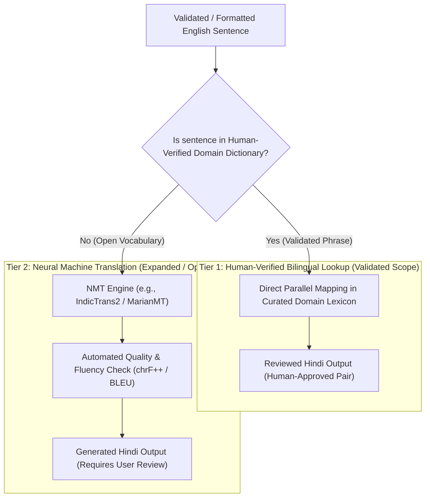
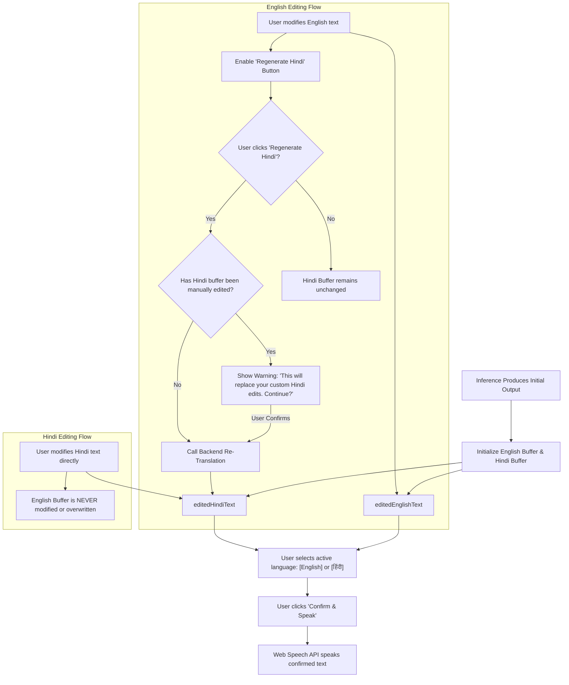
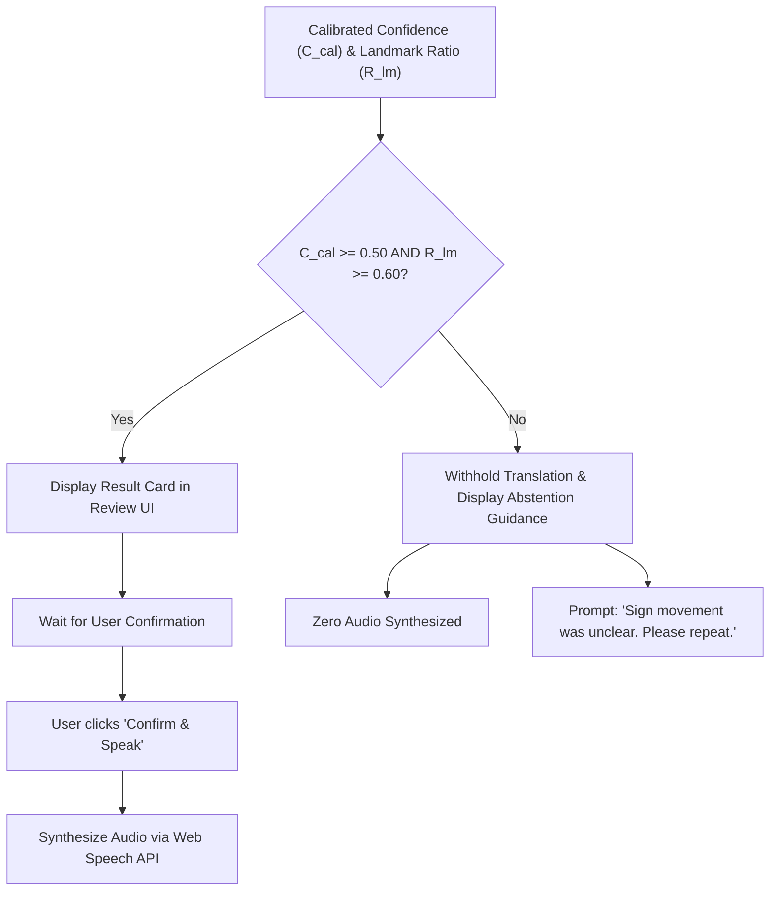

# SignBridge AI: Translation & Speech Synthesis Plan

**Document ID:** `05-translation-and-speech-plan`
**Status:** Planning & Natural Language / Audio Blueprint (Technically Reviewed)
**Primary Reference:** `docs/project-blueprint.pdf` (Sections 3, 5, 6, 8, 10, 11, 16)
**Last Updated:** 2026-11-13

---

## 1. Overview & Dual-Language Objectives

Indian Sign Language (ISL) possesses its own distinct grammatical structure, syntax, and spatial discourse conventions. ISL does not follow English or Hindi grammar; it typically uses a Subject-Object-Verb (SOV) structure with spatial referencing, directional verbs, and non-manual facial markers.

To provide reliable communication between Deaf signers and hearing non-signers, **SignBridge AI** implements:
1. **Sentence-Level English Generation:** Converting recognized signing sequences into clear, grammatically sound English text.
2. **Evaluated Hindi Translation:** Translating the validated English output into natural, accurate Hindi text through a two-tier strategy.
3. **Bilingual Speech Playback:** Enabling client-side speech output in English or Hindi using the browser's native Web Speech API.
4. **Non-Destructive Human-in-the-Loop Review:** Enforcing a review and editing interface with independent language buffers before audio playback.
5. **Domain-Specific Verification:** Applying rigorous human evaluation to critical phrases in healthcare, banking, and public services.

---

## 2. ISL Recognition Output to Sentence-Level Text

The transition from visual model outputs to natural language depends fundamentally on the annotation scheme of the underlying dataset:

```mermaid
flowchart TD
    subgraph ScenarioA ["Scenario A: Closed-Set Sentence Classification"]
        ClassIdx["Model Predicts Class Index (k in 1..K)"]
        LabelMap["Lookup in Validated Sentence Map"]
        EngA["Pre-verified English Sentence: 'Where is the doctor?'"]
        ClassIdx --> LabelMap --> EngA
    end

    subgraph ScenarioB ["Scenario B: Gloss Sequences (CSLR + SLT)"]
        GlossSeq["CSLR Outputs Gloss Sequence (e.g. 'DOCTOR WHERE')"]
        GlossTrans["Grammar Expansion / Seq2Seq Translation"]
        EngB["Synthesized English: 'Where is the doctor?'"]
        GlossSeq --> GlossTrans --> EngB
    end

    subgraph ScenarioC ["Scenario C: Direct Video-to-Text (End-to-End SLT)"]
        SeqTokens["Direct Autoregressive Token Generation"]
        EngC["Generated English: 'Where is the doctor?'"]
        SeqTokens --> EngC
    end
```



- **Scope Boundary:** If the baseline utilizes Scenario A (closed-set classification over validated domain phrases), English sentences are curated and reviewed by human evaluators to ensure grammatical fluency for each predefined target class.

---

## 3. English to Hindi Translation Architecture

### Correcting Hindi Translation Claims
Unrestricted neural machine translation cannot guarantee $100\%$ grammatical accuracy. General NMT models frequently introduce grammatical errors, tense mismatches, honorific inaccuracies, or domain-specific misinterpretations (e.g., mistranslating medical terms).

To ensure safety while enabling vocabulary expansion, SignBridge AI employs a **two-tier translation architecture**:



### Detailed Translation Specifications:

> ### ⚠️ Critical Distinction: Translation Verification vs. ML Recognition Accuracy
> Tier 1 English-Hindi phrase pairs are reviewed and approved by qualified bilingual human reviewers. This approval concerns the stored translation pairs, not visual sign recognition. It does not claim guaranteed 100% grammatical accuracy in every context, and ML visual recognition accuracy and translation quality remain separate evaluation measures.

1. **Tier 1: Human-Verified Domain Phrase Dictionary (Prototype Default)**
   - Curated list of parallel English-Hindi sentence pairs covering the validated subsets across all seven domains.
   - *Translation Quality:* Stored parallel phrases are reviewed and approved by qualified bilingual human reviewers; translation quality and ML visual recognition accuracy remain separate evaluation measures.
   - *Latency:* $< 1\text{ ms}$ (instant dictionary lookup).
   - *Failure Modes:* None for recognized in-vocabulary phrases.
2. **Tier 2: Neural Machine Translation (NMT) for Expanded Vocabulary**
   - For open-ended or newly composed sentences, the backend interfaces with an open-source Indian language translation model, such as **IndicTrans2** or **MarianMT (`Helsinki-NLP/opus-mt-en-hi`)**.
   - *Limitations & Known Risks:*
     - Gender agreement errors (Hindi verbs inflect based on subject gender, which may be ambiguous in English input).
     - Formal vs. informal honorifics (`आप` vs. `तुम`).
     - Vocabulary hallucination on specialized technical terms.
   - *Validation Protocol:* Every candidate NMT model must be benchmarked on a test set of 100 representative domain sentences evaluated by fluent Hindi speakers before deployment.

---

## 4. Non-Destructive Bilingual Editing Workflow

### Correcting the Language Editing Mechanism
Previous drafts suggested bidirectional synchronization where editing either language could automatically re-translate the other. This risks silent overwrites, where manual corrections made in one language are destroyed by edits in the other.

SignBridge AI strictly enforces a **non-destructive, decoupled editing policy**:



### Core Editing Rules:
1. **Independent Buffers:** The frontend maintains two distinct state variables: `editedEnglishText` and `editedHindiText`.
2. **One-Way Explicit Re-Translation:** Modifying English text allows the user to explicitly request a fresh Hindi translation via a dedicated button.
3. **No Silent Hindi Overwrite:** If the user has manually edited Hindi, clicking "Regenerate Hindi" triggers an explicit confirmation dialog warning of data loss.
4. **Strict English Preservation:** Directly typing or editing text in the Hindi buffer **never** triggers back-translation or alters the English text buffer.
5. **Active Speech Selection:** The user explicitly toggles whether the English or Hindi text is passed to the speech synthesizer.

---

## 5. Bilingual Text-to-Speech (TTS) Architecture

### Browser Web Speech API (`SpeechSynthesis`)
SignBridge AI prioritizes client-side speech synthesis using the standard browser Web Speech API:
- Zero cloud bandwidth consumption.
- Zero external API costs.
- Immediate audio generation without waiting for audio file downloads.

```javascript
/**
 * Speaks confirmed text in selected language with voice fallback handling
 * @param {string} text - Final confirmed text string
 * @param {string} langCode - 'en-US' or 'hi-IN'
 * @param {function} onComplete - Callback when playback finishes
 */
export function playConfirmedSpeech(text, langCode, onComplete) {
  if (!('speechSynthesis' in window)) {
    console.warn('Speech synthesis not supported in this browser.');
    return;
  }

  window.speechSynthesis.cancel(); // Terminate any lingering speech

  const utterance = new SpeechSynthesisUtterance(text);
  utterance.lang = (langCode === 'hi' || langCode === 'hi-IN') ? 'hi-IN' : 'en-US';
  utterance.rate = 0.95; // Slightly measured rate for maximum clarity
  utterance.pitch = 1.0;

  // Voice selection strategy
  const availableVoices = window.speechSynthesis.getVoices();
  const matchedVoice = availableVoices.find(voice =>
    voice.lang.toLowerCase().replace('_', '-').startsWith(utterance.lang.toLowerCase())
  );

  if (matchedVoice) {
    utterance.voice = matchedVoice;
  }

  utterance.onend = () => {
    if (onComplete) onComplete();
  };

  utterance.onerror = (event) => {
    console.error('Speech synthesis error:', event);
  };

  window.speechSynthesis.speak(utterance);
}
```

### Voice Availability & Fallbacks
- **English Voices:** Universally available across all modern desktop and mobile browsers.
- **Hindi Voices (`hi-IN`):** Available natively on Android, modern Windows (Microsoft Kalpana / Hemant), and macOS/iOS (Lekha).
- **Fallback Policy:** If the browser reports zero installed Hindi voices, the interface alerts the user and displays a prominent **"Copy Text"** button so the output can be pasted into any external communicator.

---

## 6. Calibrated Confidence & Abstention Policy

### Decision Logic
Audio output directly affects human safety and dignity in public settings. Therefore, speech synthesis is governed by a strict confirmation gate and validation-calibrated confidence:



### Abstention Criteria:
- **Calibrated Confidence Below Threshold ($\hat{P} < 0.50$):** *"We were unable to interpret this signing sequence with high certainty. Please repeat the sign or type your message."*
- **Low Landmark Detection Ratio ($< 0.60$ frames):** *"Hands were not clearly detected within the camera guide. Please ensure active hand(s) remain inside the guide."* (The ratio $R_{\text{active}}$ or $R_{\text{bimanual}}$ is a separate application-level quality gate computed from the count of frames in which MediaPipe returned valid 21-point hand landmark collections, independent of MediaPipe's internal `min_hand_detection_confidence`, `min_hand_presence_confidence`, and `min_tracking_confidence` defaults. The $0.60$ threshold is provisional and configurable).
- **Clip Duration Outside Bounds ($< 1.0\text{s}$ or $> 8.0\text{s}$):** *"Recording duration was outside supported limits (1 to 8 seconds). Please sign at natural speed."*

---

## 7. Translation Evaluation & Quality Benchmarking

To ensure that translations remain accurate and culturally appropriate:

1. **Human Evaluation Rubric (Native Bilingual Evaluators):**
   - **Fluency (1–5 scale):** Evaluates grammatical correctness and natural phrasing in Hindi.
   - **Adequacy (1–5 scale):** Verifies that the translated Hindi sentence faithfully preserves the original meaning of the English sentence.
2. **Automated Metrics (for NMT benchmarking):**
   - **BLEU-4 & chrF++:** Evaluated against parallel bilingual reference corpora.
   - **Provisional Research Target:** BLEU scores comparable to published IndicTrans2 benchmarks on domain subsets.
3. **Medical & Banking Phrase Verification:**
   - All phrases in the Tier 1 dictionary must be reviewed and approved by qualified bilingual human reviewers prior to deployment.
