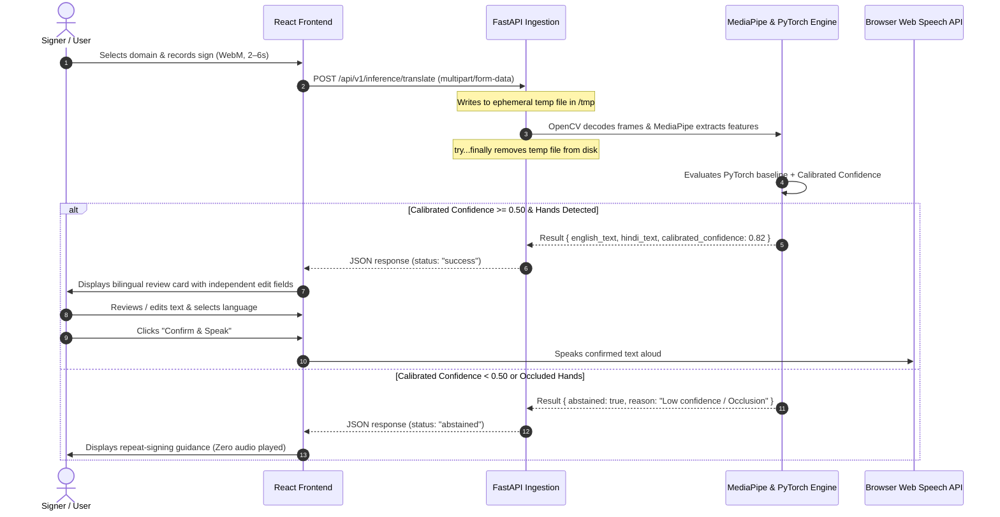
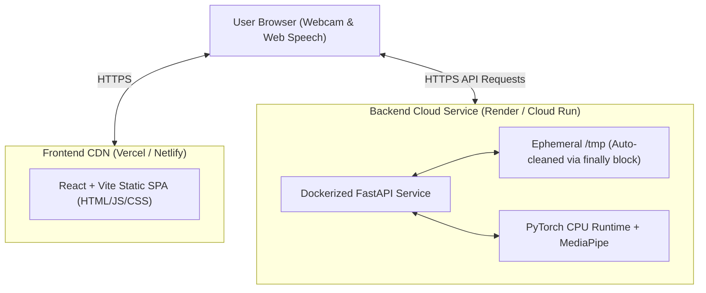

# SignBridge AI: Integration, Testing & Deployment Plan

**Document ID:** `06-integration-testing-deployment`
**Status:** Planning & Operations Blueprint (Technically Reviewed)
**Primary Reference:** `docs/project-blueprint.pdf` (Sections 7, 8, 11, 12, 13, 16, 17, 19)
**Last Updated:** 2026-11-13

---

## 1. Overview & Objectives

This document establishes the end-to-end integration, verification, and deployment plan for **SignBridge AI**:
- Connecting the **React + Vite frontend** with the **FastAPI backend** over HTTPS.
- Integrating trained **PyTorch models** and **MediaPipe feature extractors** into the server lifecycle.
- Defining automated test suites (functional, temporal preprocessing, confidence calibration, non-destructive editing, and privacy).
- Outlining cloud deployment topologies with ephemeral resource constraints.
- Structuring a scientifically honest prototype demonstration that clearly distinguishes between UI domain navigation and validated AI capabilities.

---

## 2. Frontend-to-Backend Integration

### API Client Service (`frontend/src/services/api.js`)
The client communicates with the FastAPI backend using standard multipart and JSON HTTP requests:

```javascript
const API_BASE_URL = import.meta.env.VITE_API_BASE_URL || 'http://localhost:8000';

/**
 * Submits recorded sign video blob for inference
 */
export async function submitSignVideoForTranslation(videoBlob, domainId, targetLang = 'en') {
  const formData = new FormData();
  formData.append('video', videoBlob, 'capture.webm');
  formData.append('domain', domainId);
  formData.append('target_language', targetLang);

  const response = await fetch(`${API_BASE_URL}/api/v1/inference/translate`, {
    method: 'POST',
    body: formData,
  });

  if (!response.ok) {
    const errorData = await response.json().catch(() => ({}));
    throw new Error(errorData.detail || `Translation request failed with status: ${response.status}`);
  }

  return await response.json();
}

/**
 * Requests re-translation of manually edited English text to Hindi
 */
export async function retranslateEnglishText(englishText, domainId) {
  const response = await fetch(`${API_BASE_URL}/api/v1/inference/retranslate`, {
    method: 'POST',
    headers: { 'Content-Type': 'application/json' },
    body: JSON.stringify({ english_text: englishText, domain: domainId }),
  });

  if (!response.ok) {
    throw new Error('Re-translation request failed.');
  }

  return await response.json();
}
```

---

## 3. Model-to-API Lifecycle Integration

### Sequence Flow: Ephemeral Ingestion to Output
The diagram below illustrates the end-to-end lifecycle, highlighting temporary buffering, deterministic cleanup, and mandatory human confirmation:



---

## 4. End-to-End Verification & Testing Matrix

Testing is structured across four rigorous engineering layers. All quantitative targets are marked as **provisional research targets** requiring validation through baseline experiments:

| Testing Dimension | Scope & Focus | Verification Method | Provisional Benchmark Criteria |
| :--- | :--- | :--- | :--- |
| **1. Functional & Camera UI** | • Camera permission handling<br>• Duration clipping (1.0s to 8.0s)<br>• Independent English/Hindi edit buffers<br>• Non-destructive re-translation trigger | Cypress / Playwright E2E tests & manual smoke tests | Clean state transitions; zero unhandled promise rejections; independent edit buffers verified. |
| **2. Temporal & Quality Preprocessing** | • Uniform sampling at 20 FPS<br>• Dynamic sequence padding / masking (up to 160 frames for 8.0s)<br>• Landmark detection ratio (provisional >=0.60, sign-specific any-hand / both-hands mode) | Pytest test suite with synthetic and recorded test video clips | Rejects clips $<1.0\text{s}$ or $>8.0\text{s}$; correctly handles variable sequence lengths up to 160 frames; verifies the application-level landmark detection ratio gate (count of frames with valid 21-point hand landmark outputs, independent of MediaPipe's internal configuration defaults). |
| **3. Model Calibration & Abstention** | • Held-out signer evaluation<br>• Temperature scaling calibration<br>• Abstention on noise or out-of-frame clips | Pytest test suite with held-out validation and test video splits | Provisional target: ECE $<0.10$; correct abstention on uncalibrated/noise inputs. |
| **4. Privacy & Ephemeral Cleanup** | • Deterministic deletion of temporary files<br>• Exception resilience during video decode<br>• Minimal privacy-preserving logging | Automated test checking OS `/tmp` directory before and after requests | Zero orphaned `.webm` / `.mp4` temporary files on disk, even on corrupted input. |

---

## 5. Deployment Architecture & Hosting Strategy



### Hosting & Infrastructure Specifications:
1. **Frontend Hosting (Vercel / Netlify):**
   - Free tier static site distribution.
   - Enforces HTTPS by default (mandatory for browser webcam `getUserMedia` permissions).
2. **Backend Hosting (Render / Google Cloud Run):**
   - Containerized runtime using Linux with CPU-optimized PyTorch.
   - Resource Allocation: $1\text{ to }2\text{ vCPUs}$, $1\text{ GB RAM}$.
   - Ephemeral `/tmp` mount with deterministic file deletion.
   - Keep cold start times manageable by pre-loading model weights during application startup lifespan.

---

## 6. Docker Containerization Specification

```dockerfile
# Multi-stage lightweight Dockerfile for SignBridge AI Backend
FROM python:3.10-slim AS base

# Install system dependencies for OpenCV and MediaPipe headless execution
RUN apt-get update && apt-get install -y --no-install-recommends \
    build-essential \
    libgl1 \
    libglib2.0-0 \
    curl \
    && rm -rf /var/lib/apt/lists/*

WORKDIR /app

# Copy dependency specifications
COPY requirements.txt .

# Install CPU-only PyTorch and application dependencies
RUN pip install --no-cache-dir --upgrade pip && \
    pip install --no-cache-dir torch --index-url https://download.pytorch.org/whl/cpu && \
    pip install --no-cache-dir -r requirements.txt

# Copy application code and model artifacts
COPY app/ ./app/
COPY models/ ./models/

# Expose port and run as non-root user
EXPOSE 8000
USER 1000

CMD ["uvicorn", "app.main:app", "--host", "0.0.0.0", "--port", "8000"]
```

---

## 7. Prototype Demonstration Plan (Distinguishing Model from UI Scope)

To deliver an honest, credible, and defensible academic demonstration:

### Step-by-Step Script:
1. **Problem Statement & Scope Framing (1 min):**
   - Explain the communication gap between Deaf signers and hearing non-signers.
   - Introduce the seven communication domains in the UI.
   - **Crucial Scope Distinction:** Clearly explain that while the interface provides workflow navigation for all seven domains, the current AI model is experimentally evaluated on a validated subset of domain phrases.
2. **Framing & Camera Preview (1 min):**
   - Show the live webcam preview and upper-body framing guide overlay.
   - Explain the privacy architecture: video is processed ephemerally on the server with deterministic immediate cleanup.
3. **Validated Phrase Recognition Demo (2 min):**
   - Select a validated phrase category (e.g. Healthcare: *"Where is the doctor?"*).
   - Sign the phrase at natural speed ($2\text{ to }4\text{ seconds}$).
   - Show the returned review card with the validation-calibrated confidence score.
4. **Bilingual Non-Destructive Review & Speech (1 min):**
   - Demonstrate the editing interface: edit the English text and trigger re-translation; edit Hindi directly without overwriting English.
   - Toggle language to Hindi (`डॉक्टर कहाँ हैं?`) and click **"Confirm & Speak"** to trigger speech synthesis.
5. **Honest Abstention & Repeat Guidance Demo (1 min):**
   - Demonstrate intentional failure: sign out-of-frame or perform a random waving gesture.
   - Highlight that the system **refuses to hallucinate** a random sentence, displaying instead: *"Sign movement was unclear. Please ensure hands are inside the guide and repeat."*
6. **Roadmap & Research Status (1 min):**
   - Conclude by summarizing dataset audit findings, signer-independent evaluation metrics, and next steps for vocabulary expansion.

---

## 8. Known Limitations & Research Roadmap

### Known Prototype Limitations
- **Trained Vocabulary Scope:** Bounded to phrases validated in the training corpus.
- **Lighting & Occlusion Sensitivity:** Fast hand movements or poor contrast against background degrades landmark detection.
- **Single-Signer Constraint:** Optimized for a single signer centered in the camera frame.

### Future Research Roadmap
1. **Continuous Vocabulary Scaling:** Expanding from closed-set domain phrases to continuous video-to-text translation using larger parallel corpora (e.g. iSign).
2. **Edge / On-Device Inference:** Exporting models to ONNX / WebAssembly to run landmark tracking and temporal inference entirely client-side.
3. **Multilingual Regional Expansion:** Supporting additional Indian languages (Tamil, Marathi, Bengali, Telugu) through modular translation layers.
4. **Community Co-Design:** Conducting participatory usability evaluations directly with Deaf ISL signers and accessibility advocates.
