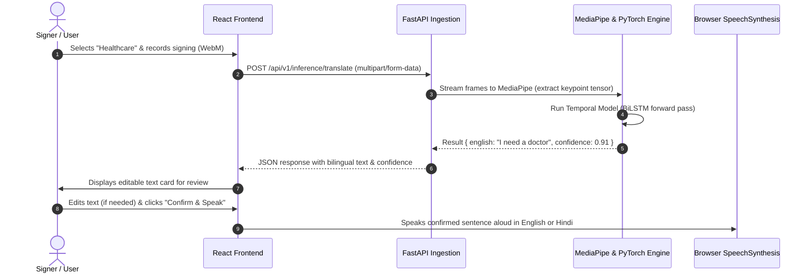
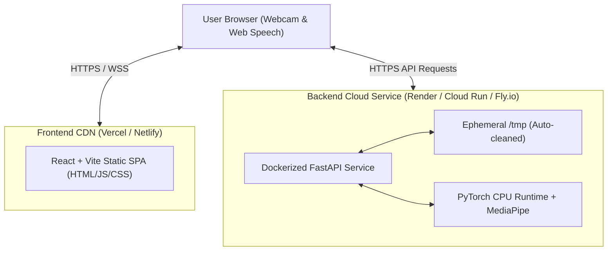

# SignBridge AI: Integration, Testing & Deployment Plan

**Document ID:** `06-integration-testing-deployment`  
**Status:** Planning & Operations Blueprint  
**Primary Reference:** `docs/project-blueprint.pdf` (Sections 7, 8, 11, 12, 13, 16, 17, 19)  
**Last Updated:** 2026-11-13  

---

## 1. Overview & Objectives

This document establishes the end-to-end engineering roadmap to connect all subsystems of **SignBridge AI**:
- Seamlessly integrating the **React + Vite frontend** with the **FastAPI backend**.
- Integrating trained **PyTorch ML models** and **MediaPipe feature extractors** into the production API.
- Defining automated and manual test strategies (functional, latency, accessibility, and privacy).
- Outlining cloud deployment options (Vercel/Netlify for frontend, Render/Cloud Run for backend).
- Preparing a scripted prototype demonstration that honestly distinguishes between validated AI capabilities and full UI domain scope.

---

## 2. Frontend-to-Backend Integration

### API Client Service (`frontend/src/services/api.js`)
The frontend communicates with the FastAPI service using standard REST conventions over HTTPS.

```javascript
const API_BASE_URL = import.meta.env.VITE_API_BASE_URL || 'http://localhost:8000';

export async function submitSignVideoForTranslation(videoBlob, domainId, targetLang = 'en') {
  const formData = new FormData();
  formData.append('video', videoBlob, 'capture.webm');
  formData.append('domain', domainId);
  formData.append('target_language', targetLang);

  const response = await fetch(`${API_BASE_URL}/api/v1/inference/translate`, {
    method: 'POST',
    body: formData,
  });

  if (!response.ok) {
    const errorData = await response.json().catch(() => ({}));
    throw new Error(errorData.detail || `Translation failed with status: ${response.status}`);
  }

  return await response.json();
}
```

### Environment Configuration & CORS
- **Frontend (`frontend/.env`):**
  ```env
  VITE_API_BASE_URL=http://localhost:8000
  ```
- **Backend (`backend/.env`):**
  ```env
  ALLOWED_ORIGINS=["http://localhost:5173", "https://signbridge.vercel.app"]
  ```

---

## 3. Model-to-API Integration

### In-Memory Model Lifecycle
To guarantee fast response times, the PyTorch model and MediaPipe extractors are loaded into memory once during the application startup lifespan:



---

## 4. End-to-End Verification & Testing Matrix

Testing is structured across four rigorous layers:

| Testing Dimension | Scope & Focus | Verification Method | Pass Criteria |
| :--- | :--- | :--- | :--- |
| **1. Functional Testing** | • Camera permission granted / denied<br>• Start, stop, and retake recording<br>• Domain switching updates suggested phrases<br>• Language toggle switches between English & Hindi | Cypress / Playwright E2E tests & manual smoke tests | UI handles all camera and navigation flows cleanly with zero console exceptions. |
| **2. Model & Translation Testing** | • Held-out signer evaluation<br>• Sentence classification accuracy<br>• Confidence threshold gating<br>• Abstention on noise or out-of-frame clips | Pytest test suite with recorded benchmark test clips | Top-1 accuracy $>75\%$ on validated set; $>90\%$ correct abstention on noise inputs. |
| **3. Performance & Latency** | • Video upload time<br>• Landmark extraction speed<br>• PyTorch forward pass latency<br>• Memory usage during multi-request load | Locust load testing & latency timers in API headers | Total end-to-end latency $<1.5\text{ seconds}$ on standard broadband connection. |
| **4. Privacy & Security** | • Ephemeral video storage verification<br>• Zero persistent video on disk<br>• Input sanitization & file size limits<br>• HTTPS transport enforcement | Security audit scripts inspecting `/tmp` and log outputs | No user video files remain on disk after response; no raw video URLs exposed. |

---

## 5. Deployment Architecture & Hosting Strategy



### Hosting Recommendations
1. **Frontend Hosting:**
   - **Platform:** **Vercel** or **Netlify**.
   - **Cost:** Free tier.
   - **Features:** Automatic CI/CD deployment on git push, global CDN distribution, HTTPS by default (mandatory for browser webcam `getUserMedia` permissions).
2. **Backend Hosting:**
   - **Platform:** **Render.com** (Web Service) or **Google Cloud Run**.
   - **Cost:** Free or low-cost pay-as-you-go containerized hosting.
   - **Runtime:** Linux container with Python 3.10, libgl1-mesa-glx (required for OpenCV headless), and CPU-optimized PyTorch wheels (`--extra-index-url https://download.pytorch.org/whl/cpu`).
   - **Cold Start Mitigation:** Keep container memory footprint under $512\text{ MB}$; implement a health ping every 10 minutes to prevent container sleep during demonstrations.

---

## 6. Docker Containerization Specification

To avoid environment discrepancies between development and production, the backend will be containerized:

```dockerfile
# Multi-stage lightweight Dockerfile for SignBridge AI Backend
FROM python:3.10-slim AS base

# Install system dependencies for OpenCV and MediaPipe
RUN apt-get update && apt-get install -y --no-install-recommends \
    build-essential \
    libgl1-mesa-glx \
    libglib2.0-0 \
    curl \
    && rm -rf /var/lib/apt/lists/*

WORKDIR /app

# Copy dependency specifications
COPY requirements.txt .

# Install CPU-only PyTorch and application dependencies
RUN pip install --no-cache-dir --upgrade pip && \
    pip install --no-cache-dir torch --index-url https://download.pytorch.org/whl/cpu && \
    pip install --no-cache-dir -r requirements.txt

# Copy application source code
COPY app/ ./app/
COPY models/ ./models/

# Expose port and configure non-root user
EXPOSE 8000
USER 1000

CMD ["uvicorn", "app.main:app", "--host", "0.0.0.0", "--port", "8000"]
```

---

## 7. Prototype Demonstration Plan

To deliver a compelling, professional, and scientifically honest demonstration:

### Step-by-Step Demo Script:
1. **Introduction (1 min):**
   - Introduce the problem: deaf individuals face systemic communication barriers in healthcare, banking, and public counters.
   - Show the SignBridge AI home screen and introduce the **Seven Communication Domains**.
2. **Domain Selection & Camera Setup (1 min):**
   - Select the **Healthcare** domain.
   - Show camera permission flow and the responsive upper-body framing guide.
3. **Live Validated Signing Demo (2 min):**
   - Perform a validated sign phrase (e.g., *"I need help finding the doctor"*).
   - Show real-time capture and upload.
   - Point out the returned result card with confidence indicator ($92\%$).
4. **Human Review & Language Toggle (1 min):**
   - Demonstrate the editing interface to show how the user retains full agency.
   - Toggle to **Hindi** (`मुझे डॉक्टर को खोजने में मदद चाहिए।`).
   - Click "Confirm & Speak" to play the clear spoken Hindi audio.
5. **Honest Uncertainty & Abstention Demo (1 min):**
   - Demonstrate a deliberate out-of-frame or random waving gesture.
   - Show that the system **does not hallucinate** a fake sentence, but cleanly displays: *"Sign movement was unclear. Please repeat the sign."*
6. **Roadmap & Conclusion (1 min):**
   - Conclude with architecture overview, dataset research milestones, and future steps.

---

## 8. Known Limitations & Future Enhancements

### Current Prototype Limitations
- **Vocabulary Scope:** Restricted to phrases represented in the validated dataset splits.
- **Lighting Sensitivity:** In extreme low-light environments, MediaPipe hand keypoint confidence degrades.
- **Single-Signer Camera View:** Optimized for a single signer positioned directly in front of the camera; multiple overlapping people in frame can cause landmark confusion.

### Future Roadmap
1. **Expansion to Additional Indian Languages:** Support Marathi, Bengali, Tamil, Telugu, and Kannada via modular translation components.
2. **On-Device Edge Inference:** Compile the PyTorch model to ONNX / TensorFlow.js / WebAssembly to run landmark and temporal classification entirely inside the user's browser, eliminating server compute costs and network latency.
3. **Continuous Dialogue Mode:** Support multi-turn back-and-forth conversations where the hearing partner's spoken response is automatically converted into text and displayed on the signer's screen.
4. **Community Co-Design:** Conduct structured usability testing directly with Deaf community members, ISL educators, and accessibility specialists.

