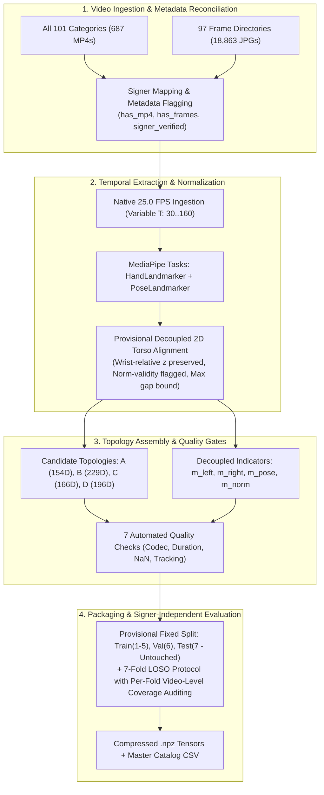
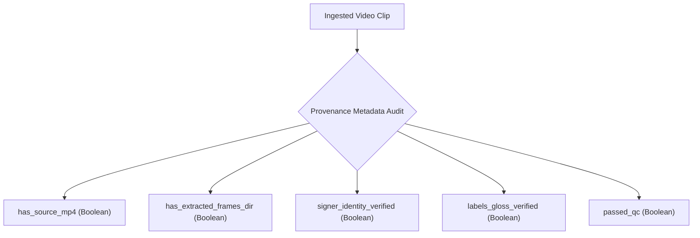
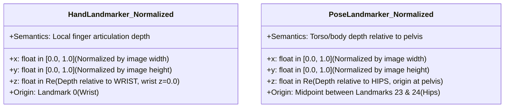
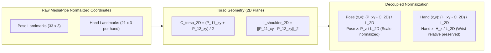
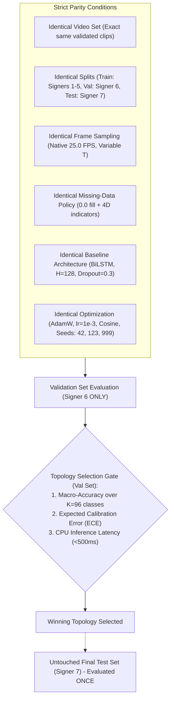
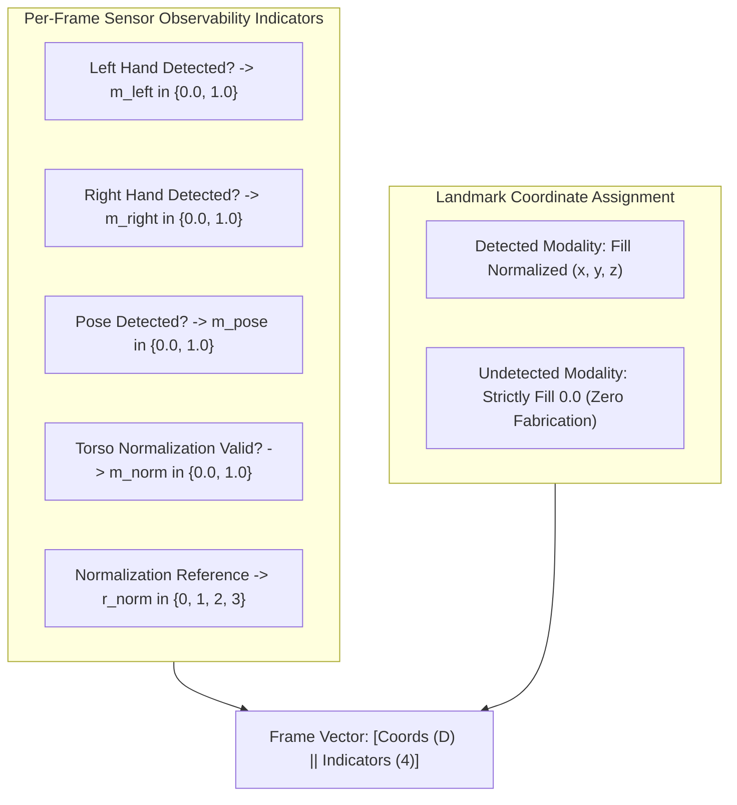

# SignBridge AI: Preprocessing Pipeline Data Contract & Architectural Specification
## ISL-CSLTR Continuous Sign Language Corpus (Final Review Edition)

**Document ID:** `docs/preprocessing-design.md`
**Milestone:** Step 2.3A — Preprocessing Pipeline Design
**Author:** SignBridge AI ML Engineering
**Date:** November 2026 (Final Revision — Pre-Implementation Sign-off)
**Status:** Architecture Proposal & Data Contract (Awaiting Formal Sign-off)
**Target Dataset:** ISL-CSLTR / ISL-CSLRT (Mendeley Data, CC BY 4.0, 7 signers)
**Primary References:**
- `docs/project-blueprint.pdf` (Sections 9, 10, 14, 15, 20)
- `docs/dataset-research-audit.md` (Step 2.1 Audit)
- `docs/isl-csltr-inspection-report.md` (Step 2.2A Inspection)
- `docs/mediapipe-feasibility-report.md` (Step 2.2B Feasibility Benchmarks)
- `docs/mediapipe-feasibility-report-raw-data.json` (Empirical Metrics)

---

## 1. Executive Summary & Design Governance

This specification defines the **preprocessing pipeline data contract** for transforming raw Indian Sign Language (ISL) recordings from the ISL-CSLTR dataset into machine learning–ready visual landmark representations.

### Scientific & Engineering Governance
1. **Zero Data Fabrication:** Missing landmarks resulting from occlusions, rapid motion blur, or single-handed gestures must **never be filled with fabricated coordinates or linear interpolation**. Missing observations are explicitly set to $0.0$ and accompanied by decoupled presence and normalization indicators.
2. **Empirically Grounded Choices:** Every design proposal is grounded in verified metadata audits and empirical feasibility metrics from Steps 2.1, 2.2A, and 2.2B.
3. **Strict Separation of Design from Implementation:** This document establishes data schemas, validation gates, coordinate math, and evaluation protocols. No pipeline execution, bulk video processing, or model training is conducted until this specification receives final approval.



---

## 2. Distinction Between Verified Dataset Facts and Proposed Design Choices

To maintain strict scientific integrity, all statements in this specification are explicitly partitioned into verified empirical facts versus design hypotheses:

| Dimension | Verified Dataset Fact `[FACT]` | Proposed Design Choice `[DESIGN]` |
|---|---|---|
| **Archive Content** | Archive contains 687 MP4 videos across 101 sentence categories and 18,863 pre-extracted frames across 97 categories. | Ingest all 101 categories as potential source data, maintaining explicit metadata distinguishing frame-verified vs. video-only categories. |
| **Signer Roster** | 7 signers (IDs '1'–'7'): 2 native deaf signers (1, 2) and 5 student volunteers (3–7). Verified in `ISL_CSLRT.txt`. | Partition signers independently into Train (1–5), Validation (6), and Test (7) for development, with mandatory 7-fold LOSO cross-validation for reporting. |
| **Video Format** | H.264 (avc1) in MP4 container at exactly 25.00 FPS (`timescale=25000`, delta=1000). Resolutions: 1080p and 240p. | Retain native 25.0 FPS without decimation or frame dropping. |
| **Gloss Annotations** | 1-to-1 global sentence-to-gloss mapping table (`ISL Corpus sign glosses.csv`). **No frame-level timestamps exist**. | Frame-level CTC alignment is unsupported; target formulation is closed-set sentence classification (Paradigm 1). |
| **MediaPipe Coordinates** | HandLandmarker: normalized image $(x, y) \in [0, 1]$, wrist $z=0.0$. Pose: image $(x, y) \in [0, 1]$, hip-relative $z$. | Provisional decoupled 2D torso-centering; Hand $z$ scaled by shoulder distance without torso translation; normalization validity explicitly tracked. |
| **Detection Reliability** | On 5 tested videos (448 frames): Pose 100%, Left Hand 40.9%, Right Hand 48.5%, Both Hands 22.3%, Zero Hands 32.9%. | Retain zero coordinates for undetected hands; append explicit modality presence indicators; exclude FaceLandmarker from baseline. |

---

## 3. Category Scope, Video Discovery & Metadata Reconciliation

### 3.1. Retaining All 101 Categories with Explicit Metadata Flagging
The ISL-CSLTR archive contains 101 sentence categories in `Videos_Sentence_Level/`. While 97 of these categories possess unpacked frame subdirectories in `Frames_Sentence_Level/`, **all 101 categories contain valid MP4 video recordings and verified gloss translations**.

To prevent loss of potential training and evaluation data, **all 101 categories are retained**. To ensure full transparency and prevent data leakage, each clip will carry explicit provenance metadata:



#### Detailed Breakdown of the Four Video-Only Categories:
The four categories lacking extracted frame directories were inspected directly in the archive metadata:

| Category Name | Video Count | File Details | Mapped Gloss (`glosses.csv`) | Signer Identity Status |
|---|---|---|---|---|
| **`he would be coming today`** | 7 MP4s | 5 Full HD (14.5–21.5 MB) + 2 Previews (0.19–0.94 MB) | `"HE COMING TODAY"` | `[UNVERIFIED]` (Requires video fingerprinting) |
| **`now onwards he will never hurt you`** | 6 MP4s | 5 Full HD (17.9–24.3 MB) + 1 Preview (0.22 MB) | `"NOW ONWARDS HE NEVER HURT YOU"` | `[UNVERIFIED]` (Requires video fingerprinting) |
| **`i dont agree`** | 1 MP4 | 1 Full HD (`MVI_6494.MP4`, 14.01 MB) | `"I DONT AGREE"` | `[UNVERIFIED]` (Single recorded take) |
| **`No need to worry dont worry`** | 1 MP4 | 1 Full HD (`MVI_6496.MP4`, 13.39 MB) | `"NO NEED WORRY DONT WORRY"` | `[UNVERIFIED]` (Single recorded take) |

- **Core Benchmark ($K=97$):** Comprises the 97 categories where signer identities are 100% verified via the author's frame directory structure.
- **Extended Evaluation ($K=101$):** Incorporates the 4 video-only categories for full-corpus tracking. For `i dont agree` and `No need to worry dont worry`, the single available clip will be assigned strictly to the training split with an explicit flag (`signer_identity_verified = False`), ensuring they do not leak into evaluation splits.

### 3.2. Prohibiting Heuristic Signer Assignment and File Pruning
Historical note on early signer hypotheses vs. verified ground truth:
- **Preliminary Step 2.2 Hypothesis (SUPERSEDED):** An initial visual inspection tentatively assumed that in `are you free today`, `free (2).MP4` corresponded to Signer 2, and `are you free today.mp4` corresponded to Signer 7.
- **Empirical Ground Truth (Step 2.3B Audit):** Direct pixel-level Mean Absolute Error (MAE) comparisons against the author's unpacked JPEGs in `Frames_Sentence_Level/` superseded the preliminary hypothesis and established verified Tier A assignments:
  - `are you free today.mp4` $\to$ **Signer 1** (Native signer; MAE = 1.5155 / 255 against folder `1/`, rotated 90° CW)
  - `free (2).MP4` $\to$ **Signer 4** (Volunteer signer; MAE = 1.0632 / 255 against folder `4/`)
  - `MVI_6209.MP4` $\to$ **Signer 7** (Volunteer test signer; MAE = 1.0855 / 255 against folder `7/`)
  - `are you free today (2).mp4` $\to$ **Signer 2** (Native signer; MAE = 1.077 / 255 against folder `2/`, rotated 90° CW)
- **Evidentiary Distinction (Tier A vs. Tier B):** Only samples with direct video-to-frame pixel comparisons (such as the four above) are designated as **Tier A: Pixel-Verified Ground Truth**. The broader set of 453 corpus mappings are **Tier B: Unique Forensic Trace Matches** (established via unambiguous 1-to-1 bijective stem correspondence with the author's frame directory structure). The 453 mappings must not be described as all being pixel-verified.
- **Rule 1: Never prune videos by file size or bitrate.** Pruning low-bitrate videos would discard valid takes from native signers (e.g. Signers 1 and 2 recorded at QVGA 320×240).
- **Rule 2: Never infer signer identity solely from filename, size, or resolution.** Signer identity must be verified via unambiguous stem matching or pixel verification against `Frames_Sentence_Level/<sentence>/<signer_id>/`. If a video cannot be matched unambiguously to a known signer, its `signer_identity_verified` flag must be set to `False` and routed to quarantine.

---

## 4. Coordinate Systems, Compatibility & Normalization Safeguards

### 4.1. Coordinate Compatibility Between Hand and Pose Landmarkers



#### Empirical Analysis of Coordinate Spaces:
1. **2D Plane Compatibility ($(x, y)$):**
   - Both `hand_landmarks` and `pose_landmarks` output $(x, y)$ in normalized screen coordinates $[0.0, 1.0]$ referenced to the top-left corner of the camera frame.
   - **Conclusion:** Hand $(x, y)$ and Pose $(x, y)$ exist in the **identical 2D reference plane**. Spatial distances and relative positions (e.g. hand distance from chin or shoulder) are geometrically valid.
2. **Depth Incompatibility ($z$):**
   - Hand $z$ origin is fixed at the **wrist (Landmark 0)**. Empirical measurement confirms `wrist (0): z = 0.000000`, with fingertips at $z \approx -0.01$ to $-0.02$. Hand $z$ represents **local finger articulation depth relative to the palm**.
   - Pose $z$ origin is fixed at the **midpoint of the hips**. Shoulder landmarks exhibit $z \approx -0.43$. Pose $z$ represents **upper-body depth relative to the pelvis**.
   - **Mathematical Flaw of Torso $z$-Subtraction:** Subtracting torso shoulder depth ($C_z \approx -0.43$) from Hand $z$ ($0.0$) would shift wrist depth to $+0.43$, artificially placing the hand 43 cm in front of the body regardless of physical posture. Hand $z$ was never measured relative to the torso.
3. **Normalized Image Landmarks vs. World Landmarks:**
   - MediaPipe Pose outputs `pose_world_landmarks` (metric 3D in meters).
   - However, MediaPipe HandLandmarker does **not** output world landmarks in meters; it only outputs normalized image landmarks.
   - Combining Pose World Landmarks (meters) with Hand Image Landmarks ($[0, 1]$ screen coordinates) causes dimensional mismatch.
   - **Decision:** The pipeline operates on **normalized image landmarks** for both modalities.

### 4.2. Provisional Decoupled 2D Torso Alignment
The pipeline adopts decoupled 2D torso-centering as a **provisional candidate**:



#### Mathematical Formulation:
1. **Torso 2D Anchor:**
   $$\mathbf{C}_{\text{torso}}^{2D} = \frac{(x_{11}, y_{11}) + (x_{12}, y_{12})}{2}$$
2. **Torso 2D Scale Factor:**
   $$L_{\text{shoulder}}^{2D} = \sqrt{(x_{11} - x_{12})^2 + (y_{11} - y_{12})^2}$$
3. **Pose Landmark Transformation:**
   $$(x_{i, \text{norm}}, y_{i, \text{norm}}) = \frac{(x_i, y_i) - \mathbf{C}_{\text{torso}}^{2D}}{L_{\text{shoulder}}^{2D}}, \quad z_{i, \text{norm}} = \frac{z_i}{L_{\text{shoulder}}^{2D}} \quad \forall i \in \{0, \dots, 32\}$$
4. **Hand Landmark Transformation:**
   - Spatial translation $(x, y)$ references the torso anchor to preserve bodily signing space:
     $$(x_{j, \text{norm}}, y_{j, \text{norm}}) = \frac{(x_j, y_j) - \mathbf{C}_{\text{torso}}^{2D}}{L_{\text{shoulder}}^{2D}} \quad \forall j \in \{0, \dots, 20\}$$
   - Depth coordinate $z$ is scaled by $L_{\text{shoulder}}^{2D}$ for body-scale invariance, but **retains its wrist-relative origin ($z=0$) without torso translation**:
     $$z_{j, \text{norm}} = \frac{z_j}{L_{\text{shoulder}}^{2D}}$$

---

### 4.3. Normalization Fallback Safeguards, Maximum Time Gap & Validity Tracking

#### No Silent Substitution Rule:
Under no circumstances will fallback reference coordinates be substituted silently as if they were valid observations. Every frame carries an explicit **normalization-validity indicator** ($m_{\text{norm}} \in \{0.0, 1.0\}$) and a **normalization reference code** ($r_{\text{norm}} \in \{0, 1, 2, 3\}$):

| Reference Code ($r_{\text{norm}}$) | Reference Source | Condition | Validity Flag ($m_{\text{norm}}$) |
|---|---|---|---|
| `0` | **Shoulders** (Landmarks 11 & 12) | Visibility of 11 & 12 $\ge 0.50$ AND $L_{\text{shoulder}}^{2D} \ge 0.05$ | **`1.0` (Valid)** |
| `1` | **Hips Fallback** (Landmarks 23 & 24) | Shoulders failed; visibility of 23 & 24 $\ge 0.50$ AND $L_{\text{hip}}^{2D} \ge 0.05$ | **`0.0` (Fallback / Approximate)** |
| `2` | **Temporal Reference Fallback** | Shoulders and hips failed; gap $\Delta t \le \Delta t_{\max}$ frames from last valid reference | **`0.0` (Fallback / Approximate)** |
| `3` | **Frame-Center / Expired Fallback** | All geometric anchors failed OR temporal gap $\Delta t > \Delta t_{\max}$; default center $(0.5, 0.5)$, nominal scale $0.20$ | **`0.0` (Invalid / Stale Expired)** |

#### Maximum Permitted Temporal Gap for Normalization Reference Re-use:
- **Parameter:** `MAX_NORMALIZATION_GAP_FRAMES = 5` frames ($\approx 200\text{ ms}$ at 25 FPS).
- **Status:** **Provisional & Configurable `[PROVISIONAL CONFIG]`**.
- **Rule Against Indefinite Stale Re-use:** When geometric anchors (shoulders and hips) are lost, the pipeline may re-use the most recent valid origin and scale $(\mathbf{C}_{\text{torso}}^{2D}, L_{\text{shoulder}}^{2D})$ for at most $\Delta t_{\max} = 5$ consecutive frames. If the tracking outage persists beyond 5 frames ($\Delta t > 5$), **stale coordinates must not be re-used indefinitely**. The reference is declared expired, and the frame falls back to $r_{\text{norm}} = 3$ (Frame-Center / Invalid) with $m_{\text{norm}} = 0.0$.

#### Explicit Clarifications on Missing Data vs. Reference Anchors:
1. **Never Forward-Fill Missing Landmarks:** Forward-fill was exclusively specified for the reference origin/scale $(\mathbf{C}_{\text{torso}}^{2D}, L_{\text{shoulder}}^{2D})$ within the $\Delta t_{\max}$ window. Landmark coordinates themselves (hands and pose) are **never forward-filled**. If a hand is missing in frame $t$, its coordinates remain strictly $0.0$.
2. **Hip Scaling Factor Status:** The anthropometric ratio $\frac{L_{\text{shoulder}}}{L_{\text{hip}}} \approx 1.25$ is officially classified as an **unvalidated heuristic `[UNVALIDATED HEURISTIC]`**, not an established constant. It must be empirically calibrated against valid frames in Step 2.3B.
3. **Handling Invalid Normalization Frames During Training:**
   - The normalization validity flag $m_{\text{norm}}$ is exposed to the model as an explicit channel alongside landmark presence indicators.
   - If a clip contains $>20\%$ frames with $r_{\text{norm}} = 3$ (frame-center/expired fallback), the clip is quarantined by **QC Gate 4** and excluded from training.
   - For isolated fallback frames ($r_{\text{norm}} \in \{1, 2\}$), the presence of $m_{\text{norm}} = 0.0$ allows temporal attention mechanisms to discount spatial coordinates from that frame.

---

## 5. Candidate Feature Topologies & Fair Comparison Protocol

### 5.1. The Four Candidate Topologies
Four candidate representations are maintained under active investigation. No topology is declared the final winner prior to experimental benchmark evaluation:

| Topology Candidate | Left Hand | Right Hand | Pose | Indicators ($m_L, m_R, m_P, m_{\text{norm}}$) | Total Dims | Technical Rationale & Trade-offs |
|---|---|---|---|---|---|---|
| **Candidate A: Pure 2D** | 42D ($21 \times 2$) | 42D ($21 \times 2$) | 66D ($33 \times 2$) | 4D | **154D** | Eliminates pseudo-depth estimation noise from monocular 2D cameras. Highly stable across diverse cameras, but discards finger curling depth cues. |
| **Candidate B: Full 3D (Provisional Baseline)** | 63D ($21 \times 3$) | 63D ($21 \times 3$) | 99D ($33 \times 3$) | 4D | **229D** | Preserves wrist-relative finger articulation depth ($z$) and full 33-point body pose. Standard MediaPipe schema compliant; requires decoupled normalization. |
| **Candidate C: 3D Hands + Upper Pose** | 63D ($21 \times 3$) | 63D ($21 \times 3$) | 36D ($12 \times 3$) | 4D | **166D** | Retains 3D hands but prunes lower body (keeps Nose 0, Shoulders 11–12, Elbows 13–14, Wrists 15–16, Hips 23–24, Ears 7–8). Focuses parameters strictly on active signing anatomy. |
| **Candidate D: 2.5D Hybrid** | 63D ($21 \times 3$) | 63D ($21 \times 3$) | 66D ($33 \times 2$) | 4D | **196D** | Retains 3D finger depth (where $z$ is physiologically critical) while restricting body pose to 2D image coordinates (avoiding noisy monocular hip-depth estimation). |

*(Note: Dimensions reflect the 4 decoupled indicators: $m_{\text{left}}, m_{\text{right}}, m_{\text{pose}}, m_{\text{norm}}$).*

### 5.2. Strict Parity & Topology Selection Governance
To select the winning feature representation without bias, all four candidates will be evaluated under strict parity:



#### Selection Governance Rule:
- **Validation-Driven Selection:** The winning topology will be selected **strictly based on Validation Set performance (Signer 6)** during Step 2.3B.
- **Untouched Test Policy:** **Signer 7 test results must NEVER be consulted during topology selection or hyperparameter tuning.** The Signer 7 test split remains sealed until the final model architecture and topology are frozen.

---

## 6. Signer-Aware Splitting & Rigorous LOSO Coverage Verification

### 6.1. Rigorous Separation of Evaluation Frameworks
The project maintains two distinct evaluation frameworks that must not be conflated:

1. **Fixed Benchmark Setup (For Model Development & Topology Selection):**
   - **Training Split (66.7% / 12,579 frames):** Signers 1, 2 (native deaf signers) + Signers 3, 4, 5 (student volunteers). Used for model weight optimization.
   - **Validation Split (16.2% / 3,053 frames):** Signer 6 (student volunteer). Used for checkpoint selection, hyperparameter tuning, topology comparison, and temperature calibration.
   - **Final Test Split (17.1% / 3,231 frames):** **Signer 7** (student volunteer). Held out strictly as an untouched final evaluation split. Evaluated only once.
2. **Seven-Fold Leave-One-Signer-Out (LOSO) Cross-Validation (For Scientific Generalization Reporting):**
   - Conducted across all 7 folds to evaluate true inter-signer variance across the entire corpus.
   - Each fold $k \in \{1, \dots, 7\}$ holds out Signer $k$ as test, Signer $(k \bmod 7)+1$ as validation, and the remaining 5 signers as training.

---

### 6.2. Video-Level Audit of the 7-Fold LOSO Coverage Claim
To verify the claim that every fold contains all 97 classes in training, a complete video-level / take-level audit was executed across all signer directories in `Frames_Sentence_Level/`:

#### Verified Video/Take Count per Signer:
- **Signer 1:** 96 categories (Missing 1: `what happened`)
- **Signer 2:** **97 categories** (Covers all 97 categories!)
- **Signer 3:** 96 categories (Missing 1: `do you need something`)
- **Signer 4:** **90 categories** (Missing 7: `do not abuse him`, `he is on the way`, `how are things`, `i am very happy`, `tell me truth`, `what have you planned for your career`, `you do anything, i do not care`)
- **Signer 5:** 96 categories (Missing 1: `what have you planned for your career`)
- **Signer 6:** 96 categories (Missing 1: `what have you planned for your career`)
- **Signer 7:** **95 categories** (Missing 2: `do not be stubborn`, `what have you planned for your career`)

*(Key Observation: `what have you planned for your career` was recorded exclusively by Signers 1, 2, and 3; Signers 4, 5, 6, and 7 never recorded this category).*

#### Video-Level LOSO Coverage Audit:

| Fold ID | Held-Out Test Signer | Inner Val Signer | Training Signers Pool | Train Class Coverage | Unsupported in Test | Active Test Classes ($K_{\text{test}}$) | Classes Missing from Test Split |
|---|---|---|---|---|---|---|---|
| **Fold 1** | Signer 1 (Native) | Signer 2 (Native) | 3, 4, 5, 6, 7 | **97 / 97 (100%)** | **0** | **96** | `what happened` |
| **Fold 2** | Signer 2 (Native) | Signer 3 (Volunteer) | 1, 4, 5, 6, 7 | **97 / 97 (100%)** | **0** | **97** | **None (100% complete)** |
| **Fold 3** | Signer 3 (Volunteer) | Signer 4 (Volunteer) | 1, 2, 5, 6, 7 | **97 / 97 (100%)** | **0** | **96** | `do you need something` |
| **Fold 4** | Signer 4 (Volunteer) | Signer 5 (Volunteer) | 1, 2, 3, 6, 7 | **97 / 97 (100%)** | **0** | **90** | 7 classes missing (e.g. `career`, `abuse`, `happy`) |
| **Fold 5** | Signer 5 (Volunteer) | Signer 6 (Volunteer) | 1, 2, 3, 4, 7 | **97 / 97 (100%)** | **0** | **96** | `what have you planned...` |
| **Fold 6** | Signer 6 (Volunteer) | Signer 7 (Volunteer) | 1, 2, 3, 4, 5 | **97 / 97 (100%)** | **0** | **96** | `what have you planned...` |
| **Fold 7** | Signer 7 (Volunteer) | Signer 1 (Native) | 2, 3, 4, 5, 6 | **97 / 97 (100%)** | **0** | **95** | `career`, `do not be stubborn` |

#### Confirmed Scientific Findings:
1. **Verification of the Training Coverage Claim `[VERIFIED]`:** In all 7 folds, the training split contains at least one example for **all 97 categories** (0 missing in train).
2. **Disparity of Test Tasks `[CRITICAL]`:** The test splits represent **different classification benchmarks**:
   - Fold 2 evaluates over **97 classes**.
   - Folds 1, 3, 5, 6 evaluate over **96 classes**.
   - Fold 7 evaluates over **95 classes**.
   - Fold 4 evaluates over **90 classes**.
3. **Evaluation Protocol Rule:** Folds must **never be compared as though they contain identical tasks**. Final LOSO reporting must document:
   - Active test class count ($K_{\text{test}}^{(k)}$) per fold.
   - Macro-averaged accuracy over active test classes.
   - Sample-weighted micro-averaged accuracy.
   - Mean and standard deviation across all 7 folds ($\mu \pm \sigma$).

### 6.3. Limitations of a Seven-Signer Dataset
- **Idiosyncratic Variance:** Signers differ substantially in signing speed, motion amplitude, and hand positioning. With only 7 signers, inter-signer variance is the dominant performance bottleneck.
- **Demographic Imbalance:** Only 2 of the 7 signers are native deaf signers; the remaining 5 are hearing student volunteers. Folds testing on native signers (Folds 1 and 2) test real-world fluent signing, whereas folds testing on volunteers reflect learned signing styles.

---

## 7. Decoupled Missing-Data Policy & Indicators



### Clarifications on Missing Data:
1. **Four Separate Indicators:** Hand presence ($m_{\text{left}}, m_{\text{right}}$), pose presence ($m_{\text{pose}}$), and normalization validity ($m_{\text{norm}}$) are separate flags.
2. **Zero Coordinates are Not Observations:** Zero coordinates $(0.0, 0.0, 0.0)$ denote **unobserved data**, never a physical gesture at the torso origin. The presence indicator enables neural networks to mask or ignore these inputs.
3. **Temporal Padding Masks are Distinct:** The batch padding mask $\mathbf{M} \in \{0, 1\}^{B \times T_{\max}}$ operates across time steps, whereas the presence indicators operate across modalities within a frame.
4. **No Synthetic Interpolation:** Linear interpolation across missing frames is prohibited in the baseline to prevent generating synthetic gestures.
5. **Quality Gate Triggers:** Clips failing duration bounds ($T < 30$ or $T > 160$), having pose ratio $< 80\%$, or exhibiting excessive normalization failure ($>20\%$ frames with $r_{\text{norm}} = 3$) are automatically quarantined.

---

## 8. Serialized Output Contract & Directory Structure

```text
data/
└── processed/
    └── isl_csltr_tensors_v1/
        ├── manifest.csv                    # Complete clip catalog (clip_id, signer, sentence, split, qc_status)
        ├── label_map.json                  # Slugified sentence to integer ID (K=97 or K=101)
        ├── split_manifest.json             # Signer-independent split assignment dictionary
        ├── train/
        │   ├── clip_0001_s1_c01.npz
        │   └── ...
        ├── val/
        │   ├── clip_0481_s6_c01.npz
        │   └── ...
        ├── test/
        │   ├── clip_0577_s7_c01.npz
        │   └── ...
        └── quarantined/                    # Clips failing QC gates (with failure logs)
            └── clip_xxxx_failed_qc.json
```

### Serialized `.npz` Data Contract
```python
{
    "features": np.ndarray,      # Shape: (T, D), dtype: float32 (D in {154, 166, 196, 229})
    "presence_mask": np.ndarray, # Shape: (T, 4), dtype: bool ([m_left, m_right, m_pose, m_norm])
    "metadata": json.dumps({
        "clip_id": "clip_0001_s1_c01",
        "sentence_id": 1,
        "sentence_text": "are you free today",
        "gloss_text": "YOU FREE TODAY",
        "signer_id": "1",
        "signer_type": "native",
        "original_filename": "free (2).MP4",
        "native_fps": 25.0,
        "frames_extracted": 78,
        "left_hand_ratio": 0.4103,
        "right_hand_ratio": 0.5513,
        "pose_ratio": 1.0000,
        "normalization_valid_ratio": 1.0000,
        "normalization_method": "decoupled_torso_v3",
        "topology": "candidate_b_229d"
    })
}
```

---

## 9. Final Preprocessing Approval Checklist

The table below summarizes all architectural decisions for Step 2.3A, categorized by governance status:

| # | Decision Item | Specification & Scope | Governance Status |
|---|---|---|---|
| **1** | **Coordinate Normalization Strategy** | Decoupled 2D torso-centering: spatial translation on $(x, y)$, wrist-relative depth preserved on Hand $z$. Normalization validity indicator ($m_{\text{norm}}$) and reference code ($r_{\text{norm}} \in \{0, 1, 2, 3\}$). Maximum temporal reference gap bounded by `MAX_NORMALIZATION_GAP_FRAMES = 5` frames ($\approx 200\text{ ms}$). No forward-filling of landmark coordinates. | `[PROPOSED & READY FOR APPROVAL]` |
| **2** | **Feature Topology Experiment** | Support Candidates A (154D), B (229D), C (166D), and D (196D) via `--topology` CLI flag in Step 2.3B. Selection decided strictly by Validation Set (Signer 6) performance under the fair comparison protocol. Signer 7 test set remains untouched. | `[PROPOSED & READY FOR APPROVAL]` |
| **3** | **Dataset Category Scope & Metadata** | Ingest all 101 categories. Maintain explicit provenance metadata separating the 97 frame-verified categories from the 4 video-only categories. Prohibit heuristic signer assignment based on file size/resolution. | `[PROPOSED & READY FOR APPROVAL]` |
| **4** | **Signer-Aware Split & LOSO Protocol** | Fixed benchmark `Train(1–5) / Val(6) / Test(7)` (Signer 7 untouched) + 7-fold LOSO cross-validation with per-fold active test class count reporting ($K_{\text{test}} \in \{90, 93, 95, 96, 97\}$). | `[PROPOSED & READY FOR APPROVAL]` |
| **5** | **Missing-Landmark Representation** | Decoupled 4D indicators ($m_L, m_R, m_P, m_{\text{norm}}$) + zero-filled coordinates for unobserved articulators. Zero synthetic interpolation. | `[PROPOSED & READY FOR APPROVAL]` |
| **6** | **Hip Scaling Factor Heuristic ($1.25$)** | Anthropometric fallback scale ratio $\frac{L_{\text{shoulder}}}{L_{\text{hip}}}$. | `[REQUIRES EMPIRICAL VALIDATION]` |
| **7** | **Signer Assignment for 4 Video-Only Categories** | Direct frame visual fingerprinting against known signer profiles for `he would be coming today`, `now onwards...`, `i dont agree`, and `No need to worry...`. | `[BLOCKED BY MISSING EVIDENCE]` |
