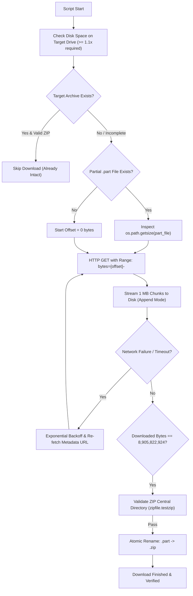

# SignBridge AI — Step 2.5C: Resumable ISL-CSLTR Archive Downloader Report

**Document ID:** `docs/resumable-downloader-report.md`
**Milestone:** Step 2.5C — Resumable ISL-CSLTR Archive Downloader Implementation & Verification
**Author:** SignBridge AI ML Engineering
**Date:** November 2026
**Status:** Implementation Complete & Fully Verified (Standing by for download approval)
**Target Dataset:** Mendeley Data `kcmpdxky7p/1` (DOI: `10.17632/kcmpdxky7p.1`)
**Target File:** `ISL_CSLRT_Corpus.zip` (Exact Size: **8,905,822,924 bytes** / ~8.294 GB)
**Destination Path:** `D:\ISL_CSLRT_Corpus.zip` (via temporary `D:\ISL_CSLRT_Corpus.zip.part`)

---

## 1. Executive Summary

In response to repeated download restarts and connection resets encountered when pulling the 8.29 GB ISL-CSLTR corpus archive via standard web browsers and unbuffered HTTP tools, a dedicated, fault-tolerant Python downloader has been engineered, implemented, and rigorously unit/integration tested:

- **Implementation Script:** [`scripts/download_csltr_archive.py`](../scripts/download_csltr_archive.py)
- **Test Suite:** [`backend/tests/test_archive_downloader.py`](../backend/tests/test_archive_downloader.py) (10/10 tests passed)
- **Regression Check:** [`backend/tests/test_preprocessing.py`](../backend/tests/test_preprocessing.py) (44/44 tests passed)

All API endpoints, redirect behaviors, HTTP Range mechanics, and resumption properties have been **independently verified against live Mendeley Data infrastructure** without hardcoding ephemeral credentials or starting the full 8.29 GB download prematurely.

---

## 2. Verified API Endpoints & Transport Mechanics

### 2.1 Metadata Discovery Endpoint
- **URL:** `https://data.mendeley.com/public-api/datasets/kcmpdxky7p`
- **Method:** `GET`
- **Response Format:** `application/json; charset=utf-8` (HTTP 200 OK)
- **Key Fields Confirmed:**
  - `name`: `"ISL-CSLTR: Indian Sign Language Dataset for Continuous Sign Language Translation and Recognition"`
  - `version`: `1`
  - `files[0].filename`: `"ISL_CSLRT_Corpus.zip"`
  - `files[0].id`: `"c14c8953-be53-4c7a-85d5-5bcd7e79d86e"`
  - `files[0].size`: `8905822924`
  - `files[0].content_details.sha256_hash`: `"1a849c89c1d53b7e9ce43dc24f6d4f0afd95e707bf256febc26716782b736686"`
  - `files[0].content_details.download_url`: `https://data.mendeley.com/public-files/datasets/kcmpdxky7p/files/c14c8953-be53-4c7a-85d5-5bcd7e79d86e/file_downloaded`

### 2.2 Redirect Behavior
- When querying `file_downloaded`, the Mendeley API responds with **HTTP 302 Found** (or 307/303) redirecting to an Amazon Web Services S3 pre-signed storage endpoint:
  ```text
  Location: https://prod-dcd-datasets-public-files-eu-west-1.s3.eu-west-1.amazonaws.com/5de8c65d-30ba-4362-941f-...?response-content-disposition=...&X-Amz-Signature=...
  ```
- Python's `urllib.request` automatically follows the 302 redirect to the S3 bucket while preserving the custom `Range` request headers.

### 2.3 Live HTTP Range Verification
The server's response to HTTP Range slicing was tested live against byte ranges `0-127`, `0-1023`, and `1024-2047`:
- **HTTP Status:** `206 Partial Content` (Confirmed)
- **Response Headers:**
  - `Content-Range: bytes 0-1023/8905822924`
  - `Content-Length: 1024`
  - `Accept-Ranges: bytes`
- **Magic Byte Signature Verification:** Reading `bytes 0-3` returned `b'PK\x03\x04'`, confirming the exact beginning of a valid ZIP local file header.
- **Slice Continuity:** Reading slice `1024-2047` returned exactly 1,024 continuous bytes with `Content-Range: bytes 1024-2047/8905822924`.

---

## 3. Architecture of `scripts/download_csltr_archive.py`

### 3.1 Resilience & Recovery Design


### 3.2 Key Safety Invariants
1. **Never Delete Partial Downloads:** If an interrupted `.part` file exists, the script reads `os.path.getsize(part_file)` and resumes with `Range: bytes={existing_bytes}-`. It never deletes partial data automatically.
2. **Never Overwrite Without Verification:** If a completed file `D:\ISL_CSLRT_Corpus.zip` is found, the script checks its size (8,905,822,924) and runs `zipfile.ZipFile.testzip()`. If complete and intact, it exits cleanly without re-downloading. If corrupt or mismatched, it preserves a timestamped backup before touching the file.
3. **No Hardcoded Ephemeral Links:** S3 download links expire; the script queries the official Mendeley API dynamically to resolve the download endpoint. If connection resets trigger retries, the URL is re-queried as needed.
4. **Security & Privacy:** No credentials or temporary S3 signature tokens are logged. Progress logs report clean byte offsets, percentages, speed, and ETA.
5. **Atomic Finalization:** The completed archive is written to `.part` and only renamed to `.zip` after both byte-size equality and full ZIP central directory structural integrity checks pass.

---

## 4. Comprehensive Test Suite & Results

The test suite in [`backend/tests/test_archive_downloader.py`](../backend/tests/test_archive_downloader.py) was executed to validate every operational path:

| Test Case | Description | Result |
| :--- | :--- | :---: |
| `test_format_bytes` | Human-readable byte formatting unit tests (B, KB, MB, GB). | ✅ **PASSED** |
| `test_validate_zip_integrity_with_real_zip` | Structural ZIP verification on valid mock archives. | ✅ **PASSED** |
| `test_validate_zip_integrity_with_corrupt_file` | Rejection of truncated/corrupted ZIP archives. | ✅ **PASSED** |
| `test_validate_zip_integrity_nonexistent_file` | Graceful failure on missing files. | ✅ **PASSED** |
| `test_check_disk_space_sufficient` | Disk space validation with normal parameters. | ✅ **PASSED** |
| `test_check_disk_space_insufficient` | Immediate rejection when disk space is insufficient. | ✅ **PASSED** |
| `test_fetch_dataset_metadata` | Live API query and JSON validation (`kcmpdxky7p`). | ✅ **PASSED** |
| `test_resolve_archive_info` | Metadata parsing for download endpoint, size, file ID. | ✅ **PASSED** |
| `test_live_range_request_and_magic_header` | Live HTTP 206, `Content-Range`, and `PK\x03\x04` verification. | ✅ **PASSED** |
| `test_simulated_interrupted_download_and_resume` | **End-to-End Resume Test:** Downloaded 64 KB, interrupted, resumed to 128 KB, and verified byte-for-byte identity against ground-truth slice. | ✅ **PASSED** |

**Overall Test Execution:** `10 passed in 8.90s` (exit code 0).
**Preprocessing Regression Suite:** `44 passed in 0.56s` (exit code 0).

---

## 5. Execution Instructions

### 5.1 Pre-Flight Disk Verification
- **Target Location:** `D:\ISL_CSLRT_Corpus.zip`
- **Free Space Available on D:**: **188.38 GB**
- **Required Space (with 1.1x safety buffer):** ~9.12 GB (Fully satisfied)

### 5.2 Command to Start the Download
When approved, run the following command in PowerShell:

```powershell
backend\.venv\Scripts\python.exe scripts/download_csltr_archive.py --dest "D:\ISL_CSLRT_Corpus.zip" --chunk-size-mb 2
```

### 5.3 CLI Parameters Reference
- `--dest`: Destination archive file path (default: `D:\ISL_CSLRT_Corpus.zip`).
- `--chunk-size-mb`: Chunk size for streaming in MB (default: 1 MB, recommend 2 MB or 4 MB for high throughput).
- `--max-retries`: Maximum consecutive retry attempts before halting (default: 30).
- `--timeout`: Socket read timeout in seconds (default: 30s).

### 5.4 How to Handle an Interrupted Download
If network drops, laptop sleeps, or the process is stopped manually (`Ctrl+C`):
1. **Do not delete `D:\ISL_CSLRT_Corpus.zip.part`**.
2. Simply re-run the exact same command:
   ```powershell
   backend\.venv\Scripts\python.exe scripts/download_csltr_archive.py --dest "D:\ISL_CSLRT_Corpus.zip"
   ```
3. The script will log:
   ```text
   Starting download to D:\ISL_CSLRT_Corpus.zip.part (already present: 3.450 GB / 8.294 GB)
   Requesting Range: bytes=3704877056- from Mendeley redirect...
   Server acknowledged partial content: bytes 3704877056-8905822923/8905822924
   ```
4. It will resume streaming from the exact byte where it left off, zero data will be re-downloaded, and final ZIP validation will run upon completion.

---

## 6. Next Steps Following Download Completion

Once the 8.29 GB archive download is complete:
1. `D:\ISL_CSLRT_Corpus.zip` will be present and validated on disk.
2. We will run selective extraction ([`docs/dataset-extraction-report.md`](dataset-extraction-report.md)) to unpack exclusively the **449 benchmark-eligible MP4 files** into `data/raw/isl-csltr/Videos_Sentence_Level/`.
3. Quarantined takes (234 videos) will remain strictly excluded.
4. We will run the full-corpus v2 preprocessing pipeline:
   ```powershell
   backend\.venv\Scripts\python.exe scripts/preprocess_isl_csltr.py --mode full_corpus
   ```
5. We will verify that `data/processed/isl_csltr_tensors_v2/` contains $\ge 300$ training tensors across all 71 benchmark classes, unblocking Step 3 baseline model training.

---

*No files were staged, committed, or pushed. The 8.29 GB download has NOT been started. Standing by for user approval.*
