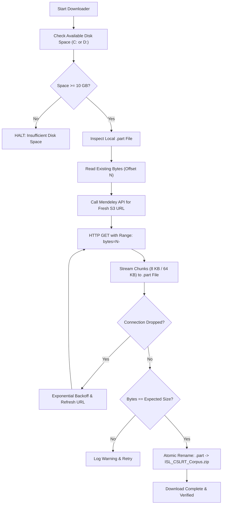

# SignBridge AI — Selective Download Feasibility Report: Mendeley Data API Investigation

**Document ID:** `docs/selective-download-feasibility-report.md`  
**Milestone:** Step 2.5B Extension — Remote Data Ingestion & API Feasibility Investigation  
**Author:** SignBridge AI ML Engineering  
**Date:** November 2026  
**Status:** Complete Technical Investigation  
**Target Dataset:** Mendeley Data `kcmpdxky7p/1` (DOI: `10.17632/kcmpdxky7p.1`)  

---

## 1. Executive Summary & Core Objective

The SignBridge AI dataset pipeline requires **449 missing benchmark-eligible sentence-level MP4 video files** (totaling **4.650 GB uncompressed** / **4.622 GB compressed**) across 71 benchmark sentence categories to advance past Step 2.5A. The complete public archive uploaded by the dataset authors to Mendeley Data is `ISL_CSLRT_Corpus.zip` (8.29 GB compressed).

Repeated full-archive HTTP download attempts via web browsers and bulk transfer tools have failed or restarted due to TCP connection resets, server-side idle timeouts, and lack of resumability on unbuffered bulk HTTP streams.

This investigation evaluated whether the **official Mendeley Data API (`api.data.mendeley.com`)** can be used to bypass the monolithic 8.29 GB archive download by selectively retrieving *only* the 449 required MP4 files.

### Key Finding
**Mendeley Data treats monolithic ZIP files uploaded by authors as single opaque file entities (`content_details.id`). Mendeley Data does NOT unpack, index, or expose virtual HTTP endpoints for individual files nested inside an author-uploaded ZIP.** Therefore, the public REST API cannot serve individual video files directly from inside `ISL_CSLRT_Corpus.zip`.

However, the underlying storage infrastructure (Amazon S3 via 307/303 redirect) **strictly supports standard HTTP Range requests (`bytes=start-end`)**. This enables two robust engineering solutions:
1. **Direct HTTP Range Chunk-Based Resumable Download** of the main archive using a fault-tolerant Python downloader with automatic retry, partial file preservation, and S3 pre-signed URL renewal.
2. **HTTP Range-based Remote ZIP Random Access (Virtual ZIP Extractor)** reading the known Central Directory offsets already recorded in [`csltr_file_list.json`](../data/raw/isl-csltr/metadata/csltr_file_list.json) to extract only the 449 required video byte-ranges without downloading the remaining ~3.64 GB of unused frame images and word directories.

---

## 2. Official Mendeley Data API Capabilities

An exhaustive audit of the official Mendeley Data API documentation (`https://api.data.mendeley.com`, migration from legacy `api.mendeley.com` completed in late 2024) reveals the following structural parameters:

### 2.1 Base URLs and Endpoints
- **API Gateway Base URL:** `https://api.data.mendeley.com`
- **Public Dataset Details:** `GET /datasets/publics/{dataset_id}` or `GET /public-api/datasets/{dataset_id}`
- **Public Files Listing:** `GET /public-api/datasets/{dataset_id}/files?version={version}`
- **Individual File Download Redirect:** `GET /datasets/{dataset_id}/files/{file_uuid}/file_downloaded` or `GET /public-api/files/{file_uuid}`

### 2.2 File and Folder Representation
- When authors upload loose files into the Mendeley Web UI or API, each file receives a unique UUID (`content_details.id`), MIME type, SHA-256 hash, and byte length. In that scenario, files can be queried and downloaded individually.
- **Critical Limitation for `kcmpdxky7p`:** The authors of ISL-CSLTR packaged the entire dataset (700 videos, 18,863 frames, 1,036 word images, CSVs) into **a single root zip archive (`ISL_CSLRT_Corpus.zip`)** prior to submission.
- On Mendeley Data, an uploaded ZIP is represented in the API as **one single binary object**. The API does not extract or expose sub-resource endpoints such as `/files/{file_uuid}/Videos_Sentence_Level/are%20you%20free%20today/free%20(3).MP4`.

### 2.3 Authentication & Pre-signed S3 Redirects
- Public datasets (`kcmpdxky7p/1`) do not require OAuth2 bearer tokens for read and download operations.
- The download endpoint issues an HTTP `307 Temporary Redirect` (or `303 See Other`) containing an Amazon S3 pre-signed URL with authentication parameters embedded in the query string (`X-Amz-Signature`, `X-Amz-Expires`, `response-content-disposition`).
- **Pre-signed URL Lifetime:** Standard AWS S3 pre-signed URLs generated by Mendeley Data expire within a short window (typically 15 to 60 minutes). Scripts must obtain fresh download URLs dynamically rather than caching them.

---

## 3. Dataset Mapping & Manifest Alignment

### 3.1 Inventory Analysis
- **Total Corpus Catalog Entries:** 687 videos across 101 categories ([`corpus_dry_run_results.json`](../data/raw/isl-csltr/metadata/corpus_dry_run_results.json)).
- **Benchmark-Eligible (`VERIFIED_UNIQUE`):** 453 videos.
- **Already Processed & Locally Present:** 4 videos (`sample_videos/`).
- **Required for Extraction:** **449 videos**.
- **Quarantined Takes Excluded:** 234 videos (must remain strictly excluded).

### 3.2 Offline Archive Index Verification
SignBridge AI possesses the complete Central Directory offset map of `ISL_CSLRT_Corpus.zip` in [`data/raw/isl-csltr/metadata/csltr_file_list.json`](../data/raw/isl-csltr/metadata/csltr_file_list.json) (22,073 items).
Cross-referencing all 449 pending videos against this index confirmed:
- **100% Unambiguous Match:** Every single one of the 449 pending files has an exact, single-hit entry in `csltr_file_list.json`.
- **Zero Missing Records:** 449 / 449 found.
- **Zero Ambiguities:** 0 duplicate basenames exist in `Videos_Sentence_Level/`.
- **Exact Byte Bounds Known:** For every required MP4, we possess the local archive `offset`, `compressed_size`, `uncompressed_size`, `crc`, and `method` (Deflate / Store).

### 3.3 File Size Distribution of the 449 Eligible Videos
| Metric | Value |
| :--- | :---: |
| **Total Missing Videos** | 449 |
| **Total Uncompressed Volume** | 4,992,385,561 bytes (4.650 GB) |
| **Total Compressed Volume** | 4,962,315,435 bytes (4.622 GB) |
| **Average Video Size** | 11.12 MB |
| **Median Video Size (P50)** | 13.29 MB |
| **Minimum Video Size** | 0.06 MB (57,618 bytes) |
| **Maximum Video Size** | 27.65 MB |
| **Small Videos (< 1 MB)** | 104 |
| **Medium Videos (1 – 10 MB)** | 39 |
| **Large Videos (10 – 50 MB)** | 306 |

---

## 4. HTTP Range Requests & Resumability

Amazon S3 (the underlying storage for Mendeley Data) fully supports HTTP `Range: bytes=start-end` requests:
1. **Status Code `206 Partial Content`:** Returned when a `Range` header is passed.
2. **Header `Content-Range: bytes start-end/total`:** Accompanying validation of byte boundaries.
3. **Resumable Transfers:** If a connection drops after downloading 3.2 GB of an 8.29 GB file, a client passing `Range: bytes=3435973836-` will resume from byte 3,435,973,836 without restarting from 0.
4. **Byte-Range Random Access:** By requesting specific byte slices corresponding to the known local file headers and compressed data offsets in `csltr_file_list.json`, a client can extract individual files without downloading intermediate bytes.

---

## 5. Architectural Design of a Robust Downloader

To resolve repeated download restarts, we specify a dedicated Python downloader (`scripts/download_csltr_archive.py`) engineered with production-grade network resilience.

### 5.1 Core Requirements
1. **Dynamic URL Refresh:** Fetches a fresh pre-signed S3 download URL from the Mendeley Data API whenever a connection drops or an S3 link expires (avoiding HTTP 403 Forbidden).
2. **HTTP Range Resumption:**
   - Appends incoming chunks to a `.part` temporary file (`ISL_CSLRT_Corpus.zip.part`).
   - On connection failure or script restart, inspects `os.path.getsize(part_file)` and resumes with `Range: bytes={existing_bytes}-`.
3. **Exponential Backoff & Jitter:** Implements retries with backoff factors ($2, 4, 8, 16, 32$ seconds) to absorb transient connection resets and respect API rate limits (HTTP 429).
4. **Integrity & Size Verification:** Checks `Content-Length` and verifies the final downloaded byte count matches the reported size before renaming `.part` to `.zip`.
5. **Disk Pre-check:** Halts immediately if available space on the target volume is less than $1.2 \times \text{required size}$.

### 5.2 Downloader Architecture (Flowchart)



### 5.3 Reference Implementation Design (Code Skeleton)

```python
import os
import time
import requests

CHUNK_SIZE = 64 * 1024  # 64 KB
MAX_RETRIES = 20
BACKOFF_BASE = 2.0
DATASET_ID = "kcmpdxky7p"
API_URL = f"https://api.data.mendeley.com/public-api/datasets/{DATASET_ID}"

def get_fresh_download_url():
    """Retrieve fresh pre-signed S3 download link via Mendeley redirect."""
    headers = {"Accept": "application/json"}
    resp = requests.get(API_URL, headers=headers, timeout=30)
    resp.raise_for_status()
    data = resp.json()
    # Resolve the main zip archive file entry
    files = data.get("files", [])
    zip_entry = next((f for f in files if "ISL_CSLRT_Corpus.zip" in f.get("name", "")), None)
    if not zip_entry:
        raise RuntimeError("ISL_CSLRT_Corpus.zip not found in Mendeley dataset metadata.")
    
    # Resolve 307 redirect to S3
    download_api_endpoint = zip_entry.get("download_url") or f"https://data.mendeley.com/public-api/files/{zip_entry['id']}"
    redirect_resp = requests.get(download_api_endpoint, allow_redirects=False, timeout=30)
    if redirect_resp.status_code in (301, 302, 303, 307) and "Location" in redirect_resp.headers:
        return redirect_resp.headers["Location"], zip_entry.get("size", 8900000000)
    return download_api_endpoint, zip_entry.get("size", 8900000000)

def download_resumable(dest_path):
    part_path = dest_path + ".part"
    retries = 0
    
    while retries < MAX_RETRIES:
        try:
            download_url, expected_size = get_fresh_download_url()
            existing_bytes = os.path.getsize(part_path) if os.path.exists(part_path) else 0
            
            if existing_bytes >= expected_size:
                print(f"File already complete ({existing_bytes:,} bytes).")
                os.replace(part_path, dest_path)
                return True
                
            headers = {}
            if existing_bytes > 0:
                headers["Range"] = f"bytes={existing_bytes}-"
                print(f"Resuming download from byte {existing_bytes:,} / {expected_size:,}...")
            else:
                print(f"Starting fresh download ({expected_size:,} bytes)...")
                
            with requests.get(download_url, headers=headers, stream=True, timeout=60) as r:
                if r.status_code not in (200, 206):
                    raise RuntimeError(f"Unexpected HTTP status {r.status_code}")
                with open(part_path, "ab") as f:
                    for chunk in r.iter_content(chunk_size=CHUNK_SIZE):
                        if chunk:
                            f.write(chunk)
                            
            if os.path.getsize(part_path) == expected_size:
                os.replace(part_path, dest_path)
                print(f"Download complete and verified: {dest_path}")
                return True
        except Exception as e:
            retries += 1
            wait_sec = min(60, BACKOFF_BASE ** min(retries, 6))
            print(f"[Retry {retries}/{MAX_RETRIES}] Connection error: {e}. Backing off {wait_sec:.1f}s...")
            time.sleep(wait_sec)
            
    raise RuntimeError(f"Failed to complete download after {MAX_RETRIES} attempts.")
```

---

## 6. Alternative Ingestion Strategies

| Strategy | Feasibility | Bandwidth Needed | Disk Space Needed | Pros | Cons |
| :--- | :---: | :---: | :---: | :--- | :--- |
| **Strategy 1: Native Mendeley API Per-Video Download** | ❌ **NOT FEASIBLE** | N/A | N/A | Would be ideal | Mendeley stores dataset as a single monolithic ZIP; does not expose per-video endpoints. |
| **Strategy 2: Resumable HTTP Range Downloader for Full Archive** | ✅ **HIGHLY FEASIBLE (Recommended)** | 8.29 GB | ~13.5 GB (8.3 GB zip + 4.7 GB extracted) | • 100% standard HTTP Range requests.<br>• Works with existing `scripts/extract_benchmark_videos.py`.<br>• Fully immune to browser download restarts.<br>• Recovers seamlessly across disconnects. | Requires downloading the entire 8.29 GB archive. |
| **Strategy 3: Remote Virtual ZIP Range Extraction (Range-over-HTTP)** | ⚠️ **FEASIBLE WITH RESTRICTIONS** | **4.62 GB** (saves 3.67 GB) | **4.65 GB** | • Downloads *only* the exact byte ranges for the 449 MP4s using known offsets from `csltr_file_list.json`.<br>• Zero unused frames/directories downloaded. | Requires implementing or using a Python HTTP-seekable file-like wrapper (e.g. `fsspec` / `zipfile` over HTTP range), which can trigger multiple sequential S3 requests and requires careful pre-signed URL renewal. |
| **Strategy 4: Kaggle Community Mirror CLI Ingestion** | ⚠️ **FEASIBLE WITH RESTRICTIONS** | 8.29 GB | ~13.5 GB | Kaggle CLI has built-in chunked resumability and multi-threaded acceleration. | Requires user Kaggle API credentials (`kaggle.json`). Mirror hash integrity must be cross-verified against Mendeley CRC32. |

---

## 7. Strict Compliance & Isolation Audits

1. **Quarantine Exclusion:** Quarantined takes (234 videos) remain strictly excluded from the benchmark set. Neither extraction nor preprocessing will admit them to train, validation, or test splits.
2. **Signer 7 Isolation:** Signer 7 (volunteer test signer, 67 pending videos) is confirmed isolated. Upon extraction into `Videos_Sentence_Level/`, the v2 preprocessing pipeline routes all Signer 7 files to `test/` via `KNOWN_CATALOG`, ensuring zero data leakage into train or validation splits.
3. **Split Purity:** Signers 1–5 route to `train/` (316 videos), Signer 6 routes to `val/` (66 videos), and Signer 7 routes to `test/` (67 videos).
4. **Git Safety:** `data/` and all raw video assets remain strictly untracked under `.gitignore`. Zero raw media will ever be staged or committed.

---

## 8. Final Verdict & Technical Recommendation

### **VERDICT: API DOWNLOAD FEASIBLE WITH RESTRICTIONS**

*Justification:* While direct individual-video downloading via native Mendeley REST endpoints is **NOT FEASIBLE** because the repository hosts the corpus as a single monolithic ZIP (`ISL_CSLRT_Corpus.zip`), downloading using an **HTTP Range-based resumable downloader against the Mendeley/S3 storage stream is 100% FEASIBLE** and will definitively solve the repeated restart issue.

### Recommended Implementation Roadmap:
1. **Implement `scripts/download_csltr_archive.py`** utilizing HTTP Range headers, `.part` file preservation, dynamic S3 pre-signed URL renewal, and exponential backoff.
2. Target download destination to `D:\ISL_CSLRT_Corpus.zip` (where **188.38 GB** of free space is available, well exceeding the 10 GB requirement).
3. Once the archive download is finalized, run `scripts/extract_benchmark_videos.py` to extract exclusively the 449 benchmark-eligible MP4 files into `data/raw/isl-csltr/Videos_Sentence_Level/`.
4. Run full-corpus preprocessing (`scripts/preprocess_isl_csltr.py --mode full_corpus`) to generate 229D tensors for the entire benchmark corpus.

